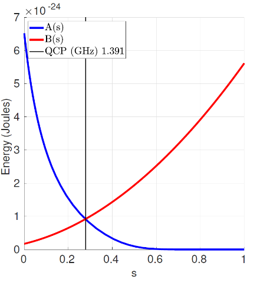
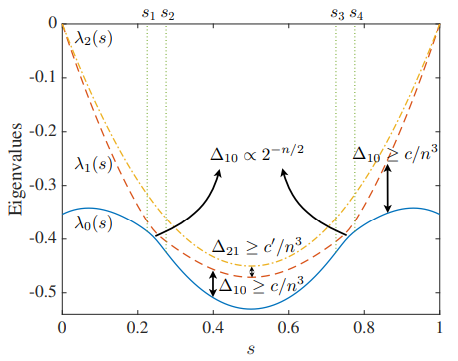
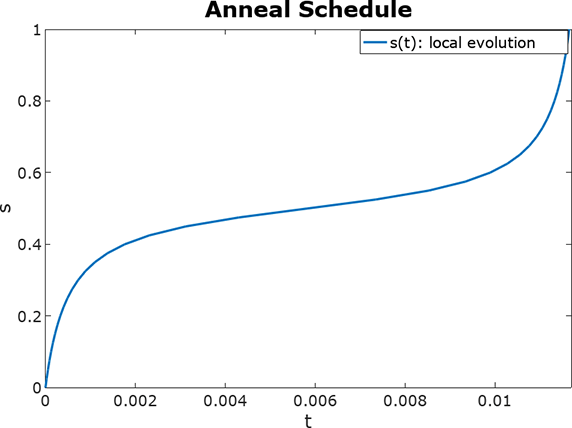
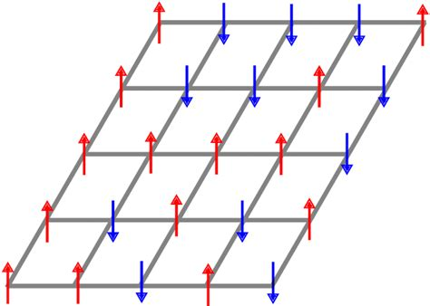

# Teorema Adiabático {.unnumbered}

La Computación Cuántica Adiabática (AQC) es un modelo de computación que usa procesos cuánticos operando bajo condiciones adiabáticas. Es un enfoque para codificar problemas de optimización como Hamiltonianos y preparar estados de baja energía; la computación cuántica basada en puertas sigue siendo el modelo dominante de propósito general, mientras que el quantum annealing práctico es un entorno más restringido [@Albash_2018].

Este tipo de computación cuántica se basa en la evolución temporal continua de un estado cuántico $|\psi(t)\rangle$ desde un valor inicial bien definido para Compute un valor observado final. La evolución está modelada por la ecuación de Schrödinger dependiente del tiempo:

$$
i\hbar \frac{\partial|\psi(t)\rangle}{\partial t}= H(t)|\psi(t)\rangle
$$

operando en la presencia de cambios adiabáticos al Hamiltoniano gobernante $H(t)$ en el rango $t\in\left[0,T\right]$, donde $\hbar$ es la constante de Planck. La computación adiabática universal polinomial es equivalente polynomially al modelo de circuitos y por lo tanto puede resolver problemas en BQP con overhead polinomial [@aharonov2008adiabatic]. Esta equivalencia no debe confundirse con las capacidades o garantías de cada quantum annealer práctico. AQC fue propuesto originalmente como un método para satisfacer problemas de satisfiabilidad [@farhi2000numerical] y ha recibido atención porque los problemas de optimización combinatoria pueden representarse naturalmente como Hamiltonianos [@lucas2014ising].

El Hamiltoniano dependiente del tiempo para este tipo de computación se da por la siguiente fórmula:

$$
H(t) = A(t)H_{A} + B(t)H_B
$$

donde $t\in[0, T]$ para el tiempo total de evolución $T$. Los horarios temporales ($A(t)$ y $B(t)$) controlan el nivel de interpolación entre el Hamiltoniano inicial y final ($H_A$ y $H_B$). Estos Hamiltonianos tienen algunas características especiales:

* $H_A$ es conocido, por conocido también significa que conocemos su estado fundamental y que seremos capaces de hacer que $|\psi(t_0)\rangle$ coincida con ese estado.
* $H_B$ es nuestro Hamiltoniano objetivo. Un mapeo que representa nuestro problema de optimización combinatoria. Nos gustaría obtener su estado fundamental.

Al hacer que las funciones de horario cumplan las condiciones $A(t_0) = 1$, $B(t_0)  =0$, $A(T) = 0$ y $B(T) = 1$ somos capaces de producir una mezcla interpolada de ambos Hamiltonianos de modo que si la evolución es lo suficientemente lenta y la brecha entre el estado fundamental y los demás estados excitados permanece, el estado producido al final de la evolución debería coincidir con el estado fundamental de nuestro Hamiltoniano final ($H(T) = H_B$).

<figure markdown>

</figure>

Un problema crítico al realizar este tipo de computación y seleccionar la función de horario correcta es el mínimo gap espectral, la diferencia de energía entre el estado fundamental y el primer estado excitado relevante. Un gap no nulo por sí mismo no es suficiente: el tiempo de ejecución también debe ser grande relativo a la tasa de cambio del Hamiltoniano y la escala inversa del gap. En particular, deberíamos preocuparnos por el gap expresado como:

$$
g_{min} = \min_{0\le t \le T} \min_{j\ne0} |E_j(t) - E_0(t)|
$$

Visualmente, puedes ver los problemas.

<figure markdown>

</figure>

Podría resultar riesgoso si en esos puntos la evolución se mueve _demasiado rápido_. Por tanto, deberíamos seleccionar una función de horario que, además de satisfacer las condiciones iniciales, también tenga en cuenta el gap cambiante para minimizar las transiciones a estados de mayor energía. Las transiciones no adiabáticas pueden dejar al sistema fuera del estado fundamental; no implican específicamente que el resultado sea un óptimo local.

<figure markdown>

</figure>

Incluso con un gap positivo, la confianza en el estado fundamental final depende del tiempo de ejecución, el horario, los elementos de matriz, la inicialización y los errores de implementación.

Una forma común del Hamiltoniano inicial es $H_A = -\sum_i^n \sigma_{x_i}$ con $\sigma_x$ siendo el operador de Pauli (previamente mencionado operador $X$) aplicado a cada qubit $i$. Este Hamiltoniano se elige dado que sabemos su estado fundamental $|+\rangle^n$ y cómo prepararlo en nuestros sistemas (recuerde la puerta Hadamard). Una forma común del Hamiltonian objetivo que podemos encontrar en la literatura se define como el modelo **Ising**. Usa variables $s_i = \pm 1$ para caracterizar el momento magnético dipole para caracterizar el ferromagnetismo. Su forma matemática es de la siguiente manera:

$$
H = -\sum_{\langle i j \rangle} J s_i s_j - \sum_j h s_j
$$

donde $h$ caracteriza la energía de spin así como su _preferencia de posición_ (spin arriba o abajo) y $J$ es la constante de acoplamiento entre spins vecinos. Es una forma general que podría usarse para caracterizar la contribución de variables individuales y colectivas involucradas en un dado proceso. La selección apropiada de $s_i \in S$ debería renderizar la opción que minimiza/maximiza la energía de nuestro Hamiltoniano.

<figure markdown>

</figure>

Es el caso general y muchos proveedores probablemente ya tengan alguna decisión tomada para nosotros (funciones de horario y Hamiltoniano inicial, por ejemplo), pero hay otros casos donde el estado inicial y el Hamiltoniano pueden ser sabiamente seleccionados de modo que el punto de partida ya esté cerca del estado objetivo que nos gustaría obtener. Este ejemplo es bastante común en casos como la química donde los estados Hartree-Fock podrían ser una mejor inicialización o alguna versión relajada del problema objetivo también podría resolverse (clásicamente) y su solución usarse para aproximar el óptimo global (warm-starting).