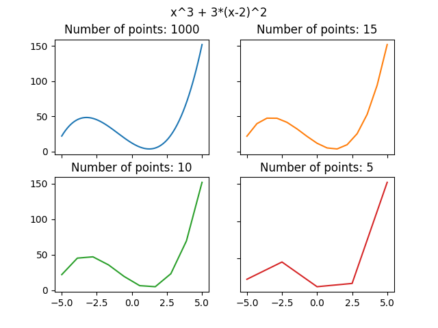
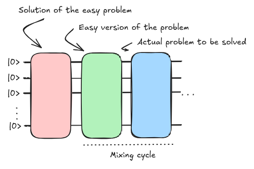
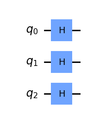
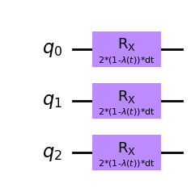
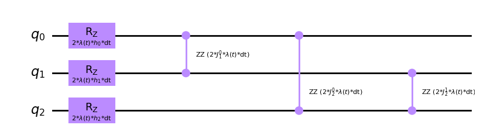
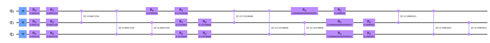

# Introducción a la digitalización {.unnumbered}

Los ordenadores cuánticos digitales funcionan, en efecto, de otra manera. Desde el punto de vista del programa, los Hamiltonianos pierden protagonismo. Lo único que necesitamos es el conjunto de instrucciones que deben ejecutar. Claro que esas instrucciones no salen de la nada, así que seguimos aplicando los principios anteriores, pero con la flexibilidad de poder ajustar cómo evoluciona el estado cuántico inicial. No estamos atados a un algoritmo o a una configuración de dispositivo concretos, ya que no hay más configuración por defecto que el estado inicial del sistema ($|0\rangle^n$). Depende de nuestro diseño cómo funcionará y cuánto partido le sacaremos a la máquina.

Por ejemplo, podemos seguir aprovechando el paradigma AQC e implementar un Hamiltoniano dependiente del tiempo que resuelva nuestro problema como antes. Un aspecto clave, eso sí, es que los ordenadores cuánticos digitales funcionan por ciclos, y las acciones tendrán que discretizarse (acotarse en el tiempo) para implementar la evolución de estado que buscamos. A cambio, tenemos más margen para modificar algunos de los parámetros que máquinas como las de D-Wave nos dan fijados. Así tendremos más opciones que explorar.

## Descomposición de Trotter-Suzuki

Aproximar un Hamiltoniano dependiente del tiempo puede ser complicado, ya que trabajar con valores continuos en una máquina que funciona por ciclos (una máquina digital) nos obliga a discretizar la evolución temporal en tramos lineales.

<figure markdown>

</figure>

Si consideramos la evolución unitaria del Hamiltoniano $U(T,t_0)$, podemos seguir el mismo enfoque y aproximar su resultado extendiendo su definición a intervalos discretos.

$$
U(T,t_0) = U(t_n, t_{n-1})U(t_{n-1}, t_{n-2}) \dots U(t_1, t_0)
$$

Cuanto menor sea el paso, mejor aproximaremos el caso continuo ideal. Ten en cuenta también que los $\delta t_i = t_{i+1} - t_i$ no tienen por qué estar equiespaciados para todos los $i$, aunque hacerlo ayuda a generalizar.

En mecánica cuántica existe un ejemplo concreto de este efecto llamado expansión de Suzuki-Trotter o trotterización [@trotter1959product; @suzuki1976generalized]. Si el Hamiltoniano tiene la forma $e^{A+B}$, su límite puede definirse como

$$
e^{A+B} = \lim_{n\rightarrow\inf} \left( e^{\frac{A}{n}}e^{\frac{B}{n}}\right)^n
$$

Es decir, podemos alternar el efecto de un Hamiltoniano descompuesto ($H = H_A + H_B$) repartido en un número discreto de pasos, de modo que cuanto menor sea el paso, mejor aproximaremos el caso ideal de una evolución temporal continua.

## Un ejemplo práctico

Vayamos paso a paso. Nuestro algoritmo de annealing digitalizado estará compuesto por tres bloques principales, como ya explicamos antes.

<figure markdown>

</figure>

El ciclo de mezcla es donde se combinan el Hamiltoniano inicial y el Hamiltoniano del problema según la función de programación.

[Material de apoyo](https://arxiv.org/abs/1906.08948)

Un aspecto clave es poder inicializar el sistema en el estado fundamental del Hamiltoniano inicial ($|+\rangle$ en nuestro ejemplo anterior). Esto se consigue fácilmente aplicando una puerta Hadamard a cada qubit.

```py
from qiskit import QuantumCircuit

init_state = QuantumCircuit(3)
for qi in init_state.qubits:
    init_state.h(qi)

init_state.draw('mpl')
```

<figure markdown>

</figure>

A continuación, necesitamos combinar nuestros dos Hamiltonianos. Seguiremos con los ejemplos vistos anteriormente. Primero, el Hamiltoniano inicial:

$$
H_A = -\sum_i^n \sigma_{x_i}
$$

En este caso, su efecto está condicionado por la función de programación. Reescribamos el Hamiltoniano dependiente del tiempo anterior de forma que una única función de programación defina la mezcla.

$$
H(t) = (1-\lambda (t))\left( -\sum_i^n \sigma_{x_i} \right) + \lambda (t) H_p
$$

Así podemos introducir un circuito cuántico parametrizado en el que un parámetro $\theta$ que decae progresivamente reproduzca el efecto de $1-\lambda (t)$.

```py
from qiskit import QuantumCircuit
from qiskit.circuit import Parameter

ltA = Parameter("$(1-\\lambda (t))$")
dt = Parameter("dt")

Ha = QuantumCircuit(3)

for qi in Ha.qubits:
    Ha.rx(2*dt*ltA, qi)

Ha.draw('mpl')
```

<figure markdown>

</figure>

Y para el Hamiltoniano objetivo, si elegimos el Hamiltoniano de tipo Ising anterior, solo tendremos que introducir los parámetros que afectan a nuestra instancia concreta del problema.

```py
from qiskit import QuantumCircuit
from qiskit.circuit import Parameter

ltB = Parameter("$\\lambda (t)$")
dt = Parameter("dt")

h = []
for i in range(3):
    h.append(Parameter(f"$h_{i}$"))

J = {}
for i in range(3):
    for j in range(i+1, 3):
        J[(i,j)] = Parameter(f"$J_{j}^{i}$")

Hp = QuantumCircuit(3)

for i in range(3):
    Hp.rz(2*dt*ltB*h[i], i)

for i in range(3):
    for j in range(i+1, 3):
        Hp.rzz(2*dt*ltB*J[(i, j)], i, j)

Hp.draw('mpl')
```
<figure markdown>

</figure>

Con estas tres piezas podemos construir nuestra versión digitalizada de una computación adiabática. Basta con elegir la resolución de la función $\lambda (t)$ (lo que suele llamarse número de pasos de Trotter) para construir el circuito completo de principio a fin.

```py
from qiskit import QuantumCircuit

qc = QuantumCircuit(3)

# Init state
qc = qc.compose(init_state)

# Trotter steps
for dtval in [0.333, 0.6666, 0.999]:
    qc = qc.compose(Ha.bind_parameters({dt: 0.333, ltA: (1-dtval)}))

    params = {dt: 0.333, ltB: dtval}
    for i in range(3):
        params[h[i]] = 0.3
        for j in range(i+1, 3):
            params[J[(i,j)]] = 0.3
    qc = qc.compose(Hp.bind_parameters(params))

qc.draw('mpl', fold = 150)
```

<figure markdown>

</figure>

Ya tenemos nuestra versión digitalizada del paradigma de _computación cuántica adiabática_. Ahora podemos ajustarla como queramos, buscando conjuntos de parámetros óptimos. Podemos cambiar la función de programación o cualquier otra opción para implementarla en un ordenador cuántico basado en puertas y comprobar si mejora los resultados de nuestros colegas de D-Wave. El objetivo sigue siendo obtener el estado fundamental, o de mínima energía, del Hamiltoniano del problema una vez completado todo el protocolo.

<!-- https://arxiv.org/pdf/2109.10145 -->