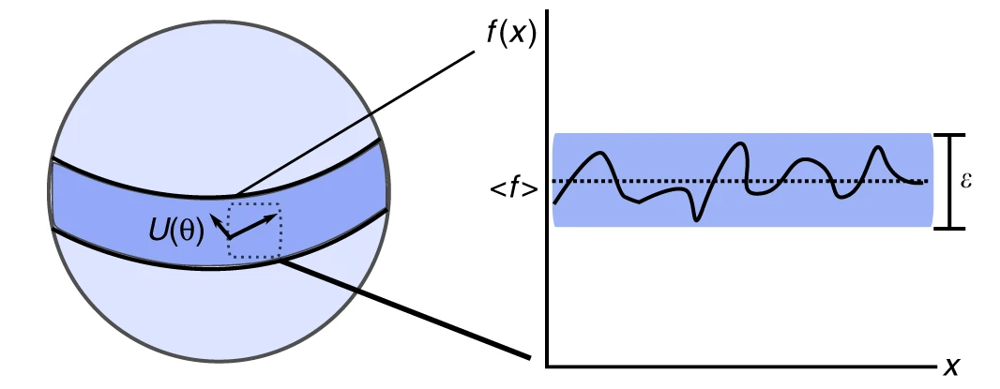
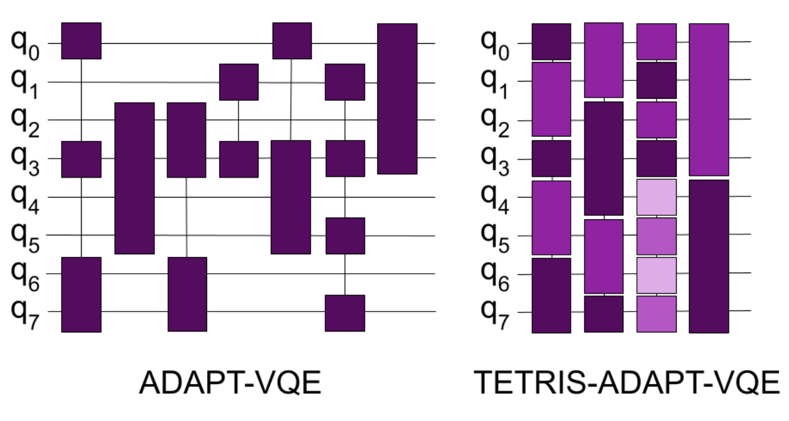
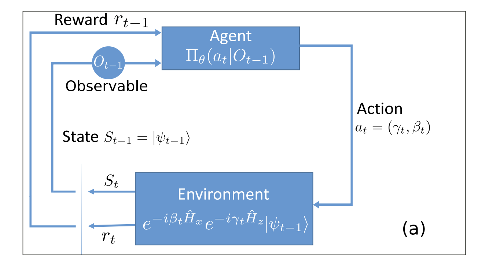
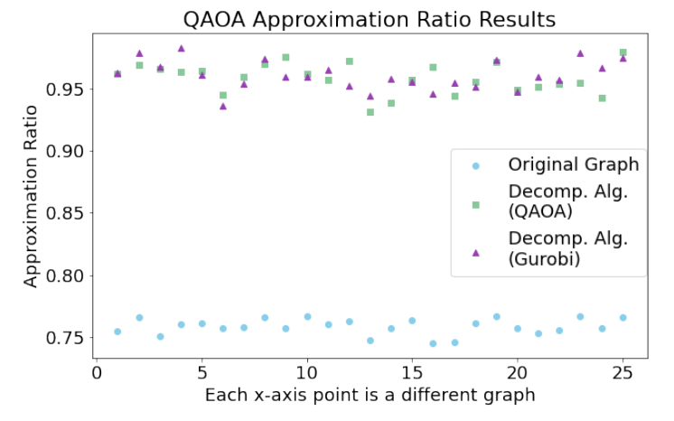

# Observaciones finales {.unnumbered}

A pesar de que ambas técnicas ([VQE](vqe.md) y [QAOA](qaoa.md)) son bastante recientes, la mayoría de la comunidad las adoptó debido a las limitaciones que tenía el hardware existente. Estas técnicas, gracias al enfoque variational, permitieron implementar circuitos más superficiales y mejorar sobre algoritmos de longitud completa al costo de ejecutar varias iteraciones hasta que el rutine de optimización termina.

La adopción de estas técnicas también trajo nuevos problemas. Al igual que las Redes Neuronales, los desafíos al escalar el entrenamiento de esas técnicas en tamaños mayores surgieron en forma de _barren plateaus_ [@mcclean2018barren], regiones en el space de soluciones donde los enfoques basados en gradientes no pueden proporcionar una dirección en la que el problema pueda optimizarse. Esto también resulta en una alta localidad en ciertas instancias que pueden hacer que nuestro entrenamiento variational caiga en mínimos locales sin la capacidad de salir de esos.

<figure markdown>
{width=60%}
</figure>

Por eso, si es posible, se recomiendan técnicas de optimización global para que esté presente cierta actividad exploratoria global mientras se hace optimización local sobre la superficie de soluciones.

## Alternativas VQE

El ansatz eficiente en hardware es una de aquellas técnicas conscientes del dispositivo que intenta minimizar la sobrecarga al pasar de la representación teórica a la implementación práctica [@leone2024practical]. Al considerar ya la topología del dispositivo, uno puede diseñar un ansatz que sea adecuado para el dispositivo más que para el problema mismo.

Adapt-VQE [@grimsley2019adaptive] es una modificación del algoritmo VQE haciendo uso de un pool de operadores. Evalúa su contribución para encontrar el estado de energía más baja (_ground state_) midiendo los gradientes (o contribución). El truco aquí es que el ansatz cambia en cada iteración en busca de un conjunto específico de operadores que beneficien la convergencia hacia el estado fundamental. Un ejemplo sencillo sobre cómo usarlo en Qiskit se puede encontrar [aquí](https://qiskit.org/ecosystem/nature/howtos/adapt_vqe.html)

<figure markdown>
{width=60%}
</figure>

Tetris-VQE [@anastasiou2024tetris] define un setup aún más complejo construido sobre el método anterior. Al crecer el ansatz evaluando el gradient pero también teniendo en cuenta el espacio libre disponible en los qubits restantes, Tetris-VQE generó ansätze tienden a ser mucho más compactos que los de Adapt-VQE.

## QAOA

Al igual que VQE, QAOA ha sido puesto a prueba y varias mejoras han sido propuestas para abordar ineficiencias detectadas o simplemente intentar mejorar su rendimiento.

**QAOA with warm-start** [@egger2021warm] propone resolver clásicamente la versión relajada del problema para usarlo como warm-start del problema (reemplazando nuestro estado inicial hacia el uno de la solución relajada). Una guía interesante se puede encontrar aquí [https://qiskit.org/ecosystem/optimization/tutorials/10_warm_start_qaoa.html](https://qiskit.org/ecosystem/optimization/tutorials/10_warm_start_qaoa.html).

Siguiendo un enfoque de aprendizaje por refuerzo se puede intentar encontrar la política óptima por la que los parámetros ideales pueden proponerse _a priori_ evitando cualquier enfoque basados en gradientes que puedan llevar a soluciones localizadas [@wauters2020reinforcement]. En el lado malo de este enfoque, el aprendizaje por refuerza requiere bastante tiempo de cómputo para _try-fail-learn_ los parámetros ideales a utilizarse.

<figure markdown>
{width=60%}
</figure>

## Problemas grandes

Hasta ahora, pudimos abordar problemas de tamaño pequeño-ish, podemos abordar problemas más grandes por supuesto pero hay ciertas limitaciones debido al número de qubits disponibles en los dispositivos (en el rango de 127-156 por IBM, por ejemplo).

El principal desafío surgirá de la implementación en hardware y la disponibilidad de dispositivos capaces de mapear el problema a su arquitectura de chip real. En la mayoría de los casos hemos hablado de términos de interacción entre todos los qubits en nuestro sistema, pero en realidad, dependiendo del dispositivo que usemos para resolver nuestro problema, podríamos encontrar que no todos los qubits están conectados entre sí. Este es el caso común para la mayoría de los chips superconducting. Eso nos obliga a encontrar formas alrededor de esas limitaciones al emparejar nuestro problema con hardware específico.

Pero también podríamos encontrar formas de decomponer el problema, hacerlo más pequeño de alguna manera y habilitar el uso de dispositivos más pequeños para abordar problemas grandes. Luego, ¿podrían también resolverse estos problemas por solvers clásicos? Dado el tamaño es más pequeño también podrían beneficiarse de eso. Algunos resultados interesantes ya han mostrado la competencia de estos algoritmos en comparación con solvers _state-of-the-art_ classical [@ponce2025graph].

<figure markdown>

</figure>

En general, los sistemas con los que a menudo trabajamos tienen una limitación dura en cuán grandes pueden ser nuestros problemas. Algunas opciones han aparecido pero los solvers clásicos también pueden manejar problemas de tamaño pequeño bastante bien así que quizá no haya una gran ganancia en muchos casos. De todas maneras, exploraremos qué se puede hacer.