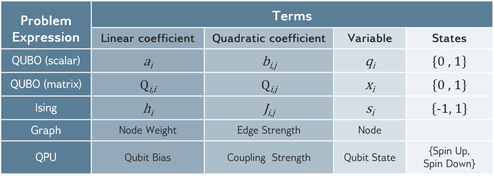
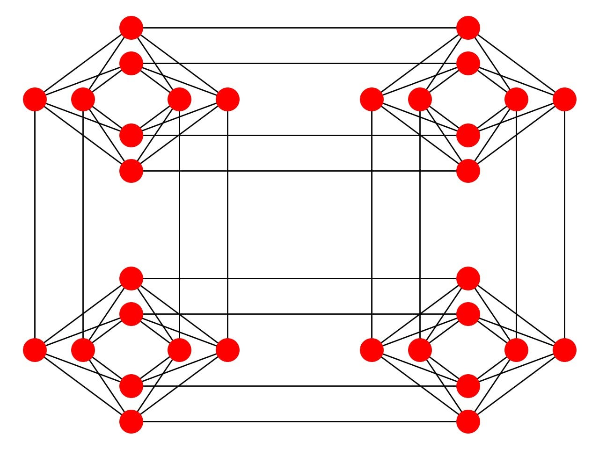
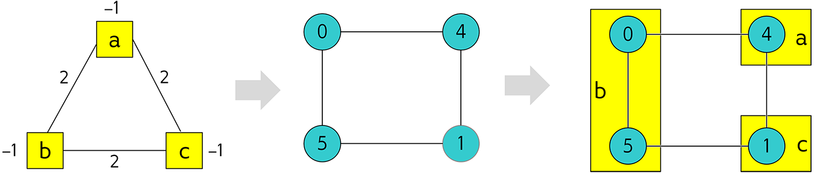
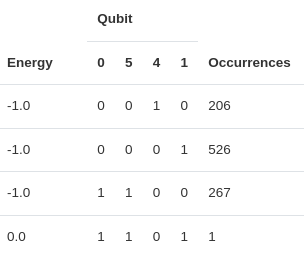

# Formulación del problema {.unnumbered}

Vamos a explorar un poco cómo D-Wave proporciona este servicio a escala. La tecnología de D-Wave se basa en qubits superconducting, por lo que deben mantener sus máquinas a una temperatura de 12mk para mantener la _quantumness_ del sistema. Sus máquinas están gobernadas por un Hamiltoniano ya fijado que se ve así:

$$
H_{dwave} = -\frac{A(s)}{2}\left( \sum_i \sigma_x^i \right) + \frac{B(s)}{2}\left( \sum_i h_i \sigma_z^i + \sum_{i>j} J_{ij} \sigma_z^i \sigma_z^j \right)
$$

donde $\sigma_{x,z}^i$ son las matrices de Pauli operando en el qubit $i$ y $h$ y $J$ son variables relacionadas con el problema. Así que como pueden ver, la mayor parte de la selección ya ha sido hecha. No entraremos en más detalles por el momento, pero para aquellos interesados en cómo se hace en más detalle, no duden en pasar por la [información adicional](https://docs.dwavesys.com/docs/latest/c_qpu_annealing.html).

Pero, ¿cómo transformamos cualquier problema clásico combinatorio en un Hamiltoniano que cabra en esta forma? Esto es en lo que vamos a centrar la próxima sección.

## QUBO y modelos Ising

Ya discutimos el modelo Ising y sus posibles limitaciones en términos de solo gestionar relaciones cuadráticas entre variables. Esto también está limitado por el hardware, así que necesitamos entender la manera en que nuestro problema formulado classicamente pueda caber en estas algo _fixed_ formulaciones.

Empecemos con un ejemplo simple de la siguiente forma:

$$
\max_x \sum_i a_i x_i \quad
s.t. \quad \sum_i b_i x_i = c
$$

donde $a_i$ y $b_i$ son variables libres y $c$ es una restricción dura. $x_i \in \{0, 1\}$ será una máscara sobre la selección de qué variables deben seleccionarse para maximizar nuestra función objetivo. Por qué **variables binarias**, bien, al final solo podemos obtener cadenas de bits al leer nuestros estados cuánticos, así que parece sensato hacer de esas las variables objetivo de nuestro problema.

Inmediatamente se presenta la gestión de restricciones ya que solo podemos evaluar el nivel de energía del sistema, por lo que cada bit de información deberá manejarse dentro de la función objetivo misma. Eso requiere introducir términos de regularización afectando la función objetivo en caso de no satisfacerse:

$$
\sum_i b_i x_i = c \quad \rightarrow \quad \left( \sum_i x_i b_i - c\right)^2,
$$

el poder necesario para valorar cualquier desviación (negativa o positiva) de nuestro valor objetivo $c$. Estos términos necesitan condicionarse a operadores de peso de modo que el problema se regularice, equilibrando entre costo y términos de regularización de la siguiente manera:

$$
\max_x \theta_1 \left( \sum_i a_i x_i \right) - \theta_2 \left( \sum_i x_i b_i - c\right)^2.
$$

Por lo tanto, **sin restricciones**.

Además, nuestros solvers solo serán capaces de minimizar la energía del Hamiltoniano, por lo que deberíamos plantearlo como un problema de minimización:

$$
\min_x \theta_2 \left( \sum_i x_i b_i - c\right)^2 - \theta_1 \left( \sum_i a_i x_i \right)
$$

Con esto deberíamos verlo fácil convertir este problema en su forma **QUBO** (Quadratic Unconstrained Binary Optimization):

$$
\min_x x^TQx + k.
$$

Aquí $Q$ representa el valor matriz entre cada par de variables (con la noción de $x_i^2 = x_i$) y la constante de offset $k$ (que se añadirá al resultado final pero no afecta la búsqueda de optimidad). 

Un hecho interesante sobre esta formulación es que contiene relaciones lineales ($Q_{ii}x_i$) y cuadráticas para términos off-diagonal ($Q_{ij}x_ix_j \text{ for } i\ne j$). Podemos relacionarlo también en su forma escalar:

$$
\min_x \sum_i a_i x_i + \sum_i \sum_{j\ne i} b_{ij} x_i x_j + k
$$

lo cual puede relacionarse directamente con el tipo de Hamiltoniano Ising visto anteriormente mediante la transformación $x_i \in \{0,1\}$ a $s_i = \pm 1$.

Una limitación clara de la formulación Ising (o el Hamiltoniano nativo del dispositivo objetivo) es la limitación para términos cuadrados ($x_ix_j$) así que no se pueden implementar relaciones de orden superior entre variables como norma general. También, se necesita caracterización binaria, ninguna variable continua puede introducirse dentro del problema como tal. Por supuesto, hay formas de abordar problemas que puedan requerir estas modificaciones, pero puede requerir un esfuerzo extra al mapear nuestro problema no-QUBO al dispositivo.

D-Wave ya imaginó una manera de facilitar estas tareas, por lo que provee bibliotecas y funcionalidades que deberían ayudar con parte del trabajo por hacer. Particularly, transforming from one shape to another y submitting problems to their devices (o intentando resolverlos localmente).

```py
from pyqubo import Spin

s1, s2, s3, s4 = Spin("s1"), Spin("s2"), Spin("s3"), Spin("s4")

# Hamiltonian
H = (4*s1 + 2*s2 + 7*s3 + s4)**2

# model creation
model = H.compile()

# QUBO request (to_ising() exists as well )
qubo, offset = model.to_qubo()
pprint(qubo)

{('s1', 's1'): -160.0,
('s1', 's2'): 64.0,
('s1', 's3'): 224.0,
('s1', 's4'): 32.0,
('s2', 's2'): -96.0,
('s2', 's3'): 112.0,
('s2', 's4'): 16.0,
('s3', 's3'): -196.0,
('s3', 's4'): 56.0,
('s4', 's4'): -52.0}

```

[Documentación de PyQUBO](https://pyqubo.readthedocs.io/en/latest/)

```py
import dimod
dimod.qubo_to_ising({('x1', 'x1'): -22, ('x2', 'x2'): -6, ('x3', 'x3'): -14,
                     ('x1', 'x2'): 20, ('x1', 'x3'): 28},
                     offset=9)

({'x1': 1.0, 'x2': 2.0, 'x3': 0.0}, {('x1', 'x2'): 5.0, ('x1', 'x3'): 7.0}, 0.0)

```

[Documentación de dimod](https://docs.ocean.dwavesys.com/en/stable/docs_dimod/)

Siendo el primero siempre da alguna ventaja, por lo que muchas de las empresas que llegaron después de D-Wave han adoptado estas bibliotecas y ofrecen cierta interoperabilidad. Puede encontrar algunos ejemplos en [Solvers híbridos](../appendix/hybridsolvers.qmd).

## Mapeo del problema

Idealmente, después de que esta conversión inicial haya sido realizada, la única pieza que falta es la presentación de nuestro job a uno de esos solvers habilitados por nuestro proveedor de quantum annealing preferido. Pero el hardware podría requerir ajustes adicionales.

Necesitaremos acostumbrarnos un poco a la transformación entre diferentes formulaciones para un problema dado.

<figure markdown>

</figure>

Pero lo más importante, como esos pueden representar cualquier $i$ $j$ indexes to be connected, el hardware podría no presentar todas las conexiones requeridas, en particular en casos all-to-all. Los iones atrapados lo facilitan, pero el resto, requieren ajustes.

**Embedding**

Mirando la conectividad del chip, si un índice representa una bola roja y cada línea se ajusta por los valores en nuestro problema $q_{ij}$, ¿cómo podemos ajustar aquellos que no tienen línea roja entre ellos?

<figure markdown>
{width=60%}
</figure>

[Arquitectura de QPU](https://docs.dwavesys.com/docs/latest/c_gs_4.html#getting-started-topologies)

Podríamos necesidad de encontrar formas de conectar qubits que no están directamente conectados y en los servicios D-Wave podemos encadenar qubits conectados de modo que podamos colocar el valor potencial de un qubit distante en ubicaciones diferentes de un chip. Esto se hace introduciendo artificialmente variables adicionales que se mapean a qubits cuyo valor debería alinearse con el qubit al que están encadenados. Una representación visual de esto sería:

<figure markdown>
{width=80%}
</figure>

De esa manera si miramos a resolver nuestro problema de tres variables en un chip de 4 qubits, podríamos ver más de tres lecturas relacionadas con qubits.

<figure markdown>

</figure>

En el ejemplo anterior, los qubits 0 y 5 están vinculados al mismo problema variable así que deberían reportar el mismo resultado de bit, pero los _chains_ de qubits pueden romperse y, por lo tanto, necesitaremos jugar con la fuerza del chain para evitar cualquier solución inválida.

Sadly for us, el embedding de problemas densamente conectados viene con el overhead de encadenar muchos qubits físicos para poder hacer todas esas conexiones all-to-all que no son nativas del dispositivo. De hecho, si revisamos el encoding que han hecho (por las personas de D-Wave) podemos ver el máximo número de qubits de los problemas codificados en hardware está en el orden de 60 a 100. Pero ¿está usando miles de qubits? Sí, así es como puede resultar malo el overhead [@cai2014practicalheuristicfindinggraph].