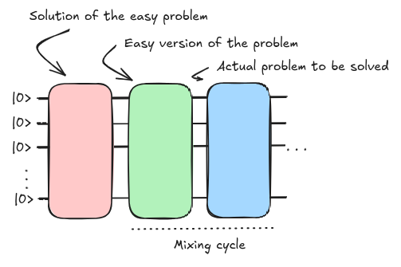
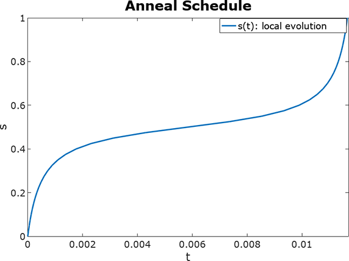
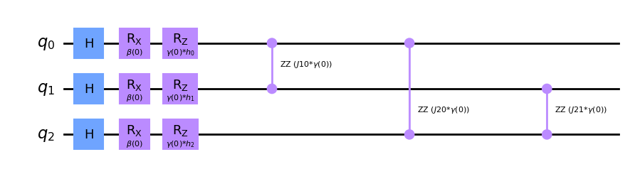

# algoritmo QAOA {.unnumbered}

Quantum Approximate Optimization Algorithm (QAOA) hereda su estructura del concepto de [Computación Cuántica Adiabática](./adiabatic.md) simplemente digitizando los pasos necesarios para impulsar el estado inicial a la solución del problema a resolver [@farhi2014quantum]. También puede verse como un caso particular de VQE donde el ansatz ya está definido por el esquema de quantum annealing. Si cuidadosamente analizamos la composición del algoritmo de annealing podemos identificar tres bloques principales que esencialmente componen el circuito QAOA.

<figure markdown>

</figure>

El Hamiltoniano inicial y final ($H_i$ y $H_f$) son los que se propagan según la trotterization, la digitación del ciclo de mezcla. El desafío consistía en definir la mejor función de programación posible para que la evolución esté libre de cualquier transición del estado fundamental.

Considerando algunos de los conceptos anteriores, podríamos liberar la función de programación y llegar a una mejor selección de parámetros que minimicen la longitud de esta evolución. Si tomamos un gran $n$ en nuestra aproximación Suzuki-Trotter podríamos movernos más allá del umbral coherente de una máquina y establecer lapsos de tiempo fijos para toda la evolución podría no ser el mejor enfoque para aproximar la evolución objetivo (que no conocemos del todo). Un punto crucial en el que los investigadores se concentran es generando la versión más superficial de esta evolución cuanto más corta sea, menos error se acumula (ver [Ruido y errores](../computers/challenges.md#ruido-y-errores)). Nos referimos a la **profundidad** del circuito como la longitud máxima que alcanza considerando cada conjunto de gates que pueden ejecutarse dentro del mismo ciclo de ejecución como la unidad de profundidad.

Si podríamos ingresar algunos placeholders y verificar cómo se comporta el circuito para un diferente set de parámetros podríamos tal vez encontrar una mejor solución que el conjunto canonical de pasos igualmente espaciados que coloca la evolución en puntos críticos de nuestra curva de programación.

<figure markdown>

</figure>

Así, al poner algunos parámetros a los bloques de mezcla obtenemos

$$
|\gamma, \beta\rangle = U(H_B,\beta_p)U(H_C, \gamma_p) \dots U(H_B,\beta_1)U(H_C, \gamma_1)|s\rangle
$$

donde $|s\rangle$ es nuestro estado inicial y $U(H_m, \theta_m) = e^{-i\theta_mH_m}$ es la transformación unitaria parametrizada para cada paso para un total de $p$ pasos.

Podríamos configurar un circuito free-form para que podamos cambiar los valores de aquellas rotaciones según un criterio diferente al usado antes.

```py
from qiskit import QuantumCircuit

init_state = QuantumCircuit(3)
for qi in init_state.qubits:
    init_state.h(qi)

# Initialization
layers = 1
qc = QuantumCircuit(3)

# Init state
qc = qc.compose(init_state)

# Trotter steps
for layer_idx in range(layers):
    # Init hamiltonian
    qc = qc.compose(Hi(layer_idx))

    # Final hamiltonian
    qc = qc.compose(Hf(layer_idx))

qc.draw('mpl', fold = 150)
```

<figure markdown>

</figure>

Esto es la base del Quantum Approximate Optimization Algorithm (QAOA). Solo necesitamos seleccionar el número de pasos (también llamados capas) para producir nuestro circuito template. Luego llega el momento de seleccionar los valores que deberían reemplazar los parámetros placeholder $\gamma$ y $\beta$.

La elección de mixer y Hamiltonianos de costo importa. Si el estado es un eigenstate del Hamiltoniano de costo, aplicar solo su unitary cambia el estado por una fase, no por su valor propio de energía: $U(\theta)|\psi_{\lambda_1}\rangle = e^{-i\theta E_{\lambda_1}}|\psi_{\lambda_1}\rangle$. QAOA alterna esta evolución de costo con un mezclador, que puede mover amplitud entre eigenstates del Hamiltoniano de costo. Su optimización variacional no garantiza evitar óptimos locales o preparar el estado fundamental exacto a profundidad finita.