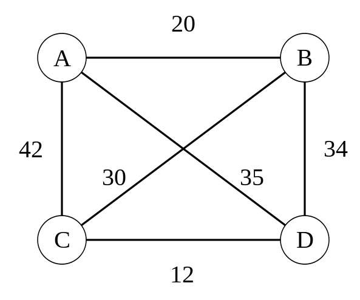

# Formulación QUBO {.unnumbered}

Como vimos en clase, una parte importante para poder usar esos dispositivos de computing cuántico es plantear nuestro problema como una representación matricial siguiendo la formulación QUBO. Luego podríamos convertirlo a tipo Ising si es necesario, pero veremos algunos de los frameworks más comunes que ya proveen un mecanismo de traducción entre los dos.

Un aspecto crítico será saber cómo transformar nuestros términos de penalización para que encajen en la función objetivo a minimizar.

## Penalties conocidos

| Constraints clásica | Equivalent Penalty |
|----------------------|--------------------|
| $x + y \le 1$ | $P(xy)$ |
| $x + y \ge 1$ | $P(1− x − y + xy)$ |
| $x + y = 1$ | $P(1− x − y + 2xy)$ |
| $x \le y$ | $P(x − xy)$ |
| $x_1 + x_2 + x_3  \le 1$ | $P(x_1 x_2 + x_1 x_3 + x_2 x_3)$ |
| $x = y$ | $P(x+y- 2xy)$ |

con $P$ siendo un escalar positivo que caracteriza el efecto de la penalización sobre la función objetivo. Es [un tema por sí mismo](https://docs.dwavequantum.com/en/latest/quantum_research/reformulating.html#constraints-conflict-graph-technique).

Vamos a ver cómo algunos problemas clásicos pueden mapearse a su forma QUBO para que estos problemas puedan resolverse por algoritmos cuánticos.

## Programación Lineal Binaria

Tomado de [@lucas2014ising], el problema de Programación Lineal Binaria intenta resolver un problema de la forma $Sx = b$ donde $x$ es el vector desconocido de variables binarias a resolver. Es un ejemplo simple ya que ya proporciona la forma que necesitamos con variables siendo binarias, no existe relación de orden superior y no hay restricciones que cuidar. Para resolver este problema necesitaremos reformular nuestra forma anterior en:

$$
\arg \min_{x} \| Sx - b \|
$$

$$
H_A = \sum_{j=1}^m \left[b_j - \sum_{i=1}^N S_{ji}x_i \right]^2
$$

buscando obtener nuestra solución para $x$ cuando $H_A = 0$ de modo que la minimización se hace sobre $H_A$ como sigue

$$
\min_x \sum_{j=1}^m \left[b_j - \sum_{i=1}^N S_{ji}x_i \right]^2
$$

Seleccionemos una instancia particular para $S$ y $b$.

```{python}
import numpy as np

S = np.array([
    [3, 4, 1, 1, 2],
    [1, 9, 2, 2, 1],
    [6, 8, 2, 2, 1]
])

b = np.array([10, 13, 17])
```

Así que ahora podemos comenzar a compormer nuestro matriz $Q$.

```{python}
import itertools

n = S.shape[1]
m = b.shape[0]

Q = np.zeros((n, n))

for j in range(m):
    # Diagonal terms
    for i in range(n):
        Q[i][i] -= 2 * b[j] * S[j][i]

    tuples = itertools.product(range(n), repeat=2)
    for tuple_ in tuples:
        x = tuple_[0]
        y = tuple_[1]
        # Dividido como estamos añadiendo el mismo valor a ij y ji
        Q[x][y] += S[j][x] * S[j][y] / 2.
        Q[y][x] += S[j][x] * S[j][y] / 2.

Q
```

Como pueden ver la matriz es simétrica por naturaleza hay una simetría natural entre $x_ix_j$ y $x_jx_i$. Podríamos force-force nuestra solución.

```{python}
min_val = 0
min_sol = []

for x in np.c_[tuple(i.ravel() for i in np.mgrid[:2, :2, :2, :2, :2])]:  # noqa
    if x @ Q @ x.T < 0:
        if (x @ Q @ x.T) < min_val:
            min_val = x @ Q @ x.T
            min_sol = x

print(min_sol, "|", min_val)
```

Nuestra solución debería ser [1 1 0 1 1], comprobémoslo.

```{python}
np.matmul(S, [1, 1, 0, 1, 1])
```

```{python}
b
```

Allí tienen, es la solución real.

## MaxCut

El corte máximo es otro ejemplo canonical a menudo usado para caracterizar el flujo entre los nodos de una red mapeando una red de distribución, eléctrica o de telecomunicación o incluso diseño de circuitos. La idea principal viene de partir los vértices de un grafo en dos conjuntos complementarios de manera que el número de aristas se maximice cortadamente.

::: {.callout-note}

_Package NetworkX will need to be added to your Python environment for this example_
:::

```{python}
import networkx as nx
from networkx.generators.random_graphs import gnm_random_graph

def gen_graph(size, seed=None):
    if seed is not None:
        return gnm_random_graph(size, size, seed=seed)
    return gnm_random_graph(size, size)
```

```{python}
G = gen_graph(5, None)
nx.draw(G)
```

Podemos modelar este problema identificando cada nodo $j$ en uno de los dos conjuntos posibles de las dos opciones ($x_j = 0$ o $x_j = 1$). Con eso podemos establecer la fórmula $x_i + x_j - 2x_ix_j$ para que identifique si la arista $(ij)$ está en el corte (si solo un $x$ está activo entonces será 1).

Eso nos deja con la fórmula general

$$
\max \sum_{(i,j)} (x_i + x_j - 2x_ix_j)
$$

que podemos convertir en un problema de minimización cambiando el signo.

```{python}
n = G.order()
nodes = list(G.nodes)

Q = np.zeros((n, n), dtype=np.dtype(np.int32))
for edge in G.edges:
    idx1 = nodes.index(edge[0])
    idx2 = nodes.index(edge[1])
    Q[idx1][idx1] += 1
    Q[idx2][idx2] += 1
    
    # Half the value as it is introduced twice
    Q[idx1][idx2] -= 1
    Q[idx2][idx1] -= 1

Q = -1.0*Q # Min
```

```{python}
Q
```

```{python}
min_val = 0
min_sol = []

for x in np.c_[tuple(i.ravel() for i in np.mgrid[:2, :2, :2, :2, :2])]:  # noqa
    if x @ Q @ x.T < 0:
        if (x @ Q @ x.T) < min_val:
            min_val = x @ Q @ x.T
            min_sol = x

print(min_sol, "|", min_val)
```

Este caso es un poco más complicado ya que más de una opción puede seleccionarse. Idealmente nos gustaría obtener todas las soluciones potenciales.

```{python}
solution = np.array(min_sol)
red_team = np.where(solution == 1) 
blue_team = np.where(solution == 0) 
```

```{python}
pos = nx.spring_layout(G) # positions for all nodes

# nodes
options = {"edgecolors": "tab:gray", "node_size": 800, "alpha": 0.9}
nx.draw_networkx_nodes(G, pos, nodelist=red_team[0], node_color="tab:red", **options)
nx.draw_networkx_nodes(G, pos, nodelist=blue_team[0], node_color="tab:blue", **options)

nx.draw_networkx_edges(G, pos, width=1.0, alpha=0.5);
```

## Problema de mochila (cuadrático)

Ajustar un conjunto de activos según el tamaño de la mochila que queramos usar puede ser un problema combinatorial difícil. No que vayamos a hacer el ejemplo completo pero es interesante mirarlo desde la perspectiva de implementación.

La Mochila Cuadrática corresponde al problema donde existe interacción entre las variables que gustaría modelar:

$$
max \sum_{i=1}^{n-1} \sum_{j=i}^n w_{ij}x_i x_j
$$

considerando que hay una restricción presupuestaria así que que

$$
\sum_{j=1}^n a_j x_j \le b.
$$

Variables $x_i$ representen la máscara de seleccionar o no $i$ elemento a ser considerado. $w_{ij}$ establece el valor de tomar en dos elementos al mismo tiempo, $a_j$ representa el peso asociado a $j$ y $b$ establece el presupuesto disponible para todo ello (el tamaño de nuestra Mochila de hecho). Como pueden verse muchos tipos diferentes de problemas pueden mapearse a este ejemplo canonical.

Un aspecto relevante de las desigualdades es que necesitaremos añadir variables holgura para convertir la restricción en la igualdad $\sum_j a_j x_j + S = b$. Aquí $S$ va de 0 a $b$, por lo que su codificación binaria debe poder representar cada valor en ese rango mientras se mantiene el problema cuadrático.

Podemos empezar añadiendo la restricción a la función objetivo seguida de un término de penalización.

$$
max \sum_{i=1}^{n-1} \sum_{j=i}^n w_{ij}x_i x_j - P\left(\sum_{j=1}^n a_j x_j + S - b\right)^2
$$

::: {.callout-note}

_Test case from [Quantum Bridge Analytics I](https://arxiv.org/pdf/1811.11538.pdf)
:::

```{python}
weight = np.array([
            [2, 4, 3, 5],
            [4, 5, 1, 3],
            [3, 1, 2, 2],
            [5, 3, 2, 4]
        ])
costs = [8, 6, 5, 3]
budget = 16
```

Para este caso, variables holgura con pesos $1, 2, 4, 8,$ y $16$ pueden representar cada posible valor de $S$ de 0 al presupuesto.

$$
8x_1 + 6x_2 + 5x_3 + 3x_4 + 1s_0 + 2s_1 = 16
$$

```{python}
costs.extend([1, 2, 4, 8, 16])
costs
```

Y penalización, bien, necesitamos decidir un figura.

```{python}
P = 10
```

```{python}
n = len(costs)

Q = np.zeros((n, n))
# First term
for i in range(len(weight)):
    for j in range(i, len(weight)):
        Q[i][j] += weight[i][j]

# Constraint section
for i in range(n):
    for j in range(n):
        Q[i][j] -= P * costs[i] * costs[j]
    Q[i][i] += P * 2 * budget * costs[i]

Q = -1.0*Q # min
```

```{python}
Q
```

```{python}
min_val = 0
min_sol = []

for x in itertools.product([0, 1], repeat=n):
    x = np.array(x)
    if x @ Q @ x.T < 0:
        if (x @ Q @ x.T) < min_val:
            min_val = x @ Q @ x.T
            min_sol = x

print(min_sol, "|", min_val)
```

Juegue con el término de penalización para comprobar su efecto en la solución final. Cambie costs para ver la evolución de la solución y variables holgura siendo usadas.

## Problema del Viajante (TSP)

Otro problema de la literatura [@lucas2014ising] es los cycles Hamiltonian o Paths. Es un problema que intenta identificar la ruta óptima para cubrir un conjunto de ciudades dado que hay un costo asociado a ir de punto $a$ a punto $b$ considerando que un cycle se obtiene y su resolución renderiza el costo mínimo para cualquier otro ciclo potencial.

<center>
    
</center>

```{python}
G = nx.DiGraph()
G.add_weighted_edges_from({
    ("A", "B", 20), ("A", "C", 42), ("A", "D", 35), ("B", "A", 20),
    ("B", "C", 30), ("B", "D", 34), ("C", "A", 42),("C", "B", 30),
    ("C", "D", 12), ("D", "A", 35), ("D", "B", 34), ("D", "C", 12)
})

nx.draw(G)
```

Vamos a intentar venir con una versión simplificada que pueda no capturar la totalidad de los cycles pero es más fácil de entender. Empecemos definiendo nuestras variables $x_{ij}$ que tomarán el valor positivo cuando la ruta esté conectada por nodo $i$ a $j$.

$$
x_{i \, j} = 
\begin{cases} 
1, & \text{$i$ is connected to $j$} \\
0, & \text{otherwise} 
\end{cases}
$$

con una distancia/costo de $c_{ij}$. La idea es visitar todos los nodos pero sin pasar por el mismo carretera en la ruta más de una vez (como el problema de los puentes de Königsberg [@mezard2009information]). Y idealmente haciéndolo a mínimo costo. Por lo tanto,

$$
\min \sum_i^n \sum_{j, j \ne i}^n c_{ij}x_{ij}
$$

Pero un conjunto de condiciones necesitan ser atendidas, en particular hay un eje temporal también necesitaremos considerar para que al comenzar en una posición cada tiempo requiere movimientos hacia adelante. Esto añadirá un $t$ para cada paso de toda la ruta a nuestras variables anteriores (el costo no se verá afectado mucho) de modo que podamos identificar el punto de inicio y final ($x_{ijt}$). Por lo tanto, el caso anterior requerirá una matriz $2^4 \times 2^4$ para caracterizar el conjunto completo de posibles aristas (las que existen y las cuales no) considerando las transiciones siendo hechas.

$$
\min \sum_p^P\sum_i^N \sum_{j, j \ne i}^N c_{ij}x_{i,p}x_{j,(p+1)}
$$

Constraints to have in mind, the salesperson should use each road only once. That means we should limit $\forall i \in \{0...n\} \sum_i^n x_{ip} = 1$ both row and column-wise, meaning salesperson is in one place at each time $p$ and can only be in one $n$ alone.

$$
H_{penalty} = \lambda\sum_{n=0}^N\left( 1 - \sum_{p=0}^P x_{n,p}\right)^2 + \lambda\sum_{p=0}^P\left( 1 - \sum_{n=0}^N x_{n,p}\right)^2 + \lambda\sum_{(i,j)\notin G}\sum_{p=0}^P x_{i,p}x_{j,p+q}
$$

In our QUBO setup, this constraint needs to be part of the objective function acting as a maximizer in our example. Usually a good estimate for a Lagrange parameter is between 75-150% of the objective function value, so we come up with an estimate for tour length and use that.

```{python}
lagrange = 100
```

Then according to previous indications, our formulation should follow the intuition that:

* If a node has exactly one active position ($k=1$) the penalty is 0 (good choice)
* Otherwise the penalty is positive and grows as $(k-1)^2$.
* We implement the penalty unit block inside $H_{penalty}$: $$\text{Penalty}_n = \lambda\left(\sum_{p=0}^{P-1} x_{n,p} - 1\right)^2$$ indicando que una sola variable ocupada debería suceder per node at a high cost ($\lambda$) for its potential positions ($p$ here as a general approach to the time indexed $it$).

If we expand the Penalty term

$$
\text{Penalty}_n = \lambda\left(\sum_p x_{n,p}^2 + 2\sum_{p<q} x_{n,p}x_{n,q} - 2\sum_p x_{n,p} + 1\right)
$$

Since $x^2 = x$ for binary variables this simplifies to:

$$
\text{Penalty}_n = -\lambda\sum_p x_{n,p} + 2\lambda\sum_{p<q} x_{n,p}x_{n,q} + 1
$$

**How does this map to QUBO form**

Considering we will solve this as a minimization problem (minimize the cost of traveling)

- Linear (diagonal) term: `Q[((node, pos), (node, pos))] -= lagrange` implements the $-\lambda \;x_{n,p}$ contribution.
- Pairwise (off-diagonal) term: `Q[((node, pos1), (node, pos2))] += lagrange` adds half of the $2\lambda$ coupling; the symmetric entry provides the other half in the QUBO matrix representation.

This gives us the final shape

$$
\min \; H_{cost} + H_{penalty}
$$

where $H_{cost}$ is the time-indexed travel cost above and $H_{penalty}$ is the sum of the node, position, and forbidden-edge penalties. For the two equality penalties, the expanded form is obtained by applying the same binary-variable identity shown above to each node and each position.

assuming non existent edges are also added at a high cost ($\lambda$).

```{python}
from collections import defaultdict

# Creating the QUBO
Q = defaultdict(float)

# number of steps
N = G.number_of_nodes()

# Objective that minimizes distance
for u in G:
    for v in G:
        if u == v:
            continue
        value = G[u][v]["weight"] if G.has_edge(u, v) else lagrange
        for pos in range(N):
            nextpos = (pos + 1) % N
            Q[((u, pos), (v, nextpos))] += value

# Constraint that each row has exactly one 1
for node in G:
    for pos_1 in range(N):
        Q[((node, pos_1), (node, pos_1))] -= lagrange
        for pos_2 in range(pos_1+1, N): # Next positions
            Q[((node, pos_1), (node, pos_2))] += 2 * lagrange

# Constraint that each col has exactly one 1
for pos in range(N):
    for node_1 in G:
        Q[((node_1, pos), (node_1, pos))] -= lagrange
        node_list = list(G)
        node_index = node_list.index(node_1)
        for node_2 in node_list[node_index + 1:]:
            Q[((node_1, pos), (node_2, pos))] += 2 * lagrange # Cost of being in more than one place
```

El diccionario anterior almacena cada par sin orden una sola vez, así que su coeficiente es el coupling completo $2\lambda$ desde el penalty expandido. Si se usa una representación de matriz simétrica en vez, ese coupling puede dividirse igualmente entre $Q_{i,j}$ y $Q_{j,i}$.

```{python}
Q
```

Estos desafíos también han sido resueltos classicamente usando procedimientos de simulated annealing.

```{python}
from networkx.algorithms import approximation as approx

cycle = approx.simulated_annealing_tsp(G, "greedy", source="D")
cost = sum(G[n][nbr]["weight"] for n, nbr in nx.utils.pairwise(cycle))
print(f"Cost for route {cycle} is {cost}")
```

And can be also solved by traversing the whole solution space (if possible).

```{python}
import dimod

sampler = dimod.ExactSolver()

response = sampler.sample_qubo(Q)

print(response.slice(0, 15))
```

Several options show up as optimal, which is the case. This is one of those examples where quantum superposition could render a state that reveals all optimal configurations.

```{python}
route = response.first.sample

cycle = [None]*5
for key in route:
    if route[key] == 1:
        cycle[key[1]] = key[0]
cycle[-1] = cycle[0]

cost = sum(G[n][nbr]["weight"] for n, nbr in nx.utils.pairwise(cycle))
print(f"Cost for route {cycle} is {cost}")
```

Using [DWave's package](https://github.com/dwavesystems/dwave-neal) we could also check SA performance.

```{python}
import neal

sampler = neal.SimulatedAnnealingSampler()
response = sampler.sample_qubo(Q)
print(response)
```

```{python}
route = response.first.sample

cycle = [None]*5
for key in route:
    if route[key] == 1:
        cycle[key[1]] = key[0]
cycle[-1] = cycle[0]

cost = sum(G[n][nbr]["weight"] for n, nbr in nx.utils.pairwise(cycle))
print(f"Cost for route {cycle} is {cost}")
```

Recoveremos esta formulación para el ejemplo de comparación sobre las diferentes formas de implementar la solución a este desafío. Hay otros enfoques basados en [programming dynamic](https://arxiv.org/pdf/2502.08853v1) pero mejor quedarnos con los básicos por ahora.