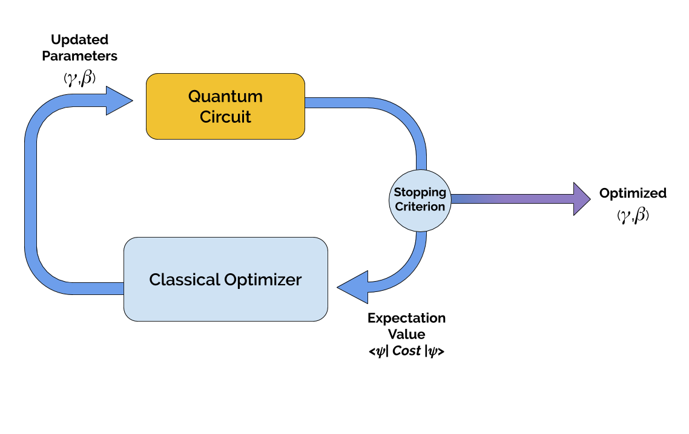

# El enfoque variacional {.unnumbered}

Quizás llamó su atención que en nuestro ejemplo anterior habían algunos parámetros basados en la función de horario y la aproximación de Suzuki-Trotter. Pero, ¿qué tal si aprovechamos el potencial de los métodos de optimización clásica para encontrar una mejor parametrización?

De hecho, podríamos potencialmente eliminar algunos de esos bloques que quizás no aporten demasiado, produciendo la aproximación de la funcionalidad que codifican de una manera más compacta. Esto también beneficia al ir al hardware. El circuito más superficial, menos ruido se acumula.

El **principio variational** establece que un problema puede resolverse usando cálculo de variaciones, que requiere encontrar funciones que optimicen los valores (parámetros) que dependen de esas mismas funciones. Esta estructura formal se usa extensivamente al entrenar modelos de machine learning como los pueden considerarse funciones paramétricas cuya meta puede minimizarse variando los pesos (parámetros) de los que se definen.

Los Algoritmos Variacionales hacen uso de tres principios básicos:

* Un **circuito cuántico paramétrico** o _ansatz_
* Un valor de expectación que fija el objetivo del proceso
* Una estrategia híbrida (cuántico-clásica) para Compute y variar los parámetros

<figure markdown>
{width=65%}
</figure>

Así que estos procedimientos requieren que el circuito se evalúe (medido de alguna manera) y los parámetros cambien idealmente aproximando un valor objetivo. Este proceso es bastante conocido para aquellos provenientes de machine learning clásico y por lo tanto se puede beneficiar de ese ecosistema. Específicamente, técnicas de optimización.

Las más fáciles son técnicas de optimización libres de gradientes. Exploran el espacio de soluciones de tal manera que no se requieren derivadas de la función real (nuestro circuito en nuestro caso).

Un enfoque diferente es extender esos optimizadores basados en gradientes dado que los circuitos cuánticos tienen una capacidad similar, podemos free up los parámetros de un circuito dado y optimizar basándonos en una función de costo que en la mayoría de los casos puede representarse por el valor de expectación sobre algún observable. Para esto, necesitaríamos entender cómo se pueden Compute estas derivadas... a escala.

## Computing gradients

Para ajustar el conjunto ideal de parámetros minimizando una función de costo, los enfoques basados en gradientes son bastante populares pues al estar al tanto de la dirección en que esta función de costo se minimiza puede acortar el tiempo requerido para que el método encuentre su meta. Los circuitos cuánticos tienen una capacidad similar, podemos free up los parámetros de un circuito dado y optimizar basándonos en una función de costo que en la mayoría de los casos puede representarse por el valor de expectación sobre un observable. Para esto, necesitaríamos entender cómo se pueden Compute estas derivadas... a escala.

```{python}
from qiskit import QuantumCircuit
from qiskit.circuit import Parameter

a = Parameter('a')

qc = QuantumCircuit(1)
qc.ry(a, 0)
qc.draw()
```

Esto es una simple rotación sobre el eje Y del sphere de Bloch. Así sabemos que si medimos el observable X de un estado producido por esta rotación obtenemos:

$$
\langle Y(a) | X | Y(a) \rangle = \sin(\pi a)
$$

```{python}
import numpy as np
from qiskit.quantum_info import Statevector
 
init = QuantumCircuit(1)
state = Statevector(init)

val = 0.3
circ = qc.assign_parameters({a : np.pi*0.3})
eval = state.evolve(circ)
print(eval)
```

```{python}
from qiskit.quantum_info import Pauli

# Target hamiltonian
op = Pauli('X')

print(f"<Ry|X|Ry> : {eval.expectation_value(oper=op)}")
print(f"Sin function: {np.sin(np.pi * val)}")
```

Then we know we could calculate its derivative as $\pi\cos(\pi a)$. This may not be an option for when we go to hardware and we make the circuit much more complicated in terms of gates (in particular multiqubit gates). Enter numerical resolution of derivatives!

Podemos producir una aproximación a nuestro target aprovechando diferencias finitas para aproximación numérica, teniendo en cuenta el límite:

$$
f^{'}(a) = \lim_{h \rightarrow 0} \frac{f(a + h) - f(a)}{h}
$$

which essentially only requiere two evaluations of our function.

```{python}
state = Statevector(init)

val = 0.3
h = 0.001

# Get the expectation value for f(x)
circ = qc.assign_parameters({a : np.pi*0.3})
eval = state.evolve(circ)
exp_val = eval.expectation_value(oper=op)

# Get the expectation value for f(x+h)
circ = qc.assign_parameters({a : np.pi*(0.3+h)})
eval = state.evolve(circ)
exp_val_eps = eval.expectation_value(oper=op)

print('Finite difference:', (exp_val_eps - exp_val) / h)
print('Cosine formula:   ', np.pi * np.cos(np.pi * val))
```

Con un número variado de observables y composiciones, esto es lo que los frameworks de diferenciación automática pueden proporcionar haciendo un seguimiento de valores y beneficiándose de la naturaleza composable de las aproximaciones numéricas. A veces sabemos la fórmula matemática exacta, pero en el caso de QC eso suele no ser el caso. Una de las formas más básicas de aproximarla se llama "finite differences". Dado una función $f(x)$ de una variable podemos verificar cuál es el valor del gradiente calculando sus valores ante pequeñas perturbaciones: $f(x+\epsilon)$ y $f(x−\epsilon)$ donde $\epsilon$ es simplemente un número muy pequeño.

$$
\Delta_{\theta}f(x;\theta) = \frac{1}{2}\left[ f\left(x;\theta+\frac{\pi}{2}\right) - f\left(x;\theta+\frac{\pi}{2}\right)\right]
$$

Frameworks como Pennylane especializan en este campo, proporcionando acceso directo a gradients cuando nuestro circuito está definido.

```{python}
import pennylane as qml

dev = qml.device("default.qubit", wires=2)

@qml.qnode(dev)
def circuit(weights):
    qml.RX(weights[0], wires=0)
    qml.RY(weights[1], wires=1)
    qml.CNOT(wires=[0, 1])
    qml.RX(weights[2], wires=1)
    return qml.expval(qml.PauliZ(1))
```

```{python}
import pennylane.numpy as np

weights = np.array([0.1, 0.2, 0.3], requires_grad=True)

qml.drawer.use_style("pennylane")
qml.draw_mpl(circuit)(weights);
```

```{python}
circuit(weights)
```

```{python}
qml.gradients.param_shift(circuit)(weights)
```

Un problema con calcular gradients así es que ahora tenemos que evaluar nuestra función de costo en el rango de 3 veces más por cada iteración y número de variables (ya que necesitaremos fijar todos menos uno para Compute el gradient en cada valor de variable). Una explicación más detallada y referencias relevantes se pueden encontrar [aquí](https://pennylane.ai/qml/glossary/parameter_shift).

En muchos casos veremos cómo los métodos basados en gradientes no están disponibles para evitar el uso extensivo de hardware cuántico.

## Valor de expectación

La luz guía al entrenar circuitos usando el principio variational es definir con precisión las **funciones objetivo** y **de costo**. ¿Qué estamos buscando? ¿Cómo podemos medir el progreso? En general, se entiende que la minimización de energía, buscando el estado cuántico que renderiza un valor de expectación mínimo, puede ser tractable y una buena medida de mejora. Así, el **valor de expectación** descrito como

$$
\langle \psi |H|\psi\rangle
$$

con $H$ siendo el Hamiltoniano target o un Hamiltoniano caracterizando el problema que nos gustaría resolver y $|\psi\rangle$ el estado cuántico que obtendríamos del circuito, tendríamos una manera de evaluar nuestro progreso. También podemos formularlo como

$$
\langle H \rangle_{\psi} = \sum_j \lambda_j |\langle \psi|\lambda_j\rangle|^2.
$$

Representa la suma de todos los eigenvalues condicionados por su probabilidad de outcome dado el estado $|\psi\rangle$. Esa caracteriza la naturaleza matemática de este valor y es evidente que el valor mínimo se alcanza cuando hay una superposición perfecta entre $|\psi\rangle$ y el eigenstate de valor mínimo ($H|\lambda_0\rangle = \lambda_0|\lambda_0\rangle$).

En principio, si puede obtener un número infinito de pasos y elegir ángulos que exactamente imiten el camino adiabático, obtendrá los resultados correctos. Por lo tanto, la principal limitación es definir un circuito y encontrar el conjunto de parámetros que realmente hagan el trabajo. Pero, ya mencionado [en la literatura](https://arxiv.org/abs/2004.09002):

> "No one knows if a quantum computer running a quantum algorithm will be able to outperform a classical computer on a combinatorial search problem."

[Variational Quantum Eigensolver (VQE)](vqe.md) y [Quantum Approximate Optimization Algorithm (QAOA)](qaoa.md) son probablemente las dos técnicas más conocidas en este régimen así que los exploraremos para mejor entender qué sus pros y contras son. Verá cómo la mayoría de la fundación ya establecida por la digitación del procedimiento de annealing pagará mientras intenta entender esas técnicas _state-of-the-art_.