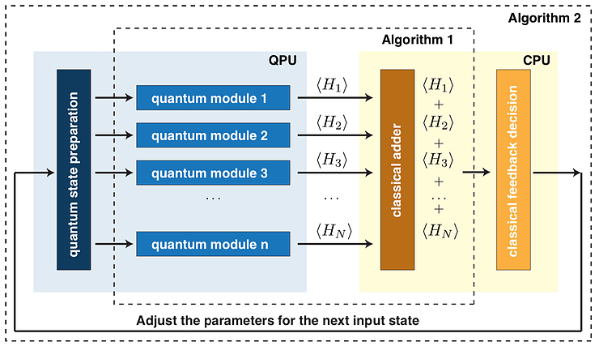

# Variational Quantum Eigensolver {.unnumbered}

Variational Quantum Eigensolver (VQE) [@peruzzo2014variational] es un algoritmo híbrido cuántico-clásico para aproximar el valor propio más bajo de un Hamiltoniano. El estado fundamental de un Hamiltoniano es el eigenstate $|\psi_0\rangle$ asociado con el valor propio más pequeño $E_0$:

$$
H|\psi_{\lambda}\rangle = E_{\lambda}|\psi_{\lambda}\rangle
$$

Para cualquier estado normalizado $|\psi\rangle$, el principio variational da

$$
\langle \psi | H | \psi \rangle \ge E_0,
$$

con igualdad solo cuando $|\psi\rangle$ es exactamente el estado fundamental. Esto significa que si parametrizamos un estado de prueba $|\psi(\theta)\rangle$ y minimizamos el valor de expectación

$$
C(\theta) = \langle \psi(\theta) | H | \psi(\theta) \rangle,
$$

obtenemos una cota superior sobre $E_0$. En la práctica, un optimizador clásico actualiza $\theta$ hasta que esta cota sea lo más pequeña posible. El estado correspondiente es entonces la mejor aproximación al estado fundamental alcanzable por el ansatz elegido.

Esto es especialmente útil cuando la diagonalización completa de $H$ es demasiado costosa, pero un energía aproximada del estado fundamental es suficiente para la tarea en cuestión. Eso es el caso de muchos problemas de química y optimización, donde el estado de energía mínima codifica la solución deseada.

Para ver cómo funciona, considere el siguiente Hamiltoniano:

$$
H = \left[
\begin{array}{cc}
3 & 1 \\
1 & -1
\end{array}
\right]
$$

que puede descomponerse en combinaciones lineales de operadores de Pauli tal que

$$
H = I + X + 2Z.
$$

Usando las matrices estándar de Pauli,

$$
I = \begin{pmatrix} 1 & 0 \\ 0 & 1 \end{pmatrix},
\quad
X = \begin{pmatrix} 0 & 1 \\ 1 & 0 \end{pmatrix},
\quad
Z = \begin{pmatrix} 1 & 0 \\ 0 & -1 \end{pmatrix},
$$

podemos recuperar su forma original tal que

$$
H = I + X + 2Z =
\begin{pmatrix}
1 & 0 \\ 0 & 1
\end{pmatrix}
+
\begin{pmatrix}
0 & 1 \\ 1 & 0
\end{pmatrix}
+
\begin{pmatrix}
2 & 0 \\ 0 & -2
\end{pmatrix}
=
\begin{pmatrix}
3 & 1 \\ 1 & -1
\end{pmatrix}.
$$

Equivalentemente, $H = H_1 + H_2 + H_3$ con $H_1 = I$, $H_2 = X$, y $H_3 = 2Z$.

VQE no requiere que el ansatz esté adaptado al Hamiltoniano en sí; solo necesita ser expresivo suficiente para representar un estado cercano al estado fundamental. Una elección sencilla es, por lo tanto, la rotación uniparámetro simple:

$$
|\psi(\theta)\rangle = R_y(\theta)|0\rangle = \cos\frac{\theta}{2}|0\rangle + \sin\frac{\theta}{2}|1\rangle.
$$

Un detalle práctico es que los diferentes términos de Pauli se miden en bases diferentes. Para $Z$, la base computacional ya es adecuada. Para $X$, debemos rotar el qubit antes de medir para que la medición suceda efectivamente en la base $\{|+\rangle,| -\rangle\}$. Concretamente, $X = R_y(\pi/2) Z R_y(-\pi/2)$, por lo que medir $X$ en la base computacional es equivalente a medir $Z$ después de una rotación $R_y(-\pi/2)$.

Con este ansatz, el valor de valor de energía es

$$
E(\theta) = \langle \psi(\theta) | H | \psi(\theta) \rangle = 1 + \sin\theta + 2\cos\theta.
$$

De hecho, para $|\psi(\theta)\rangle = (\cos\frac{\theta}{2}, \sin\frac{\theta}{2})^T$,

$$
\langle Z \rangle = \cos\theta, \qquad \langle X \rangle = \sin\theta,
$$

asi que la energía total es la suma de las tres contribuciones de Pauli: $1 + 2\langle Z\rangle + \langle X\rangle$.

En $\theta = 0$, el estado de prueba es $|0\rangle$, y por lo tanto

$$
E(0) = \langle 0 | H | 0 \rangle = 3.
$$

::: {.callout-note collapse="true"}

## Visión paso a paso de la matriz inicial

La derivación original puede escribirse explícitamente como una secuencia de operaciones. Partiendo de $|0\rangle = (1,0)^T$,

$$
|0\rangle = \begin{pmatrix} 1 \\ 0 \end{pmatrix},
\qquad
Z|0\rangle = \begin{pmatrix} 1 \\ 0 \end{pmatrix},
\qquad
X|0\rangle = \begin{pmatrix} 0 \\ 1 \end{pmatrix}.
$$

Por lo tanto,

$$
\langle 0 | Z | 0 \rangle = 1,
\qquad
\langle 0 | X | 0 \rangle = 0,
$$

y el valor de expectación total se convierte en

$$
\langle 0 | H | 0 \rangle
= \langle 0 | I | 0 \rangle + \langle 0 | X | 0 \rangle + 2\langle 0 | Z | 0 \rangle
= 1 + 0 + 2 = 3.
$$

Si en cambio elegimos el estado rotado $|+\rangle = H|0\rangle = \frac{1}{\sqrt{2}}(1,1)^T$, entonces

$$
\langle + | X | + \rangle = 1,
\qquad
\langle + | Z | + \rangle = 0,
$$

lo que muestra cómo el mismo Hamiltoniano puede evaluarse en diferentes bases dependiendo de qué término de Pauli se mide. Este es el origen del paso de rotación de base en implementaciones prácticas de VQE.

:::

A medida que $\theta$ cambia, el optimizador busca el mínimo de $E(\theta)$. El mínimo global se alcanza en

$$
\theta^* = \pi + \arctan\left(\frac{1}{2}\right),
$$

donde

$$
E(\theta^*) = 1 - \sqrt{5} \approx -1.236.
$$

Este es el energía del estado fundamental del Hamiltoniano y coincide con el valor propio más pequeño de $H$. En un flujo de trabajo VQE realista, el optimizador evalúa el valor de expectación repetidamente, y cada evaluación puede requerir medir diferentes términos de Pauli en diferentes bases. El punto importante es que el bucle variational actualiza los parámetros hasta que la energía medida se minimiza, mientras que el optimizador clásico guía la búsqueda en el espacio de parámetros.

**Carga híbrida**

La forma de explorar las opciones es establecer una función de costo que nos ayude a impulsar el valor en la dirección correcta. Aquí, el valor de expectación es de gran ayuda ya que sabemos que nos proporcionará una aproximación al estado fundamental del sistema (dependiendo de la cantidad de tiempo que lo dejemos iterar).

Esto es cuando las rutinas de optimización tradicionales o clásicas resultan útiles. Podemos emplear métodos existentes de optimización clásica como Gradient Descent estocástico (SGD), el método de Powell o el método de Nelder-Mead buscando travesar eficientemente el espacio de solución potencial para todos los valores $\theta$ podrían tomar.

También, dado el precedente decomposition podríamos ver fácilmente cómo estos cálculos podrían realizarse en paralelo maximizando el uso de recursos tanto del lado clásico como cuántico.

<figure markdown>

</figure>

Un beneficio clave de VQE es que no requiere una forma específica para nuestro ansatz, así que si se selecciona una opción lo suficientemente flexible podríamos beneficiarnos de aquellos que mejor se adaptan a la topología de conectividad de nuestro hardware para obtener los resultados.