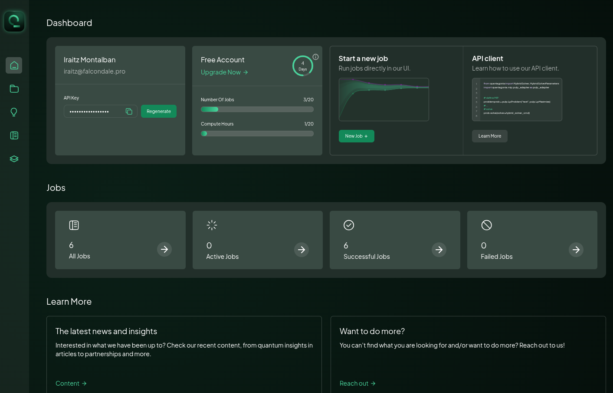

# Solvers híbridos

Aunque hablamos de ordenadores cuánticos y cómo usarlos para resolver problemas específicos, problemas complejos; el porcentaje del problema resuelto por cada dispositivo (clásico y cuántico) depende del problema específico que gustaría resolver.

Piensa en el algoritmo de Shor. Revolucionó el campo y preocupó a algunos CSO/CISOs. Pero solo cambia un pequeño paso del algoritmo convencional de Factorización de primos. Gracias a ese paso hay una aceleración significativa en el algoritmo que lo lleva de orden exponencial a orden polinomial.

Una explicación más detallada se puede encontrar en la documentación de IBM [aquí](https://learning.quantum.ibm.com/course/fundamentals-of-quantum-algorithms/phase-estimation-and-factoring) pero este tipo de enfoques híbridos pueden beneficiarse realmente del hardware NISQ en otros regímenes como optimización.

## Annealers híbridos {.unnumbered}

Nuestro enfoque de optimización ya está limitado a la formulación QUBO pero esta es una restricción impuesta por nuestro hardware. Podríamos querer encontrar soluciones a problemas cuyas variables pueden ser enteros, por ejemplo. Estos tipos de problemas se resuelven clásicamente usando estrategias _branch and bound_.

Tomando un problema de la forma

$$
\max_{x\in\mathbb{R}^n} f(x) \\
\quad  \text{s.t.  } c(c) \le 0 \\
    \quad \quad x_i \in \mathbb{Z}, i \in I
$$

donde $f$ y $c$ son funciones no lineales y no convexas. Esto hace que nuestro problema objetivo sea un problema no convexos MINLP (mixed-integer nonlinear programming). Garantizar que no solo lleguemos a una solución sino **la** solución es una tarea exigente.

Buena noticia es que los QUBOs no convexos pueden hacerse convexos así:

$$
\max_{x\in\{0,1\}^n} x^T (Q + diag(s))x + s^Tx
$$

donde $s$ se refiere a un desplazamiento que hay que obtener. Se pueden encontrar diferentes métodos para obtener dicho desplazamiento, como resolver un Problema de Optimización Semidefinida Auxiliar (SDP) que devuelve el mayor autovalor de $Q$ [@billionnet2007using]. El cálculo del desplazamiento también puede abordarse con ordenadores cuánticos mezclando recursos clásicos y cuánticos de diferentes maneras [@montanaro2020quantum; @augustino2025solvingsemidefiniterelaxationqubos]. Encontrar el equilibrio correcto entre recursos clásicos y cuánticos debería impulsar definitivamente procesos que no requieran un servicio tolerante a fallos a escala.

### Solvers híbridos de D-Wave

D-Wave fue uno de los primeros en aprovechar estos flujos de trabajo complejos que involucran recursos clásicos y cuánticos, y dio con una solución práctica que cualquiera puede usar a través de su servicio. Lanzó un conjunto de [solvers híbridos](https://docs.dwavesys.com/docs/latest/doc_leap_hybrid.html). Estos solvers son particularmente convenientes cuando en lugar de Binary Quadratic Models queremos formular nuestro problema como:

* [Constrained Quadratic Models](https://docs.ocean.dwavesys.com/en/stable/concepts/cqm.html#cqm-sdk): problemas que pueden incluir variables reales, enteras y/o binarias y una o más restricciones.
* [Discrete Quadratic Models](https://docs.ocean.dwavesys.com/en/stable/concepts/dqm.html#dqm-sdk): problemas que contienen variables discretas en su formulación central de variables.

Como puedes ver, no hay bala de plata, pero estar al tanto de todas las posibilidades que ofrece la tecnología puede marcar la diferencia al enfrentar nuestros casos de uso empresariales para ese porcentaje extra que nos hace competitivos.

### Quantagonia

Debido a su cambio en la estrategia de precios, ya no podemos jugar con sus dispositivos tanto como nos gustaría, así que una alternativa interesante es el servicio proporcionado por [Quantagonia](https://www.quantagonia.com/).

