# Desafíos {.unnumbered}

Este es un tema difícil, aunque disfrutemos trabajando con ordenadores cuánticos, el aspecto clave es poder resolver _eficientemente_ un problema dado. Y, en esta etapa, hay muchos competidores haciendo un gran trabajo resolviendo problemas sin necesidad de ordenadores cuánticos, y es importante que mientras este campo evolucionemos hagamos el mejor uso de sus colegas. Todas esas tecnologías _quantum-inspired_ y _quantum-adjacent_.

<figure markdown>
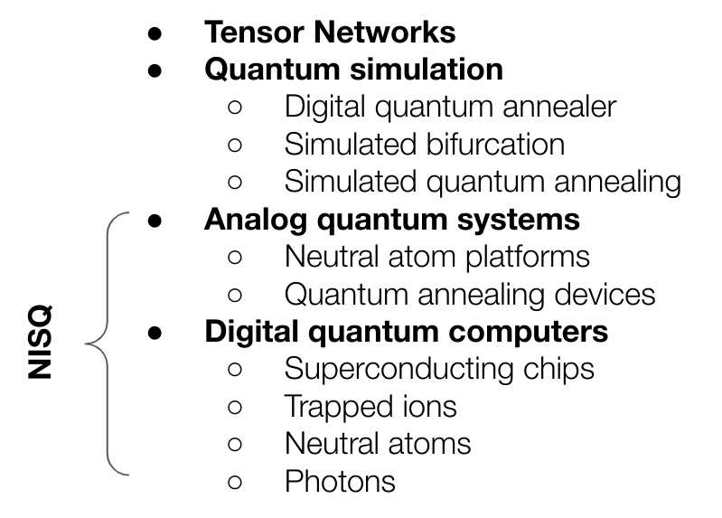{width=70%}
</figure>

De esta familia nos hemos enfocado hasta ahora en el último bit, el bit **Noisy Intermediate-Scale Quantum (NISQ)**, el relacionado con hardware cuántico real, pero eso no significa que aquellas técnicas y dispositivos inspirados por los retos que plantean los sistemas mecánicos cuánticos sean menos que el hardware real. De hecho, uno de los principales problemas para reclamar la ventaja cuántica es la mejora y refinamiento constante de dispositivos clásicos resolviendo los mismos problemas.

¡Les advertimos!

## Consideraciones

Antes de entrar en técnicas más engorrosas y obscuras, entendamos el contexto en el que intentamos usar la computación cuántica para superar los medios clásicos. No es una comparación justa como casi 70 años de desarrollo en el régimen clásico mientras que los ordenadores cuánticos, aunque se hayan usado casi 25 años desde la primera realización del qubit, podrían requerir algún trabajo extra hasta que un status similar de madurez y confianza se alcance.

La siguiente sección intentará hacer al lector consciente de algunos de los problemas que podría enfrentar y cómo abordarlos, con un interés particular en los Ordenadores Cuánticos Digitales.

### Dispositivos cuánticos

Hemos visto que muchos dispositivos diferentes existen, pero, incluso entre los basados en la misma tecnología, encontraremos discrepancias en cómo implementan sus operaciones. Cuando estas operaciones están totalmente parameterizadas las llamamos Puertas, pero aunque la ingeniería hace un esfuerzo sustancial para cerrar la brecha entre el marco teórico y la realidad física, quizá necesitemos hacer nuestra parte también.

#### Mapas de acoplamiento

El mapa de acoplamiento se refiere a la conectividad entre qubits. La mayoría de nuestros problemas se mapearán a esos qubits y necesitaremos definir la fuerza de la acción con respecto a los qubits vecinos. Esta capacidad de codificar las interacciones está reflejada en la conexión física entre los qubits de un dispositivo dado y se llama **mapa de acoplamiento**.

Como ejemplo, este es el mapa de acoplamiento de Rigetti:

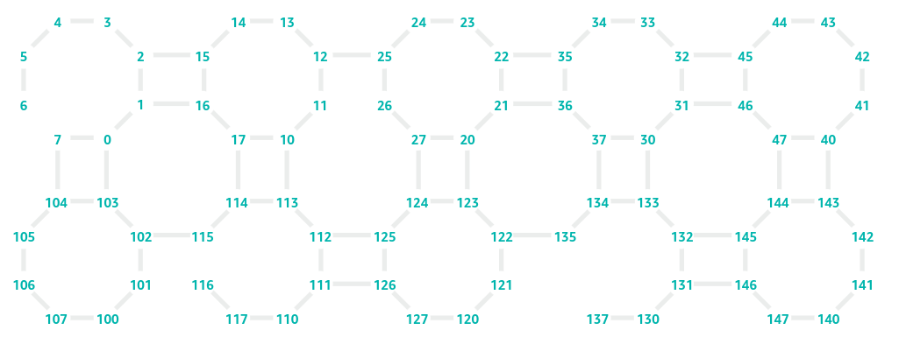{width=70%}

Y este pertenece a IonQ's Aria:

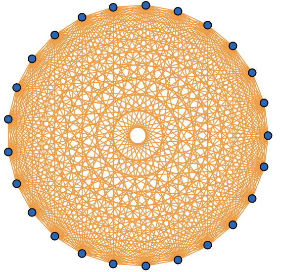{width=50%}

Parece que las trampas de iones pueden ser un mejor ajuste para problemas de optimización combinatoria ya que ya tienen conectividad virtually all-to-all, pero carecen de la escala de los dispositivos superconducting. ¿Podemos hacer algo para virtualmente conectar esos qubits en dispositivos de Rigetti all-to-all?

**Puertas SWAP**

La puerta SWAP afecta a dos qubits entrecambiando su estado, de tal manera que

$$
SWAP|\phi\rangle|\psi\rangle = |\psi\rangle|\phi\rangle,
$$

y su forma matricial queda de la siguiente manera

$$
SWAP = \left[
\begin{array}{cccc}
1 & 0 & 0 & 0 \\
0 & 0 & 1 & 0 \\
0 & 1 & 0 & 0 \\
0 & 0 & 0 & 1
\end{array}
\right].
$$

Al aplicar iterativamente estas puertas podemos crear una conectividad lógica all-to-all incluso en dispositivos sparsamente conectados. Las estrategias de SWAP son bastante comunes en la literatura, particularmente cuando se usan dispositivos superconducting. Diferentes enfoques pueden encontrarse en la literatura, y veremos en la práctica cómo resulta al final, pero en 2022 [@Weidenfeller_2022] mostraron cómo añadiendo capas de SWAP produce una conectividad virtually all-to-all con un aumento mínimo de profundidad.

<figure markdown>
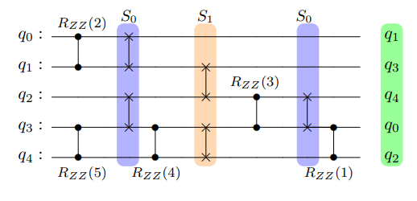
</figure>

<figure markdown>
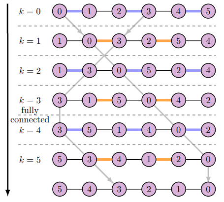
</figure>

Entonces simplemente necesitaríamos introducir la cantidad adecuada de puertas SWAP cuando sea necesario según nuestro target device coupling map. El inconveniente de ello es que nuestra profundidad de circuito aumentará, se añadirán más operaciones, pero ¿no es eso malo?

#### Puertas nativas

Nuestro marco lógico para computing cuántico se traduce en diferentes dispositivos. Como ya mencionamos cuando discutimos diferentes tecnologías de dispositivos, la actuación sobre los qubits se realiza de distinta manera:

* Qubits superconducting usan pulsos de microondas
* Trampas de iones usan láser
* Átomos neutrales usan láseres, de una manera ligeramente diferente

Por lo tanto, todas las operaciones necesitan encontrar una traducción que mapee puertas lógicas al resultado esperado, es decir, una pulsos calibrados necesita ser encontrado que renderice el resultado esperado. Siguiendo está el ejemplo de la puerta Hadamard en un qubit dado

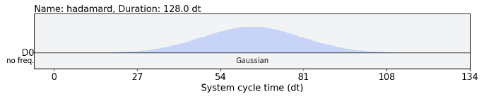

Una forma de pulso Gaussian de 128 unidades de duración del sistema y una amplitud de 0.1. Si este fuera el nivel necesario para trabajar, probablemente menos personas abrazarían la computación cuántica, por lo que la mayoría de las empresas ofrecen un conjunto ya calibrado de operaciones que, aunque no sea el conjunto completo de puertas del formalismo, forma un conjunto básico y universal de operaciones para que cualquier circuito lógico pueda transformarse a esas puertas nativas.

Si accedemos a cualquier dispositivo IBM Quantum Computing podemos ver información relevante donde podemos encontrar esas puertas nativas llamadas como las _basis gates_

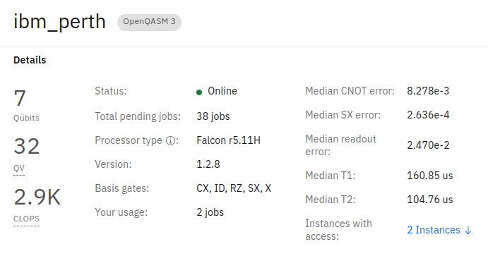

* ID es la operación identity
* X es la puerta NOT y [SX](https://qiskit.org/documentation/stubs/qiskit.circuit.library.SXGate.html), el $\sqrt{X}$
* RZ es la rotación sobre el eje $Z$ dada un ángulo $\theta$
* CX es nuestra única puerta de dos qubits y representa el CNOT

Entonces, si solo tenemos una puerta CNOT, ¿cómo podríamos implementar las puertas SWAP que necesitamos para crear un circuito all-to-all connected? Tricky as it might be we need to find a way to decompose our logical gates into the gates we have available [@gokhale2021fasterreliablequantumswaps].

### Transpilación

La transpilación se refiere al enfoque sistemático de cambiar un circuito lógico para que quepa bajo las basis gates y coupling map para un dispositivo dado. Es reminiscentes del viejo paso de compilación necesario en programas de computadora para ajustar una arquitectura dada, pero en este caso, dado que todavía convierte nuestro código fuente en un different source-code, transpilation es el nombre adecuado.

Estos pasos lógicos, una vez transpilados, pueden interpretarse por el dispositivo sabiendo el tipo de pulso que necesita enviarse a cada qubit para representar la operación solicitada.

IBM tiene uno de los módulos de transpilación más maduros y a menudo se usa para traducir los circuitos lógicos a especificaciones para otros dispositivos. Está compuesto por diferentes circuit _passes_ enfocándose en fijar problemas específicos entre circuito lógico y dispositivo físico.

<figure markdown>
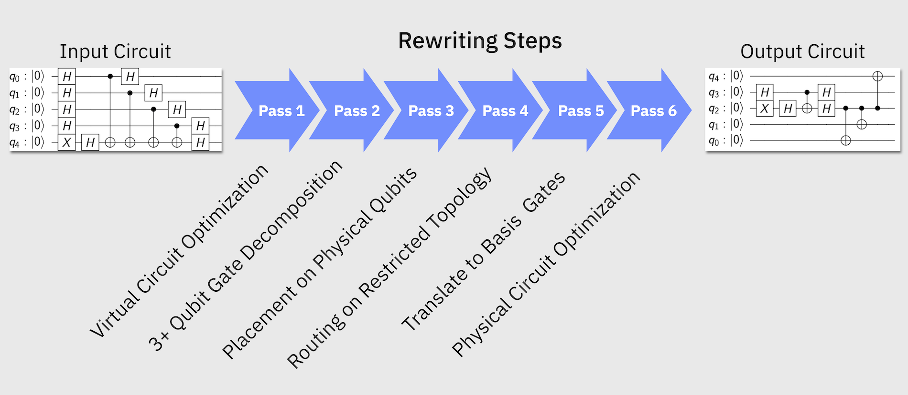
</figure>

Al final verá la representación del programa de pulsos que finalmente se envía al dispositivo siguiendo la arquitectura capa como en la imagen abajo.

<figure markdown>
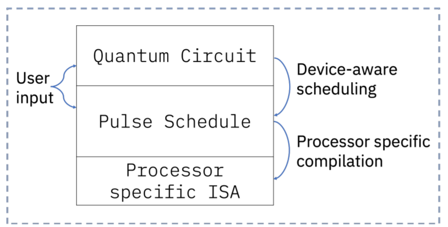{width=60%}
</figure>

Más sobre esto se puede encontrar en la documentación de IBM [https://qiskit.org/documentation/tutorials/circuits_advanced/04_transpiler_passes_and_passmanager.html].

### Ruido y errores

Y si fuera suficiente, los dispositivos cuánticos están lejos de ser perfectos al realizar operaciones. Las operaciones no siempre resultan como se espera debido a:

* Error de medición o readout
* Tasas de error de operación

Y dado el limitado acoplamiento nativo y traducción de gates, más operaciones de las inicialmente esperadas necesitan añadirse al circuito final. Cuantas más operaciones tengamos, más error añadiremos al estado final.

<figure markdown>
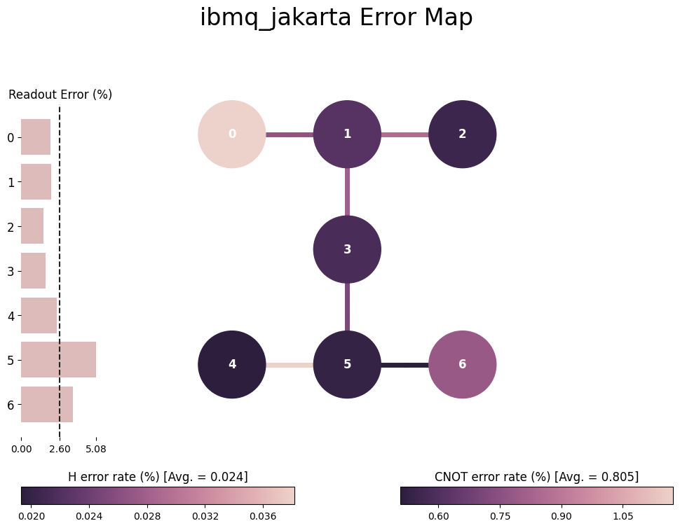{width=60%}
</figure>

Todo esto va contra el esfuerzo que hemos puesto al intentar resolver nuestro problema con precisión usando ordenadores cuánticos. Afortunadamente, hay personas investigando cómo estos efectos pueden minimizarse o suprimirse, así que veamos algunos ejemplos. También es relevante aclarar el vocabulario ya que podría ponerse un desorden. Están intentando llevarnos a la era de **Computación Cuántica Fault-Tolerant**. Algunas de las áreas en las que la gente está trabajando serán destacadas abajo.

**Supresión de errores**

La supresión de errores busca aprovechar el conocimiento sobre el sistema y sus errores fundamentales para suprimir su efecto cuando alguien ejecuta un circuito dado en esos dispositivos. A menudo se encuentra a un nivel fundamental, realmente cerca del hardware mismo y debería ser fácil abstraer al usuario final de estas acciones ya que mayormente requieren poco conocimiento sobre el circuito que se está ejecutando.

Un ejemplo claro de estas técnicas es _Dynamical Decoupling_. Una técnica que introduce operaciones cuando los qubits están idle para que no se vean afectados por los qubits y operaciones circundantes.

<figure markdown>
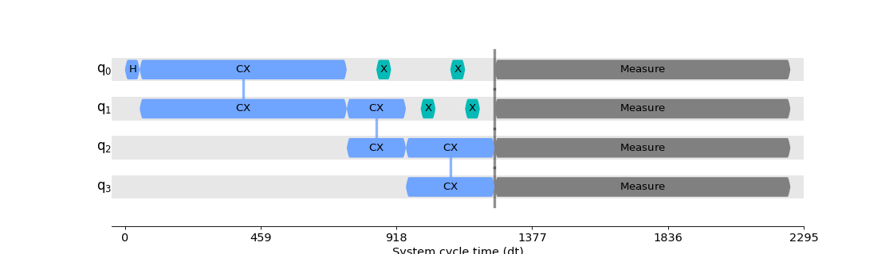
</figure>

Derivative Removal by Adiabatic Gate (DRAG) como ejemplo adicional, agrega un componente a la forma estándar de pulso para reducir qubits entrando en estados superiores a los 0 y 1 que usamos para cálculos. Estas técnicas apuntan a resolver problemas fundamentales relacionados con la implementación física.

**Mitigación de errores**

Estas técnicas intentan disminuir el efecto del ruido durante la ejecución compensando los problemas sistemáticos del dispositivo mismo. Podríamos caracterizar estadísticamente el error sistemático al readout y compensarlo después de la ejecución del circuito.

<figure markdown>
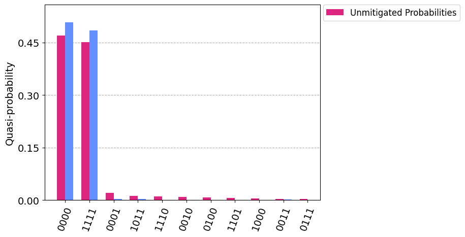
</figure>

O cuando el valor esperado es el objetivo, caracterizando el nivel de ruido y extrapolando el valor podríamos obtener qué valor obtendríamos en ausencia de ruido para un dispositivo dado.

<figure markdown>
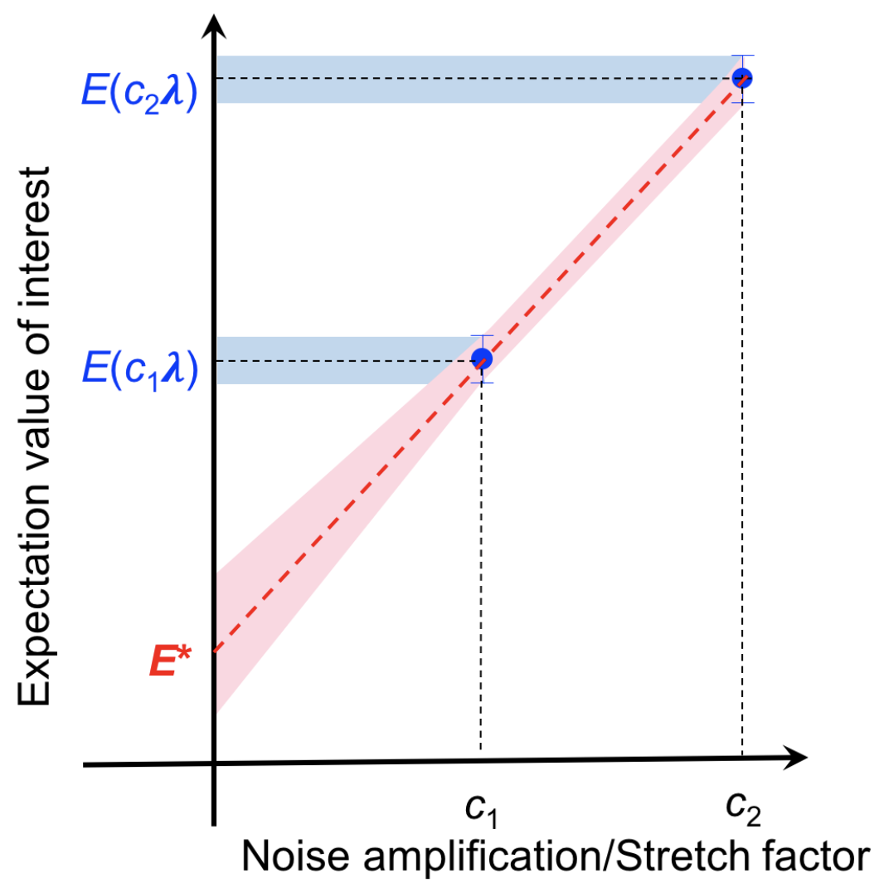{width=60%}
</figure>

Acciones simples como la selección de layout, intentando seleccionar aquellos qubits con menos error en ellos o qubits circundantes podrían ser simples y poderosas para circuitos pequeños pero se vuelve desafiante en casos de uso reales donde la profundidad y la conectividad aumentan considerablemente.

**Corrección de errores**

La corrección de errores se refiere al objetivo final de muchas empresas de computing cuántico, en particular proveedores de hardware, donde una implementación lógica usando acciones redundantes físicas puede llevar a un dispositivo fault-tolerant. El truco aquí es que nuestros qubits serán una representación lógica de lo que hemos visto hasta ahora

$$
|0\rangle_L = |000000000\rangle
$$

Y por lo tanto, las operaciones también deberían modificarse para representar las acciones sobre todos los qubits físicos detrás de nuestras acciones lógicas. El ejemplo de abajo es uno de los ejemplos canónicos de códigos de corrección de errores diseñados por Peter Shor.

<figure markdown>
{width=60%}
</figure>

**Computación Cuántica Fault-Tolerant** sería el escenario ideal donde un usuario final solo se preocuparía por la implementación lógica y la máquina se encargaría de la redundancia para corregir errores y devolver la ejecución real del código en ausencia de ruido. Lamentablemente, todavía estamos lejos de este futuro ya que requiere entre cientos y miles de qubits físicos para implementar un solo qubit lógico, aumentando la escala hasta un millón de qubits necesarios para cómputo significativo (ver [mapa de viaje de Google](https://quantumai.google/learn/map)).

Por lo tanto, necesitamos invertir tiempo en manual fixing and mitigation. Aunque estas técnicas puedan sonar complejas, el status actual de frameworks como Qiskit puede ayudar [a cerrar la brecha](https://docs.quantum-computing.ibm.com/optimize).

### Medios adicionales

Bueno, espero que no haya sido demasiado intenso. Nos hemos puesto en el funcionamiento interno de los servicios de quantum disponibles y hemos enumerado algunos de los impedimentos que podríamos enfrentar al pasar a dispositivos reales. Nos hemos centrado en los Ordenadores Cuánticos Digitales siendo los que nos permiten mover más allá del servicio ofrecido por los Quantum Annealers pero no requieren tanto entendimiento como los Ordenadores Cuánticos Analogos.

Siendo conscientes de las técnicas que pueden usarse también mostramos lo fácil que es implementar esos en hardware cuántico real de IBM's Qiskit Runtime. Otros proveedores de nube pueden habilitar otros dispositivos pero requerirán conocimiento adicional sobre cómo implementar esas técnicas. Podemos beneficiarnos de algunos de los métodos hechos disponibles por la comunidad de código abierto de Unitary Fund o jugadores niche como Q-Ctrl:

* [Mitiq](https://mitiq.readthedocs.io/en/stable/)
* [Fire Opal](https://q-ctrl.com/fire-opal)
* [Superstaq](https://superstaq.readthedocs.io/en/latest/)

Es probable que los proveedores de servicios de computing cuántico aumenten el nivel de abstracción haciendo más fácil implementar algoritmos en hardware real, pero por el momento, aún algunos trabajo necesita hacerse en nuestro lado como vimos. Ceñámonos a simuladores y emuladores por ahora.