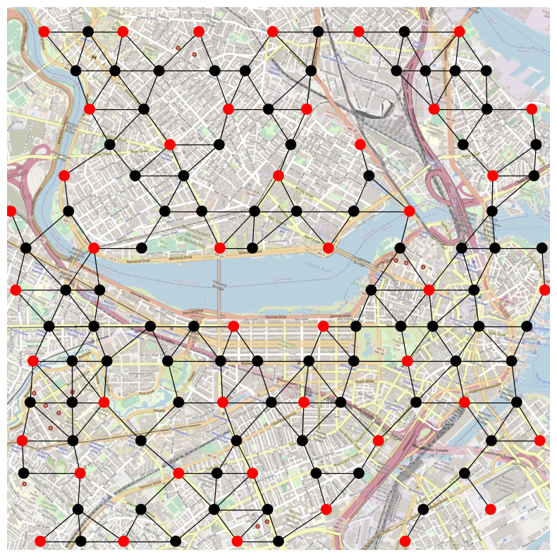
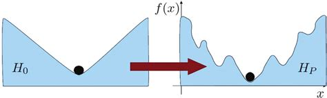
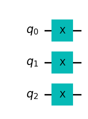
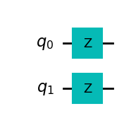

# Tipos de máquinas {.unnumbered}

Hemos hablado de cómo funcionan el hardware, pero no todos los ordenadores cuánticos funcionan de la misma manera. Solo hablando de ordenadores cuánticos puros, se pueden encontrar tres tipos principales de ordenadores.

## Dispositivos analógicos

Al igual al principio de los ordenadores, gestionar señales analógicas es la forma natural de comenzar al intentar domesticar fenómenos físicos para reproducir un conjunto particular de pasos. Existen máquinas con qubits bien caracterizados pero requiriendo una forma específica de interactuar con ellas. Este es el caso de las plataformas de átomos neutros, se proporciona un Hamiltoniano que actúa sobre el sistema y nuestro deber es definir las señales que dirigirán el sistema hacia la solución de nuestro problema. Estos átomos son qubits bien definidos, pero manipularlos según el marco matemático puede resultar desafiante, por lo que resulta más fácil (en cierto sentido) impulsar todo el sistema mediante manipulación de señales (hence analog computation).

El Hamiltoniano en esos dispositivos queda de la siguiente manera,

$$
\frac{\mathcal{H}(t)}{\hbar} = \sum_j \frac{\Omega_j(t)}{2} \left( e^{i \phi_j(t) } | 0_j \rangle  \langle 1_j | + e^{-i \phi_j(t) } | 1_j \rangle  \langle 0_j | \right) - \sum_j \Delta_j(t) \hat{n}_j + \sum_{j < k} V_{jk} \hat{n}_j \hat{n}_k,
$$

donde $|0_i\rangle$, $|1_i\rangle$, y $\hat{n}_i = 0|0_i\rangle\langle0_i|+1|1_i\rangle\langle1_i|$ se refieren a la posición de qubits $i$ para un dado espacio. Definir algoritmos requiere manipular las trayectorias temporales de los parámetros del Hamiltoniano $\Omega_i(t)$, $\phi_i(t)$, y $\Delta_i(t)$. El término Rabi $\Omega$ y el detuning $\Delta$ introducen escalas de energía que compiten con la escala geométrica $V_{ij}$.

Estas máquinas resuelven nativamente un problema matemático llamado, _maximum independent set_ (máximo conjunto independiente). Cada átomo tiene un radio de bloqueo que impide que dos átomos (qubits) estén activos al mismo tiempo (ambos siendo $|1\rangle$). Si somos capaces de codificar nuestro problema, la máquina podría computar los puntos más eficientes en un mapa donde debería colocar activos específicos basándose en su alrededor. Más sobre esto en el sitio de documentación de QuEra [https://queracomputing.github.io/Bloqade.jl/dev/tutorials/1.blockade/main/].

Mire esta referencia sobre cómo interactuar con dispositivos QuEra usando el servicio Amazon Braket y su [SDK](https://docs.aws.amazon.com/braket/latest/developerguide/braket-quera-submitting-analog-program-aquila.html). Es más fácil de lo que parece pero uno necesita saber definitivamente cómo traducir el problema a resolver a esaformulación. Estos dispositivos a menudo están limitados a un conjunto de problemas matemáticos que requieren a los usuarios pensar cómo su problema de negocio real puede encajarse en esos ajustes. Como ejemplo, aquí hay un problema candidato sobre dónde colocar antenas en Boston para minimizar el costo pero maximizar la cobertura.

<figure markdown>

</figure>

* [Example](https://github.com/QuEraComputing/QuEra-braket-examples/blob/main/OptimizationTutorial/AWS_nonadiabatic_optimization_demo.ipynb) para la imagen anterior
* General on MIS for neutral atoms: [https://arxiv.org/pdf/2109.03517.pdf](https://arxiv.org/pdf/2109.03517.pdf)

Es probable que, como ha sucedido con el resto de las máquinas, crezcan en la dirección de operación digitada. Una pista sobre las puertas nativas mencionadas anteriormente: definir un conjunto de parámetros que traduzcan el Hamiltonian del dispositivo a las puertas que nos gustaría usar, es parte de la magia que muchos proveedores de hardware realizan a través de frameworks de programación de modo que no tengamos que preocuparnos demasiado al respecto.

## Annealers cuánticos

En 1998, Tadashi Kadowaki y Hidetoshi Nishimori del Instituto de Tecnología de Tokio demostraron que el quantum annealing podría superar a las técnicas de annealing clásica usadas hasta ese momento para optimización y tareas combinatorias. Los Quantum Annealers trabajan comenzando el sistema en un estado conocido y, al realizar pequeñas perturbaciones al sistema, proporcionan la solución a un estado objetivo. Su universalidad ha sido probada.

[Computación cuántica adiabática (AQC)](../algorithms/adiabatic.md) es un modelo de computación que usa procesos cuánticos operando bajo condiciones adiabáticas. Como forma de computación cuántica universal, AQC emplea los principios de **superposición, tunelamiento y entrelazamiento** que se manifiestan en sistemas físicos cuánticos.

<figure markdown>

</figure>

D-Wave fue uno de los primeros en producir un ordenador cuántico comercialmente disponible con miles de qubits. Un hito claro en el camino hacia la viabilidad comercial.

Una gran pega de esta máquina es que solo puede trabajar usando la evolución adiabática como proceso principal. Esto significa que solo podemos gobernar el funcionamiento interno de la máquina hasta cierto punto. Los annealers funcionan de manera precisa así que no permiten la flexibilidad que los ordenadores digitados sí hacen, haciendo que sean más cercanos a una máquina analoga con capacidad de programación restringida.

Estas máquinas son capaces de resolver un problema complejo de hecho. En general, cualquier problema QUBO cuadrático unconstrained encaja en el framework general de usar annealers para encontrar el estado de energía mínima de un problema tipo Ising:

$$
H = -\sum_{\langle i j \rangle} J s_i s_j - \sum_j h s_j.
$$

Vemos esto con más detalle cuando cubrimos el funcionamiento interno de los annealers, pero piense que si su problema encaja en este tipo de formulación matemática, podría encontrar un aliado cuando se trata de annealers.

## Ordenadores cuánticos digitales

Para proporcionar un cierto nivel de universalidad cuando se trata de operaciones, la digitación de las interacciones con el ordenador cuántico y los estados que encode se ha convertido en un camino crítico hacia la comercialización de dispositivos cuanticos. La gestión de Hamiltonianos sigue siendo necesaria, pero la forma en que estas necesitan introducirse en la máquina podría manejarse mediante operaciones atómicas (puertas lógicas) con las que podemos componer operadores de nivel superior o crear dinámicas más complejas que nos acerquen a cómo operan los ordenadores clásicos, permitiendo adición incremental de instrucciones y niveles de abstracción más altos.

Los ordenadores digitados funcionan habilitando un conjunto de operaciones digitadas de modo que podamos implementar nuestras rutinas. El estado inicial del sistema sería todavía $|00...0\rangle$ así que si nos gustaría transformar este estado en $|11..1\rangle$ deberíamos encontrar el Hamiltoniano que lo hace.

Una operación not, como en los ordenadores clásicos, es una de las acciones básicas:

$$
X^{\otimes n} |0\rangle^{\otimes n} = |1\rangle^{\otimes n}
$$

Una composición simple de $X$ (not) operación en cada qubit. Por tanto, podría expresarse de manera pictórica:

<figure markdown>

</figure>

De esa manera es bastante sencillo entender qué operaciones atómicas se requieren y tener un lenguaje de programación que nos abstraiga de señales y pulsos.

Como ejemplo, una transformación unitaria caracterizada por $U = Z_1 \otimes Z_2$ lleva a una implementación sencilla

```py
OPENQASM 2.0;
include "qelib1.inc";

qreg q[2];
rz(pi/2) q[0];
rz(pi/2) q[1];
```

<figure markdown>

</figure>

Este enfoque hace que la programación de estas máquinas sea realmente cercana a la manera en que los dispositivos clásicos fueron programados en los primeros días.

Hay que prestar atención aunque que este marco lógico a menudo resulta complicado de representar por medios físicos, por lo que veremos algunas discrepancias cuando empecemos a mirar lo que se llama puertas nativas. Esto se volverá claro cuando empecemos con nuestros ejercicios contra hardware real. Mantengamos la alegría de jugar con simuladores cuánticos por ahora.