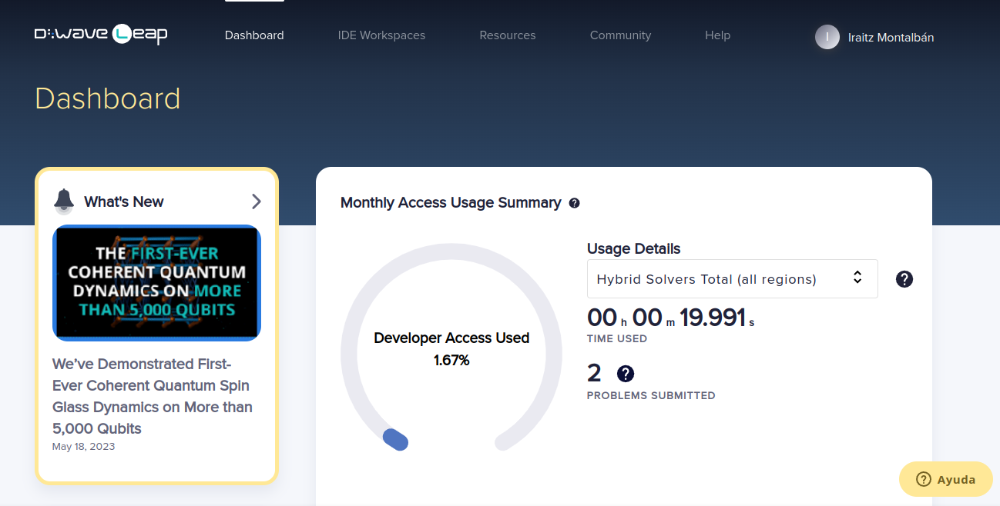
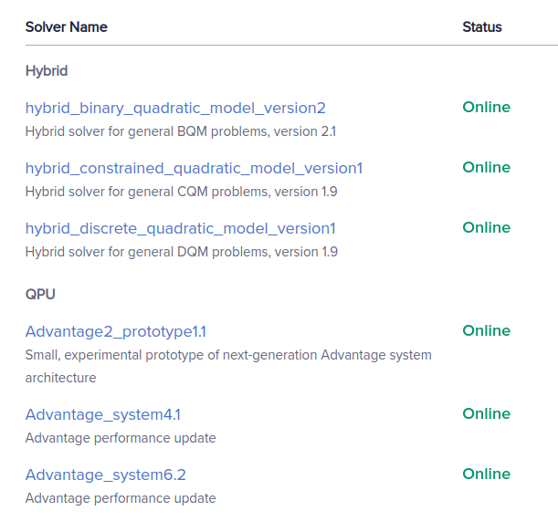
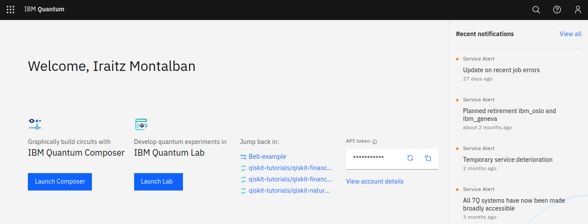
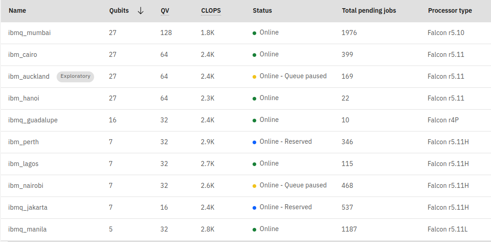
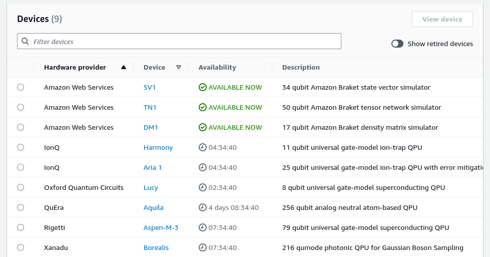
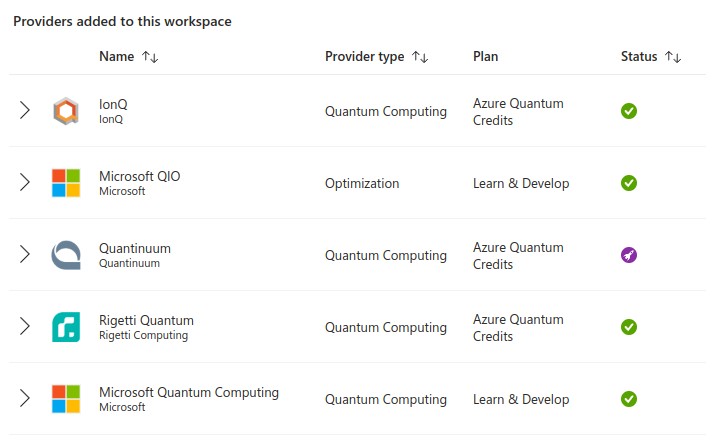
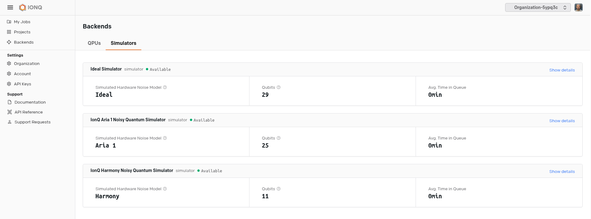

# Proveedores de servicios {.unnumbered}

La mayoría de estas máquinas no pueden comprarse; o su costo sería muy por encima de cualquier retorno de inversión potencial. Son bastante caras y requieren mantenimiento activo, así que afortunadamente tenemos la capacidad de interactuar con máquinas remotas desde nuestros workstations. De esa manera podemos _alquilar_ su uso y dejar que otros hagan el trabajo pesado de mantenimiento. La mayoría de los proveedores de hardware ofrecen sus ordenadores cuánticos como un servicio, así que podemos solicitar tiempo de cómputo y enviar nuestros circuitos/algoritmos para que se ejecuten en esos. Esto fue realmente común para Universidades e instituciones de investigación cuando solicitaban tiempo en un recurso de supercomputing o HPC, pero desde la creación de la nube también es una práctica generalizada entre departamentos de datos y análisis donde los recursos efímeros pueden tener sentido debido a la naturaleza experimental de una iniciativa dada.

Los guiaremos sobre cómo estos servicios pueden habilitarse desde los jugadores que proporcionan el servicio mismos así como proveedores de nube donde se puede encontrar una mayor variedad de máquinas.

## Proveedores de servicio directos

### D-Wave

D-Wave es conocido por ser una de las primeras empresas en hacer sus ordenadores cuánticos disponibles comercialmente (2011). Este jugador canadiense nicho construyó máquinas de quantum annealing para que la gente pueda... ¿comprarlas? Bueno, probablemente fue parte de su intención, pero estas son máquinas grandes y caras que todavía deben demostrar su utilidad. Afortunadamente en 2018 lanzaron su solución en la nube [DWave Leap](https://cloud.dwavesys.com/leap/login).

Su acceso en la nube permite algo de tiempo gratuito en estas máquinas para que los usuarios puedan evaluar su utilidad y ventaja para resolver problemas específicos.

<figure markdown>

</figure>

El panel ofrece información sobre el tiempo de uso restante y hay opciones para abrir un IDE basado en navegador o acceder a la documentación para casos de uso que puedan ayudar a comenzar con este servicio.

Ya discutimos que los Annealers cuánticos son un tipo de beast diferente, así que podrían requerir diferentes formas de instruir qué hacer. Por eso D-Wave tuvo que aprovechar también kits de desarrollo de software (SDK) basados en Python para que la gente pueda interactuar con sus máquinas (exclusivamente).

[Stack de software Ocean](https://docs.ocean.dwavesys.com/en/latest/overview/install.html)

Adjuntando una cuenta de GitHub, el acceso inicial de 20 min. se extiende a un permiso mensual donde estarán disponibles sus dispositivos puramente cuánticos así como solvers híbridos.

<figure markdown>

</figure>

### IBM

IBM ha estado involucrado desde los primeros días en el desarrollo de ordenadores cuánticos. Los chips superconductores están en el núcleo de lo que pueden proporcionar, y probablemente ya haya visto algunas imágenes de lo que sus máquinas parecen, así que ahora sabe qué hay dentro de este enorme cilindro.

<figure markdown>

</figure>

Se dice que los representantes de IBM preguntaron en una conferencia cuántos de los asistentes interactuarían realmente con un servicio de computing cuántico para enviar sus experimentos si IBM permitiría tal acceso. Apparently un número enorme de personas alzaron sus manos y eso dio origen a la plataforma de IBM Quantum Computing [https://www.ibm.com/quantum] y el framework que habilitó la comunicación e implementación de experimentos.

<figure markdown>

</figure>

Podemos usar recursos en línea disponibles allí, como el Quantum Lab (un IDE basado en Jupyter) o obtener el token API para interactuar desde nuestra máquina local mediante Qiskit. Los mismos dispositivos estarán disponibles para nuestros experimentos en ambos casos.

<figure markdown>

</figure>

## Servicios en la nube

No todas las empresas tienen la capacidad de desarrollar y mantener un servicio en línea orientado al cliente como su enfoque pueda ser más el desarrollo de hardware, y podrían beneficiarse de asociaciones donde esto sea hecho por un tercer proveedor. Los proveedores de nube, ya conscientes de esto, decidieron dar un paso y crear un servicio para que otros puedan hospedar sus servicios de computing cuántico.

### Amazon Braket

AWS creó un servicio llamado Amazon Braket para que personas que ya usan sus servicios de nube puedan simplemente agregar recursos de computing cuántico como un extra a su pila actual. Ofrece una experiencia similar a la de IBM o DWave, pero el principal beneficio es el acceso a dispositivos distintos a los de IBM o DWave.

<figure markdown>

</figure>

Se puede usar su Software Development Kit (SDK de Braket) que podría ser necesario para algunos dispositivos que no proporcionan puertas digitadas, pero en general, debido al acuerdo en instrucciones digitadas, existe una integración entre ambos lenguajes: Amazon Braket SDK y IBM's Qiskit.

### Microsoft Azure

De manera similar, Azure creó un servicio que proporciona acceso a un conjunto de dispositivos, algunos de los cuales solo son accesibles en esta plataforma (por ejemplo, Quantinuum). Se llama Quantum Workspaces, y también ofrece un IDE basado en Jupyter para experimentación en línea.

<figure markdown>

</figure>

Microsoft creó su propio framework de computing cuántico llamado Q#, pero dada la madurez de Qiskit, existen plugins para que los programadores no tengan que cambiar de frameworks.

## Proveedores directos

Algunas empresas, como IonQ, proporcionan acceso directo a sus simuladores, emuladores y dispositivos vía su servicio en la nube. Este es el caso del servicio [IonQ's Cloud](https://ionq.com/quantum-cloud). Cualquiera puede registrarse y solicitar acceso a los simuladores y QPUs disponibles allí.

<figure markdown>

</figure>

## Proveedores terceros

Existen algunos proveedores intermediarios que se posicionan entre el acceso al hardware y la experiencia del desarrollador. Definitivamente interesante mirar su oferta a medida que evoluciona:

* [Strangeworks](https://strangeworks.com/)
* [qBraid](https://www.qbraid.com/)