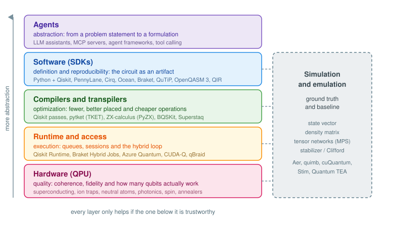

# La pila de computación cuántica {.unnumbered}

Hemos visto cómo se construyen estas máquinas, quiénes las alquilan a nosotros y qué falla cuando enviamos un circuito. Llegó el momento de alejarse y ver todo el asunto.

La computación clásica se estableció en una pila hace mucho tiempo. Nadie que escriba una aplicación web piensa en el programador de instrucciones, y nadie diseñando un CPU se preocupa por JavaScript. Cada capa hizo una promesa, la cumplió y la capa de encima dejó de preocuparse. La computación cuántica está en medio de construir esa misma estructura, solo que las capas aún son visibles y con fugas, así que vale la pena saber en cuál estamos parado. La mayor frustración en este campo viene de culpar a la capa equivocada.

<figure markdown>

</figure>

léalo de arriba hacia abajo si quiere seguir un problema en su camino hacia una máquina, o de abajo hacia arriba si quiere saber qué puede ofrecer la máquina. De cualquier manera, cada capa tiene exactamente un trabajo.

## Agentes: abstracción

En el muy arriba hay alguien que tiene un problema, y ese problema se declara en el lenguaje de su dominio. Una flota de entrega que tiene que visitar 60 direcciones. Una molécula cuya energía del estado fundamental alguien necesita. Un portafolio con restricciones sobre cuánto puede ir en cada sector. Ninguno de estos es un circuito cuántico aún.

Convertir eso en algo que un algoritmo cuántico pueda consumir es el trabajo de esta capa: elegir una formulación (un QUBO, un Hamiltoniano, un map feature), elegir un algoritmo que encaje tanto la formulación como el hardware disponible, y enrolar el bucle clásico-cuántico alrededor. Durante la mayor parte de la corta historia de este campo ese trabajo perteneció a una persona, usualmente una cara y sigue siendo el principal cuello de botella para la adopción. No puedes contratar tu camino fuera de una escasez de talento.

Lo que está cambiando es que esta capa se está automatizando parcialmente. No la física, el trabajo de traducción:

* **Asistentes de código** entrenados o ajustados en los SDK, como el [Qiskit Code Assistant](https://quantum.cloud.ibm.com/docs/en/guides/qiskit-code-assistant), que convierten "construye un ansatz hardware-efficient para este Hamiltoniano" en algo que ejecuta.
* **Tool calling y MCP servers** para que un modelo no tenga que adivinar. Puede consultar el mapa de acoplamiento de un backend, mirar su calibración actual, transpilate un candidato circuit y leer la cuenta de puertas de dos qubits antes de decidir cualquier cosa. Proveedores como [qBraid](https://docs.qbraid.com/) ya exponen sus servicios de esta manera.
* **Frameworks de agentes** que dividen el trabajo en formulación, implementación y verificación, de modo que la pieza que escribe el circuito no sea la misma que juzga si es correcta.
* **Retrieval sobre documentación y papers**, lo cual importa más de lo que suena en un campo donde la forma recomendada de hacer algo cambia cada pocas lanzamientos.

Ahora, una advertencia. Esta es la capa más joven y menos fiable del stack, y falla de una manera particularmente desagradable: produce código que ejecuta. Cuando [@vishwakarma2024qiskithumanevalevaluationbenchmark] benchmarkó modelos en tareas de Qiskit escritas a mano, los modelos generaron código ejecutable, pero el éxito cayó bruscamente a medida que las tareas se complicaron, y "ejecutable" es un umbral muy bajo aquí. Un circuito construido sobre el Hamiltoniano incorrecto felizmente retornará un histograma, y ese histograma parecerá exactamente un resultado válido.

Así que la regla para esta capa es simple: el agente propone, el stack verifica. La abstracción solo vale la pena cuando las capas inferiores pueden comprobar lo que vino de arriba, lo cual es una buena razón para cuidar la siguiente.

## Software: definición y reproducibilidad

Esta es donde el algoritmo deja de ser un dibujo en una pizarra y se convierte en un objeto. Algo que puedes serializar, versionar, entregar a un colega y ejecutar nuevamente en seis meses.

Python ganó esta capa, para mejor o peor, y el ecosistema creció alrededor:

* **[Qiskit](https://www.ibm.com/quantum/qiskit)** es el punto de referencia para trabajo based-gates, y aunque personas que apuntan a otros proveedores tienden a escribir en él y convertir después.
* **[PennyLane](https://pennylane.ai/)** trata los circuitos como funciones diferenciables, lo que lo convierte en la elección natural cuando el circuito está dentro de un bucle de entrenamiento.
* **[Cirq](https://quantumai.google/cirq)** para dispositivos Google, **[Braket SDK](https://aws.amazon.com/braket/)** para el catálogo de AWS, **[Ocean](https://www.dwavequantum.com/solutions-and-products/ocean/)** para annealing y formulaciones QUBO, **[Bloqade](https://queracomputing.github.io/bloqade-analog/latest/)** para átomos neutrales y **[QuTiP](https://qutip.org/)** cuando necesitas la dinámica en lugar de puertas.
* **[Qibo](https://qibo.science/)** sitúa ligeramente aparte, actuando como middleware entre una manera de escribir cosas y varios backends.

Debajo del SDKs hay un nivel de intercambio que no recibe suficiente atención. **[OpenQASM 3](https://openqasm.com/)** [@Cross_2022] describe circuitos incluyendo control clásico en tiempo real, timing y detalle a nivel de pulso, y **[QIR](https://www.qir-alliance.org/)** toma el camino LLVM para que programas cuánticos puedan manejarse por herramienta que ya existe en el mundo del compilador. Estos formatos son la razón por la que un circuito escrito en un SDK puede ejecutarse por un proveedor que nunca haya oído hablar de ese SDK.

Y luego está la parte que todos saltan. La reproducibilidad en computing cuántico es más difícil que en un proyecto Python normal porque el resultado depende de cosas fuera de tu código:

* Fije el entorno. Un lockfile y `uv sync` cuestan nada y ahorran una tarde. Los transpilers, en particular, cambian su salida entre versiones menores, por lo que "mismo script, diferente answer" es un martes normal.
* Fije las semillas. Shot sampling, optimizer initialization y la búsqueda de layout del transpiler son todos estocásticos.
* Grabe el backend **y** su captura de calibración. El mismo circuito en el mismo dispositivo dos días después no es el mismo experimento, y si no escribió qué qubits le fueron dados, no puede explicar la diferencia después.
* Serialice el circuito que fue realmente enviado, no el que escribió. Entre los dos hay un transpiler, y puede que haya cambiado bastante.

```bash
uv init my-quantum-experiment
uv add qiskit qiskit-ibm-runtime pytket-qiskit
uv lock
```

Aburrido, y la actividad de mayor retorno en todo el stack.

## Compiladores y transpiladores: optimización

Ya conocimos la [transpilación](challenges.md) cuando vimos que nuestro circuito lógico no cabe en el dispositivo en el que va a ejecutarse. Lo que importa aquí es que es una capa con implementaciones competitivas, y son intercambiables. No está obligado a usar el que venía con su SDK.

Lo que se está optimizando, en orden roughly de cuánto duele:

* **Cuenta de puertas de dos qubits.** Estas son de una a dos órdenes de magnitud más ruidosas que las puertas de un qubit. Es el número que hay que mirar primero, y a menudo el único que importa.
* **Profundidad**, porque los qubits idle se decohieren mientras sus vecinos son operados.
* **Layout y routing**, mapear qubits lógicos a físicos de modo que las interacciones que su algoritmo necesita coincidan con la conectividad que tiene el chip, e insertar SWAPs donde correspondan.
* **Non-Clifford count**, el número de $T$ gates, que es irrelevante hoy y el costo dominante una vez llegue la corrección de errores, ya que esas son las más caras de implementar fault-tolerantly.

Las herramientas vale la pena conocer:

* **[Qiskit's transpiler](https://quantum.cloud.ibm.com/docs/en/guides/transpile)**, organizado como pass managers con niveles de optimización del 0 al 3, más los passes impulsados por IA ofrecidos a través de su servicio de transpiler. Maduro, bien documentado y el por defecto por una razón.
* **[pytket](https://tket.quantinuum.com/)**, el compilador TKET de Quantinuum [@Sivarajah_2020]. Estaba diseñado desde el inicio para ser retargetable y vendor-agnostic, y se acopla a los SDK, así que puede seguir escribiendo Qiskit y compilar con TKET a través de `pytket-qiskit` si los números salen mejor.
* **[ZX-calculus](https://zxcalculus.com/)** [@vandewetering2020zxcalculusworkingquantumcomputer], que es una idea diferente en absoluto. En lugar de tratar el circuito como una secuencia de gates, se reescribe como un gráfico donde la estructura de gates se disuelve, se simplifica con un pequeño conjunto de reglas de reescritura locales, y luego se extrae un circuito atrás. Porque el objeto intermedio no es un circuito, encuentra simplificaciones que la reescritura gate-by-gate no puede ver. [PyZX](https://github.com/zxcalc/pyzx) es el punto de entrada usual, y este enfoque es particularmente fuerte en fase y $T$ count reduction, por lo que la comunidad de corrección de errores se preocupa por ello.
* **[BQSKit](https://bqskit.lbl.gov/)**, que toma resíntesis numérica: corte el circuito en bloques, compute la unitary de cada bloque, y busque una secuencia más corta que la reproduzca hasta una tolerancia que elija. Comerciar una cantidad controlada de precisión por un circuito más corto a menudo es un excelente trato en hardware ruidoso.
* **[Superstaq](https://superstaq.readthedocs.io/en/latest/)**, que compila device-aware a través de varios proveedores y felizmente bajará del nivel de gate cuando el hardware lo permita.

Y debajo de las gates está el nivel de pulso, donde una gate se convierte en una señal de microondas o laser shaped. [Qiskit Dynamics](https://qiskit-community.github.io/qiskit-dynamics/) y [Pulser](https://pulser.readthedocs.io/) para dispositivos Pasqal viven aquí, junto con el control Hamiltonian analogical que vimos para átomos neutrales. La mayoría de la gente nunca necesita bajar allí, que es exactamente el punto de tener capas.

Un hábito que construir: cuente las puertas de dos qubits antes y después de compilar, en cada ejecución. Toma una sola línea y es la mejor señal temprana que tendrá de que el resultado va a ser ruido.

## Simulation and emulation: ground truth

Esta capa no sitúa arriba o abajo, corre alongside the whole stack, y juega dos roles muy diferentes.

El primero es depuración. Para instancias pequeñas puede conocer la respuesta exacta, lo que significa que puede decir si su formulación estaba equivocada, su circuito estaba equivocado o el hardware simplemente era ruidoso. Sin esto, todos los tres fallos se ven idénticos.

El segundo papel es menos cómodo: esta es la competencia. Los métodos clásicos siguen mejorando, y la pregunta honesta antes de gastar créditos de hardware es si un método clásico ya resuelve su instancia. Cubrimos los métodos en [recursos clásicos](../gettingstarted/classicalqc.qmd), así que solo el mapa aquí:

* **State vector** para circuitos exactos pequeños, aproximadamente hasta 25 a 30 qubits antes de que su memoria renuncie.
* **Density matrix** cuando necesita ruido en la picture, a costo cuadrático.
* **Tensor networks** para los casos donde el entrelazamiento se mantenga bounded.
* **Stabilizer simulation** para Clifford circuits, donde [Stim](https://github.com/quantumlib/Stim) [@gidney2021stimfaststabilizercircuit] maneja millones de gates en segundos. Si trabaja en corrección de errores, esta es su herramienta principal en lugar de un fallback.

Los tensor networks merecen la extraña oración. No representan el estado completo, representan las correlaciones, y solo pagan por el entrelazamiento que esté realmente presente. Un circuito poco profundo o débilmente entrelazado contrae mucho más allá de lo que un state vector podría alguna vez sostener, lo cual es precisamente por qué varias afirmaciones de ventaja cuántica se han dado marcha atrás después de que alguien los reprodujera clásicamente [@xu2023herculeantaskclassicalsimulation]. Las herramientas prácticas son [quimb](https://quimb.readthedocs.io/en/latest/index.html), [NVIDIA cuQuantum](https://developer.nvidia.com/cuquantum-sdk) para contracción en GPU, [Quantum TEA](https://www.quantumtea.it/) y [TensorKrowch](https://joserapa98.github.io/tensorkrowch/_build/html/index.html), más los backends MPS ya integrados en Aer y PennyLane.

Así que la regla para esta capa: si un estado de producto de matrices (MPS) con un bond dimension modesto resuelve su instancia, no necesita un QPU aún. Eso no es una derrota, es un presupuesto ahorrado, y saber dónde sitúa ese límite para su problema es una de las cosas más valiosas que puede medir.

## Runtime and execution: ejecución

Entre un circuito compilado y un chip hay una cola, una sesión, un ciclo de calibración y un scheduler, y esta capa es lo que convierte "Tengo un circuito" en "Tengo resultados".

Suele sonar plomería hasta que intenta ejecutar un algoritmo variacional. Mil iteraciones de optimización, cada una reencolada desde cero detrás de los trabajos de otros usuarios, no es un experimento, es un fin de semana. Eso es lo que esta capa le compra:

* **[Qiskit Runtime](https://quantum.cloud.ibm.com/docs/en/guides/primitives)** con sus primitivas Sampler y Estimator, sesiones que mantienen su lugar en la cola a través de un bucle, y mitigación de errores aplicada server side para que no tenga que implementar zero noise extrapolation usted mismo.
* **[Braket Hybrid Jobs](https://docs.aws.amazon.com/braket/latest/developerguide/braket-jobs.html)**, que colocan la parte clásica junto al QPU por la misma razón.
* **Aggregators** como [qBraid](https://www.qbraid.com/) y [Strangeworks](https://strangeworks.com/), que dan una interfaz única sobre muchos proveedores y absorben el manejo de credenciales.
* **HPC integration**, hacia donde esto está yendo. [CUDA-Q](https://developer.nvidia.com/cuda-q) y el [Munich Quantum Software Stack](https://www.munich-quantum-valley.de/research/consortia/q-dessi) tratan el QPU como un acelerador sentado junto a GPUs en un centro de supercomputing, programado a través del mismo sistema de trabajos que todo lo demás. Dado cuánto de cada algoritmo cuántico es clásico, esta probablemente sea la forma que tomará el futuro.

## Hardware: calidad

Todo lo anterior es una promesa. Esto es donde se conserva o no.

El recuento de qubits es el número headline y el menos informativo. Lo que determina si su circuito produce algo son:

* **$T_1$ y $T_2$**, cuánto tiempo un qubit mantiene su estado y su fase.
* **Gate fidelity**, single-qubit y, mucho más importante, two-qubit.
* **Readout error**, que a menudo es la mayor contribución single y la más fácil de mitigar.
* **Connectividad**, ya que un sparse coupling map significa SWAPs, y SWAPs significan más puertas de dos qubits.
* **Velocidad**, medida como algo como CLOPS, que decide si un variational loop termina hoy o la próxima semana.

Promedios de estos mienten, aunque suelen medirse en los mejores qubits en aislamiento. Quantum Volume mejoró en eso al probar ancho y profundidad juntos, pero aún premia el subconjunto de mayor calidad de un dispositivo. **Layer fidelity** y su error por layered derived gate (EPLG) [@McKay_2023] se introdujeron para medir qué sucede cuando muchos qubits se operan simultáneamente en todo el chip, que es el régimen en que cualquier algoritmo real se ejecuta. Al comparar dispositivos, ese es el número que debe preguntar.

Las tecnologías, con los jugadores que construyen sobre cada una:

* **Superconducting**: IBM, Google, Rigetti, IQM, OQC, y las variantes bosónicas de Alice & Bob y Nord Quantique que construyen protección de errores en el propio qubit.
* **Trapped ions**: IonQ, Quantinuum, AQT. Excelente fidelidad y conectividad all-to-all, pero gates más lentos y menos qubits.
* **Neutral atoms**: Pasqal, QuEra, Atom Computing, planqc. Arreglos grandes, geometría reconfigurable, y el modo analogical que vimos antes.
* **Photonics**: Xanadu, PsiQuantum, Quandela, ORCA. Operación a temperatura ambiente y un conjunto diferente de problemas enteramente.
* **Silicon spin**: Diraq, Quantum Motion, SQC, Equal1, apostando que la base de manufactura de la industria semiconductor eventualmente gana.
* **Annealers**: D-Wave, todavía los únicos con una década de operación comercial detrás.

Todos se dirigen hacia el mismo destino, corrección de errores, donde un qubit lógico se construye a partir cientos o miles de físicos y las capas por encima finalmente dejan de preocuparse por el ruido. No estamos allí, que es por lo que [existe el capítulo de desafíos](challenges.md).

## Leyendo la pila en la práctica

Tomemos el problema MaxCut del que siempre volvemos, y sigamos:

1. **Agents** convierten "partition this network so that the cut is maximal" en un QUBO, eligen QAOA sobre VQE porque el cost Hamiltonian es diagonal, y escriben la primera versión del código.
2. **Software** fija exactamente qué eso significa: este grafo, este número de capas, este optimizer, estas semillas, esta versión de Qiskit, todo comprometido y reproducible.
3. **Compilers** toman el circuito resultante, que asume conectividad all-to-all que no obtendrá, y lo convierten en algo que el chip puede ejecutar, espero sin triplicar la cuenta de puertas de dos qubits.
4. **Simulation** ejecuta la misma cosa exactamente para un grafo pequeño, así sabemos cuál es la respuesta correcta, y ejecuta un solver clásico en el grafo completo, así sabemos contra qué competimos.
5. **Runtime** mantiene la sesión abierta a través del bucle de optimización y mitiga el error de readout en el camino de regreso.
6. **Hardware** decide si alguna de ello sobrevive.

Si el resultado está mal, la capa que falló suele ser identifiable: un error de formulación se muestra en simulación también, un problema de compilación se muestra como una explosión en la cuenta de gates, y un problema de hardware se muestra como un resultado que se degrada a medida que añades capas. Diferentes fallos, diferentes arreglos, y esto es por qué mantener las capas separadas en tu cabeza merece el esfuerzo.

## Cuadro sinóptico

| Capa | Qué aporta | Herramientas y técnicas | Síntoma cuando es débil |
|---|---|---|---|
| Agentes | Abstracción | Asistentes LLM, servidores MCP, tool calling, frameworks de agentes | Código plausible resolviendo el problema incorrecto |
| Software | Definición y reproducibilidad | Python + Qiskit, PennyLane, Cirq, Ocean, Braket, QuTiP, Qibo, OpenQASM 3, QIR, uv | Resultados que nadie puede reproducir, incluyéndote a ti |
| Compiladores | Optimización | Qiskit passes, pytket (TKET), ZX-calculus (PyZX), BQSKit, Superstaq, control a nivel de pulso | La profundidad del circuito explota, el output se vuelve ruido |
| Simulation | Verdad baselínea y ground truth | State vector, density matrix, tensor networks (quimb, cuQuantum, Quantum TEA), Stim | Sin idea si el hardware o el código están equivocados |
| Runtime | Ejecución | Qiskit Runtime, Braket Hybrid Jobs, Azure Quantum, CUDA-Q, qBraid, Strangeworks | Variational loops que nunca terminan |
| Hardware | Calidad | Superconducting, ion traps, neutral atoms, photonics, spin qubits, annealers | Todo lo anterior fue teatro |

Hoy en día la mayor parte del valor en este stack está en la mitad inferior, y es donde va el dinero. Pero la cosa interesante sobre las capas es qué sucede cuando las de abajo se vuelven suficientemente buenas como para dejar de preocuparse. Cada mejora en la parte inferior eleva el valor de la superior, porque el cuello de botella se mueve de "¿puede ejecutarse en absoluto" a "¿preguntó alguien la pregunta correcta". Todavía no estamos ahí. Vale la pena construir el hábito ahora.