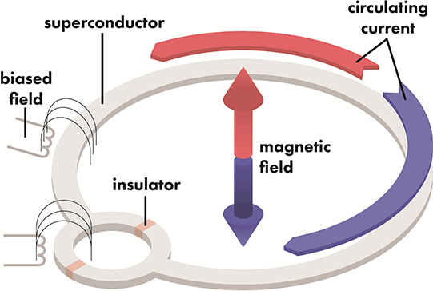
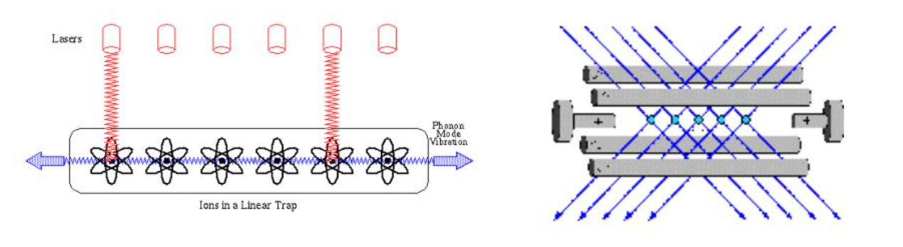
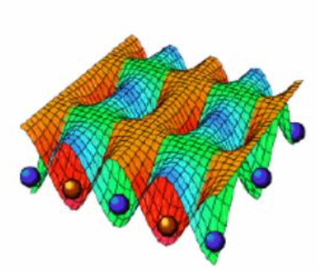
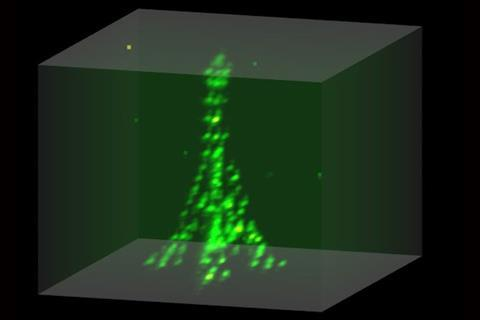

# Tecnología {.unnumbered}

Para crear una máquina capaz de ejecutar el marco matemático descrito por la computación cuántica, pueden utilizarse diferentes tecnologías.

## Chips superconductores

Los qubits superconductores se implementan usando elementos macroscópicos construidos con un circuito eléctrico LC. El efecto de un resonador eléctrico se observa a temperaturas de trabajo específicas por debajo de 15mK, lo que requiere construir refrigeradores de dilución bastante grandes. Una de las principales desventajas de esta tecnología es su susceptibilidad al ruido ambiental (fuentes siendo dieléctrico del metal circundante o radiación de energía circundante) que causan tiempos de coherencia cortos.

<figure markdown>
  
</figure>

Probablemente una de las implementaciones más maduras cuando se trata de realización de qubits. Empresas como IBM, Intel, Google o D-Wave basan sus dispositivos en esta tecnología. El qubit más popular, el transmon, ofrece tiempos de coherencia entre 50 y 100 $\mu$s con tiempos de operación en el orden de nanosegundos (demostración más rápida: 18 ns en 2019). Esto deja una razón de operación de $10^{4}$ satisfaciendo el 3er criterio de DiVincenzo. Las fidelidades de los qubits alcanzan el 99.95% con experimentos que informan un 99.66% para una puerta de dos qubits en 2016.

Funciona controlando el flujo de corriente a través del circuito superconducting y esos flujos de corriente pueden operarse usando pulsos de microondas. Diferentes configuraciones de pulsos (longitud, amplitud o fase) representan las puertas digitadas potenciales que se podrían encontrar.

La topología del circuito a menudo está limitada a acoplamiento de vecinos próximos, lo que limita la implementación de algoritmos densamente conectados.

Estos dispositivos pueden manejar hasta 433 qubits (la arquitectura Osprey de IBM) en su versión digital, pero la máquina de annealing de D-Wave tiene hasta 8000 qubits para usarse.

| Proveedor             | Máx. Qubits   |
| -------------------- |:-------------:|
| D-Wave               |   8000        |
| IBM                  |   433         |
| Rigetti              |   80          |
| OQC                  |   32          |

Para saber un poco más sobre el funcionamiento interno, diríjase a la explicación exhaustiva de Xanadu [https://pennylane.ai/qml/demos/tutorial_sc_qubits].

## iones atrapados

Inicialmente propuesto por Cirac y Zoller [@cirac1995quantum], iones están confinados en trampas que componen el ordenador cuántico.

<figure markdown>
  
</figure>

Los pares de estados electrónicos internos de los iones se implementan como los estados base del qubit $|0\rangle$ y $|1\rangle$. Pueden ser cualquier combinación de niveles de larga duración, diferenciados por la separación de sus niveles de energía. Los dos más predominantes son los niveles hiperfino, separados por frecuencias de gigahercios; y los niveles ópticos, separados por frecuencias de cientos de terahercios.

Después de que los iones sean cargados en sus trampas, los qubits están bombeados ópticamente al estado fiducial de $|1\rangle$. La metodología de operación de puertas mediante transición de estado depende del tipo de qubit iónico óptico. Para qubits ópticos, se usa un láser con una frecuencia resonante igual a la transición de estado, mientras que las operaciones de puerta sobre qubits hiperfino pueden realizarse ya sea con láseres usando acoplamiento Raman estimulado o con microondas que aborden directamente la separación de energía a gigahercios.

La lectura dependiente del estado también se lleva a cabo con láseres. Usando métodos contemporáneos, se han logrado fidelidades de lectura de más del 99.9% en microsegundos [@myerson2008high;@crain2019high].

Las trampas de iones tienen una conectividad virtually all-to-all que permite cualquier interacción entre qubits. Las desventajas pueden atribuirse a la disminución de la velocidad y fidelidad de las puertas de dos qubits a medida que aumenta el número de iones en la cadena. A medida que aumenta el tamaño de la cadena de iones, su masa aumenta así como la distancia promedio entre iones. Esto a su su vez lleva a una disminución en la fuerza de acoplamiento entre iones arbitrarios, causando una disminución en la velocidad de las puertas de dos qubits. La fidelidad disminuye debido a la mayor susceptibilidad de los modos normales usados para mediar la interacción de dos qubits a interacciones espectrales indeseadas de crosstalk, así como al calentamiento inducido por ruido en el sistema si las tomas son más largas.

Una forma de evadir este problema es dividir la larga cadena lineal en módulos más pequeños, y sigue siendo la barrera que muchos fabricantes de dispositivos en este régimen necesitan trabajar.

| Proveedor             | Máx. Qubits   |
| -------------------- |:-------------:|
| IonQ                 |   23          |
| Quantinuum           |   32          |

Más información sobre sus especificaciones actuales se puede encontrar en sus sitios o en los sitios de proveedores de nube:

* [IonQ](https://ionq.com/resources/ionq-aria-practical-performance)
* [Quantinuum](https://assets.website-files.com/62b9d45fb3f64842a96c9686/6459acc9b999bb7fb526c4bf_Quantinuum%20H2%20Product%20Data%20Sheet.pdf)

Más información detallada [gracias a Xanadu](https://pennylane.ai/qml/demos/tutorial_trapped_ions).

## Átomos neutrales

Propuesto alrededor de 2000, el concepto básico radica en usar átomos o metales alcalinos neutros como el Rubidio (Rb) atrapados en arreglos ópticos. Al enfriar los átomos en un array a temperaturas cercanas al cero absoluto usando refrigeración láser, trampas usando campos magnéticos o láseres permiten la reorganización de los átomos dentro de la red. La propia estructura del átomo representa el sistema de dos niveles que buscamos, por lo que se hace un mapeo uno a uno entre el átomo y el qubit que nos gustaría fabricar.

<figure markdown>
  
</figure>

Las operaciones de una sola puerta se logran impulsando transiciones atómicas usando haces de láser enfocados estrechamente en un solo átomo, o por microondas, para los cuales la resonancia del átomo objetivo necesita ser desplazada usando campos magnéticos o haces de láser. Las operaciones de dos qubits parecen ser un obstáculo para los qubits de átomos neutrales debido a sus interacciones débiles entre sí; sin embargo, este problema se resuelve excitando átomos a estados de Rydberg. Un átomo de Rydberg exhibe una fuerte interacción dipolar y produce un fenómeno conocido como bloqueo de Rydberg, que prohíbe que más de un átomo en un pequeño volumen esté simultáneamente excitado a un estado de Rydberg. Esto puede usarse para producir entrelazamiento entre dos átomos usando una secuencia de tres pulsos. La lectura del array de átomos neutros se Typically se hace tomando una imagen de fluorescencia al final del proceso computacional. Se realiza de tal manera que cada átomo en el estado $|0\rangle$ aparecerá brillante, mientras que los átomos en el estado $|1\rangle$ permanecen oscuros.

El arreglo de átomos en cualquier tipo de estructura 2D o incluso 3D hace que el mapeo de problemas y el acoplamiento de qubits sean lo suficientemente flexibles como para que potencialmente cualquier problema pueda caber en esos dispositivos. El problema principal radica en la realización de puertas de dos qubits con la fidelidad suficiente. Las operaciones de una sola puerta alcanzan una fidelidad del 99.9% mientras que las puertas de dos qubits han sido estudiadas extensivamente, aumentando la inicial del 80% logrado a principios de 2016 al informe del 96.5% en 2019 [@levine2019parallel]. Esto todavía es un esfuerzo que limita la operatividad y la universalidad de codificar, ya que la mayoría de las plataformas requieren algún tipo de codificación analógica en abstracción lógica que otros pueden proporcionar.

<figure markdown>
  
</figure>

Los tiempos de coherencia de los qubits están en el orden de segundos, con un régimen de operación de microsegundos (aprox. razón $10^7$). También tienen la capacidad de operar simultáneamente en diferentes clusters de átomos, habilitando operación superpuesta a diferencia de las trampas de iones.

| Proveedor             | Máx. Qubits   |
| -------------------- |:-------------:|
| Pasqal               |  ~300         |
| QuEra                |   256         |

Algunas especificaciones de ambos proveedores de hardware:

* [Pasqal](https://www.pasqal.com/hardware)
* [QuEra](https://www.quera.com/aquila)

Una visión fácil de leer y detallada de esta tecnología, otra vez [gracias a Xanadu](https://pennylane.ai/qml/demos/tutorial_neutral_atoms).