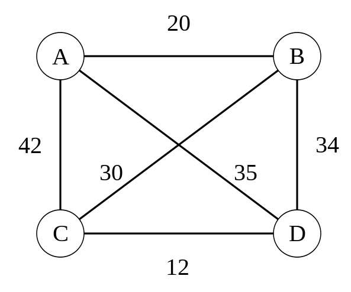

## Problema del viajante

[Ya vimos](../algorithms/quboformulations.qmd#problema-del-viajante-tsp) cómo implementar una versión simple del problema TSP.

<center>
    
</center>

Vamos a comprobar una versión simplificada de este problema con solo tres nodos.

```{python}
import networkx as nx

G = nx.DiGraph()
G.add_weighted_edges_from({
    ("A", "B", 2), ("A", "C", 4.2), ("B", "A", 2),
    ("B", "C", 3), ("C", "A", 4.2),("C", "B", 3)
})

nx.draw(G)
```

Así que nuestro QUBO final se representará como...

```{python}
from collections import defaultdict

lagrange = 12

# Creating the QUBO
Q = defaultdict(float)

# number of steps
N = G.number_of_nodes()

# Objective that minimizes distance
for u, v in G.edges:
    for pos in range(N):
        nextpos = (pos + 1) % N

        # going from u -> v
        try:
            value = G[u][v]["weight"]
        except KeyError:
            value = lagrange # Non existent route cost

        Q[((u, pos), (v, nextpos))] += value

        # going from v -> u
        try:
            value = G[v][u]["weight"]
        except KeyError:
            value = lagrange # Non existent route cost

        Q[((v, pos), (u, nextpos))] += value

# Constraint that each row has exactly one 1
for node in G:
    for pos_1 in range(N):
        Q[((node, pos_1), (node, pos_1))] -= lagrange
        for pos_2 in range(pos_1+1, N): # Next positions
            Q[((node, pos_1), (node, pos_2))] += lagrange

# Constraint that each col has exactly one 1
for pos in range(N):
    for node_1 in G:
        Q[((node_1, pos), (node_1, pos))] -= lagrange
        for node_2 in set(G)-{node_1}:
            Q[((node_1, pos), (node_2, pos))] += lagrange # Cost of being in more than one place
```

## Solver exacto

No siempre está disponible, particularmente si aumentamos el número de nodos, pasos temporales y personas viajeras, pero es una buena manera de comprobar qué tan buenos son nuestros algoritmos propuestos para resolverlo.

```{python}
import dimod

sampler = dimod.ExactSolver()

response = sampler.sample_qubo(Q)
print(response.slice(0, 15))
```

```{python}
route = response.first.sample

cycle = [None]*(N+1)
for key in route:
    if route[key] == 1:
        cycle[key[1]] = key[0]
cycle[-1] = cycle[0]

cost = sum(G[n][nbr]["weight"] for n, nbr in nx.utils.pairwise(cycle))
print(f"Cost for route {cycle} is {cost}")
```

## Simulated annealing

```{python}
from networkx.algorithms import approximation as approx

cycle = approx.simulated_annealing_tsp(G, "greedy", source="A")
cost = sum(G[n][nbr]["weight"] for n, nbr in nx.utils.pairwise(cycle))
print(f"Cost for route {cycle} is {cost}")
```

## Quantum Annealing

Para un ejemplo adecuado de recocido cuántico necesitaríamos usar un dispositivo como los del [apéndice B](../appendix/hybridsolvers.qmd). Podemos hacer una simplificación simulándolo localmente... Primero, es necesaria una conversión a coeficientes de Ising. Dimod ofrece muchas [funciones convenientes](https://test-projecttemplate-dimod.readthedocs.io/en/latest/index.html) para convertir entre representaciones análogas.

```py
from quantagonia import HybridSolver, HybridSolverParameters
from quantagonia.qubo import QuboModel

# Qubo to Binary Quadratic Problem
bqm = dimod.BinaryQuadraticModel.from_qubo(Q)

# read bqm file into QuboModel
qubo = QuboModel.from_dwave_bqm(bqm)

# solve QUBO with Quantagonia's solver
API_KEY = os.environ["QUANTAGONIA_API_KEY"]
params = HybridSolverParameters()
hybrid_solver = HybridSolver(API_KEY)
qubo.solve(hybrid_solver, params)
```

Ising se usa comúnmente para enfoques puramente cuánticos.

```{python}
bqm = dimod.BinaryQuadraticModel.from_qubo(Q)
h, J, offset = bqm.to_ising()
```

Si seguimos las instrucciones en la [documentación de Quantagonia](https://docs.quantagonia.com/examples.html) podemos ver que ofrece una integración fluida con Qiskit y las librerías de modelado de D-Wave. También podríamos obtener los datos puros de los diccionarios con variables con nombre para que resulte más fácil manejarlos usando índices para los qubits.

```{python}
# Get the variable names
indexes = list(h.keys())

hp = []
jp = {}
for i in range(len(h)):
    name_i = indexes[i]
    hp += [h[name_i]]
    for j in range(len(h)):
        name_j = indexes[j]
        if (name_i,name_j) in J:
            jp[(i,j)] = J[(name_i,name_j)]
```

Para este problema sencillo podríamos optar por una simulación local implementando la evolución canónica [descrita antes](../algorithms/aqc.html). El problema podría ser gestionar el tamaño del problema, que da lugar a una matriz $2^N \times 2^N$.

```{python}
import numpy as np

# Pauli matrices
sigma_x = np.array([[0, 1], [1, 0]], dtype=complex)
sigma_z = np.array([[1, 0], [0, -1]], dtype=complex)
I = np.eye(2, dtype=complex)

def kron_product(matrices):
    """Compute Kronecker product of a list of matrices."""
    result = matrices[0]
    for mat in matrices[1:]:
        result = np.kron(result, mat)
    return result

def transverse_field(N, h=1.0):
    """
    Construct the transverse field term: -h * sum_i sigma^x_i
    """
    dim = 2**N
    H_x = np.zeros((dim, dim), dtype=complex)
    
    for i in range(N):
        # Build sigma^x_i = I ⊗ ... ⊗ sigma_x (at position i) ⊗ ... ⊗ I
        ops = [I] * N
        ops[i] = sigma_x
        H_x += kron_product(ops)
    
    return -h * H_x

def problem_hamiltonian(N, h_array, J_matrix):
    """
    Construct the problem hZ + JZZ
    """
    dim = 2**N
    H = np.zeros((dim, dim), dtype=complex)

    for i in range(N):
        # Build sigma^x_i = I ⊗ ... ⊗ sigma_x (at position i) ⊗ ... ⊗ I
        ops = [I] * N
        ops[i] = sigma_z
        H += h_array[i] * kron_product(ops)
    
    for keys in J_matrix:
        # Build sigma^z_i sigma^z_j
        ops = [I] * N
        ops[keys[0]] = sigma_z
        ops[keys[1]] = sigma_z
        H += J_matrix[keys] * kron_product(ops)
    
    return H

size = len(h)
H_init = transverse_field(size)
H_problem = problem_hamiltonian(size, hp, jp)
```

Podemos comprobar si la solución de nuestro problema coincide con la esperada.

```{python}
import numpy as np
from math import sqrt
from numpy.linalg import eig

def get_gs(h_mat):
    """ Computes the ground state """
    evals, evecs = eig(h_mat)
    sort_index = np.argsort(evals)

    stat_gs = evecs[:, sort_index[0]]
    gs_val = evals[sort_index[0]]
    
    num = 1
    for idx in sort_index[1:]:
        if evals[idx] == gs_val:
            stat_gs += evecs[:, idx]
            num += 1
        else:
            break

    return np.dot((1/sqrt(num)), stat_gs)

r = np.nonzero(get_gs(H_problem))[0]
print(f"Potential solutions {r}")
```

Necesitaríamos extraer la representación binaria de este entero para entender las variables seleccionadas para nuestra solución, pero tener seis valores representaría un estado base degenerado con seis soluciones óptimas. Podríamos entonces realizar la evolución del estado como lo hicimos antes para obtener ese estado desde un estado inicial y ver qué velocidad de mezcla de hamiltonianos funciona mejor.

```{python}
#| echo: false
import warnings
warnings.filterwarnings("ignore")
```

```{python}
import matplotlib.pyplot as plt

def get_eigenspectra(h_mat):
    """
    Computes the eigenspectra
    """
    evals, evecs = eig(h_mat)
    sort_index = np.argsort(evals)

    return evals [sort_index], evecs[:, sort_index]

e0 = []
e1 = []
time_range = np.arange(0.0, 1.0, 0.1)

for lambda_t in time_range:

    H = (1-lambda_t)*H_init + lambda_t*H_problem

    vals, stats = get_eigenspectra(H)
    e0.append(vals[0])
    e1.append(vals[1])

plt.plot(time_range, e0, label="$E_0$")
plt.plot(time_range, e1, label="$E_1$")
plt.legend(loc="upper left")
plt.show()
```

Parece que estamos trabajando con un gap muy pequeño en esta configuración, lo que no es una buena opción si quisiéramos usar computación adiabática como [vimos antes](../algorithms/adiabatic.md). Podríamos, por supuesto, una vez que disponemos de un procedimiento mecánico-cuántico, implementarlo usando un [enfoque digitalizado](../algorithms/examplesfordaqc.qmd).

```{python}
from qiskit import QuantumCircuit

initial_state = QuantumCircuit(size)

# Hadamard gate
for qb_i in initial_state.qubits:
    initial_state.h(qb_i)
initial_state.draw('mpl')
```

```{python}
from qiskit.circuit import Parameter

# Create a parameter to instantiate
beta = Parameter("$\\beta$")

mixer = QuantumCircuit(size,size)
for i in range(size):
    mixer.rx(2*beta*(-1), i)
    
mixer.draw('mpl')
```

```{python}
from qiskit.circuit import Parameter

# Create a parameter to instantiate
gamma = Parameter("$\\gamma$")

problem = QuantumCircuit(size,size)

for node, h_val in enumerate(hp):
    problem.rz(2*gamma*h_val, node)

for key in jp:
    problem.rzz(2*gamma*jp[key], key[0], key[1])

problem.draw('mpl', fold=-1)
```

Con estos tres bloques solo necesitamos definir cómo vamos a digitalizar la evolución hacia la solución de nuestro problema.

```{python}
tsp_circ = QuantumCircuit(size,size)
tsp_circ.compose(initial_state, inplace=True)

# Length of the equidistant steps
dt = 0.1

for lt in np.arange(0.1, 1.1, dt):
    tsp_circ.compose(problem.assign_parameters({gamma: lt}), inplace=True)
    tsp_circ.compose(mixer.assign_parameters({beta: (1-lt)}), inplace=True)
tsp_circ.measure(range(size), range(size))

tsp_circ.draw('mpl', fold=500)
```

Cada vez es más difícil de ver. Podemos comprobar la respuesta final de esa evolución, pero también algunas características interesantes como la profundidad del circuito o el número de operaciones, que serán relevantes al intentar cuantificar la precisión de nuestra simulación asociada al ruido/error de un dispositivo dado.

```{python}
tsp_circ.depth()
```

```{python}
tsp_circ.num_nonlocal_gates()
```

Simulemos la distribución...

```{python}
from qiskit_aer import AerSimulator
from qiskit.visualization import plot_histogram

# execute the quantum circuit
backend = AerSimulator()

# execute the quantum circuit
result = backend.run(tsp_circ, shots=10_000).result()
counts  = result.get_counts(tsp_circ)

plot_histogram(counts)
```

Y su perfil de energía...

```{python}
energy = []
success_probability = [] 

for bit_string in counts:
    solution = [int(char) for char in bit_string]
    solution_dict = {}
    for i, v in enumerate(indexes):
        solution_dict[v] = solution[i]
    energy.append(bqm.energy(solution_dict))
    success_probability.append(counts[bit_string]/10_000)

plt.bar(energy, height=success_probability, label="Digitized AQC")
plt.show()
```

Podemos mejorar esto claramente hacia una versión sesgada a la izquierda, pero necesitaríamos encontrar la planificación adecuada para ello.