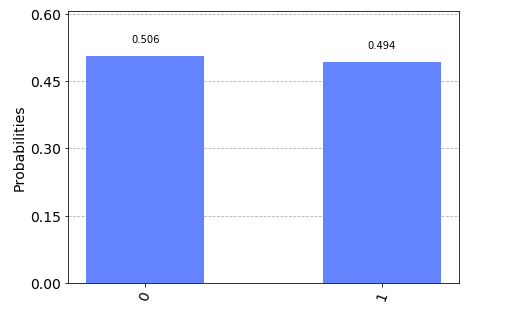
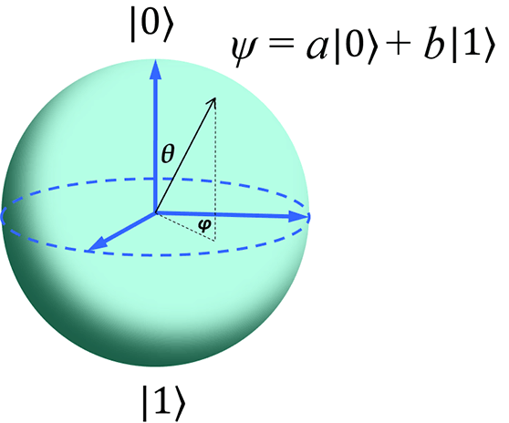

# Conceptos básicos {.unnumbered}

El concepto principal que aprovechan los ordenadores cuánticos es la capacidad de actuar sobre estados cuánticos. Un estado cuántico no es otra cosa que la descripción matemática de la distribución de probabilidad del posible resultado tras realizar una medición sobre un sistema. Suena complicado, pero es más sencillo de lo que parece, ten paciencia conmigo.

## Cúbits y estados

Un ordenador cuántico es un dispositivo capaz de manipular estados cuánticos de una manera determinada. Un estado cuántico es como la descripción completa de todo lo que se puede saber sobre un sistema físico diminuto, una partícula como un electrón o un fotón, en un momento dado. Piénsalo así: imagina una moneda girando en el aire. Mientras gira, no puedes decir que sea definitivamente cara o cruz, está en un estado de ser «ambas» hasta que cae. Un estado cuántico es algo parecido, pero para partículas inimaginablemente pequeñas.

Estos estados se representan como un vector normalizado (un vector de _longitud_ 1), porque la probabilidad de los resultados debe sumar uno, es decir, la certeza. Probemos con el más básico, un sistema de un único estado unitario. La versión cuántica de una moneda tiene este aspecto:

$$
|\phi\rangle = \left[
\begin{array}{c}
\alpha \\
\beta
\end{array}
\right]
$$

siendo esta la representación mínima de un estado cuántico: un vector de norma unitaria $\in \mathbb{C}^2$ cuya realización física se conoce como **cúbit**. Los cúbits no existen (como los bits, de hecho), esos conceptos son construcciones puramente matemáticas con un significado concreto. En nuestro caso, la unidad mínima que podemos manipular en el ordenador cuántico.

Representa los dos extremos en los que puede estar el sistema y sus **amplitudes de probabilidad**. Significa que observaremos uno u otro si medimos el sistema, y que esas probabilidades deben sumar uno. Su fórmula es $|\alpha|^2+|\beta|^2 = 1$ y representa la certeza de que el sistema existe en una de esas opciones.

Este estado puede descomponerse en componentes básicos, los dos casos extremos mencionados antes o, en términos matemáticos, **estados de la base**. Esto es importante porque, en lo que respecta a los ordenadores cuánticos, nuestra unidad mínima se expresará en su base computacional:
$$
|0\rangle = \left[
\begin{array}{c}
1 \\
0
\end{array}
\right]
\quad
|1\rangle = \left[
\begin{array}{c}
0 \\
1
\end{array}
\right]
$$

Usamos esta [notación de Dirac](https://en.wikipedia.org/wiki/Bra%E2%80%93ket_notation) simplificada solo para escribir menos, porque si no ocuparíamos buena parte del espacio escribiendo vectores y matrices. Tiene su gracia, porque esos dos vectores columna se traducirán a los ya conocidos bits 0 y 1 cuando leamos el estado desde un ordenador clásico. Los ordenadores clásicos solo trabajan con *bits*, así que hagamos lo que hagamos a nivel cuántico, todo se reducirá después a un conjunto de unos y ceros. Pero de eso nos ocuparemos más adelante, cuando hablemos de las [mediciones](#medicion).

Así, el estado anterior puede describirse en nuestra unidad de cúbit como:

$$
|\phi\rangle =
\alpha |0\rangle + 
\beta |1\rangle = \left[
\begin{array}{c}
\alpha \\
\beta
\end{array}
\right],
$$

es decir, los posibles resultados de nuestro estado cuántico son $|0\rangle$ con probabilidad $|\alpha|^2$ y $|1\rangle$ con probabilidad $|\beta|^2$. ¿Cómo sabemos el resultado real de nuestro estado? Pues necesitamos [medirlo](#medicion). Eso se hace proyectando nuestro estado sobre uno de esos estados de la base, así que se usa el conjugado complejo de los vectores anteriores para saber qué probabilidad tiene cada opción.

$$
\langle 0 | = \left[
\begin{array}{cc}
1 & 0
\end{array}
\right]
\quad
\langle 1 | = \left[
\begin{array}{cc}
0 & 1
\end{array}
\right]
$$

Al proyectar nuestro estado en esos vectores de la base obtendríamos:

$$
|\langle 0 |\psi\rangle|^2 = \left|\left[
\begin{array}{cc}
1 & 0
\end{array}
\right]\left[
\begin{array}{c}
\alpha \\
\beta
\end{array}
\right]\right|^2 = |\alpha|^2
$$

Así que en realidad no evaluamos el estado, sino que usamos un vector de la base para ver «cuánto se acerca» nuestro estado a esa opción que forma parte de los estados de la base que estamos considerando.

Y aquí encontramos una de las primeras cosas extrañas de los *cúbits* en comparación con los *bits*. Siendo 0 y 1 los estados básicos de un bit, su realización física solo puede estar en uno de esos estados, mientras que los cúbits pueden estar _parcialmente_ en más de un estado, creando una **superposición** de estados.

## Superposición

Esta es una de las cosas que más cuesta entender al acercarse por primera vez a la computación cuántica, porque no resulta tan intuitiva desde nuestra perspectiva macroscópica. Además se suele malinterpretar, así que trataremos de dejarla clara. Este es un ejemplo de estado superpuesto

$$
|\phi\rangle =
\alpha |0\rangle + 
\beta |1\rangle.
$$

El estado está en superposición, es decir, es una moneda girando en el aire y no sabemos qué estado mostrará cuando la paremos para mirarla. Nuestra capacidad de percibirlo está limitada por el propio procedimiento de medición, que además altera el estado del sistema (detiene el giro de la moneda), pero mientras gira se encuentra en un conjunto de probabilidades que no está atado por completo a una opción concreta (cara o cruz).

Necesitamos proyectar nuestro estado cuántico en uno de los dos posibles estados que podemos obtener ($|0\rangle$ o $|1\rangle$). Por desgracia, al medir solo se pueden obtener bits clásicos (0 o 1) en nuestras máquinas convencionales (como el portátil o el teléfono que estás usando ahora mismo), así que nada de amplitud de probabilidad, nada de fase... la información cuántica se pierde en el proceso de medición y acabamos con información clásica (aburrida).

Para entender del todo el estado mientras gira, lanzamos la moneda varias veces y comprobamos cada vez qué estado obtenemos. Con eso dibujamos el resultado de las probabilidades en una gráfica. El _histograma de probabilidades_ se crea tras una secuencia de creaciones y mediciones del estado cuántico que solemos llamar **SHOTS**. Con eso nos hacemos una idea de cómo es la moneda _mientras gira_.

<figure markdown>

</figure>

En una serie de mediciones hemos visto el estado $|0\rangle$ un 50,6 % de las veces y el estado $|1\rangle$ un 49,4 %. Desde luego, a mí me parece superpuesto. Es difícil de ver desde donde estamos, pero un estado cuántico guarda mucha más información que esta simple elección binaria. De hecho, tanto $\alpha$ como $\beta$ son números complejos, y por eso la _esfera de Bloch_ ofrece una expresión más detallada del estado de un cúbit. Por desgracia para nosotros, esto es algo que nunca percibiremos desde un dispositivo real, pero ayuda mucho mientras construimos el formalismo o creamos algoritmos en nuestra cabeza.

Todos los estados posibles formarán parte de la superficie de esa esfera, ese es el potencial de un único cúbit. Nada mal.

<figure markdown>
{ width=60% }
</figure>

Los estados cuánticos pueden expresarse también considerando las coordenadas polares:

$$
|\phi\rangle = \cos (\theta/2) |0\rangle + e^{i\phi} \sin (\theta/2)|1\rangle
$$

que representan las coordenadas de la esfera sobre la superficie de la _esfera de Bloch_. En este caso se ve más claro que representar simples bits eliminará en realidad la mayor parte de la información (como la fase) contenida en los estados cuando operamos con ellos en el régimen cuántico.

## Medición {#medicion}

Medir los estados cuánticos es condición necesaria para extraer información de ellos, pero al hacerlo afectamos al sistema por el colapso de la función de onda. Lo sé, demasiado técnico.

Vale, cuando observamos un estado cuántico solo podemos ver uno de los posibles resultados, el que observamos en realidad. Y esto afecta al sistema, es decir, cuando lo miramos colapsa al estado que hemos observado y deja de existir como distribución de probabilidad para pasar a ser una certeza.

La acción que usamos para observar el estado cuántico se realiza mediante **observables** (operadores autoadjuntos). Se usan para proyectar la medición de un estado cuántico dado en uno de sus _valores propios_. Usando la cercanía entre el estado cuántico y los vectores propios del observable podemos medir cuánto se solapan. Los vectores propios del observable forman una base ortonormal del espacio de Hilbert, así que cada medida corresponde a una proyección en los vectores propios que componen la base. Lo sé, esto es un poco demasiado técnico, pero piensa en el observable como unas gafas tintadas: si las gafas tienen un color verdoso, todo se verá de algún tipo de verde, verde oscuro para lo negro o verde claro para lo blanco. Es algo así. Algo así.

Veremos que un observable habitual es la matriz de Pauli $\sigma_z$

$$
\sigma_z = \left[
\begin{array}{cc}
1 & 0 \\
0 & -1
\end{array}
\right]
$$

Podemos descomponerla en sus vectores y valores propios, de modo que

$$
\sigma_z|0\rangle = 1|0\rangle \rightarrow \sigma_z|1\rangle = -1|1\rangle.
$$

Por tanto, cualquier medición posible se proyectará en uno de esos dos vectores propios y su valor propio se usará como resultado de la medición. El conjunto de la base mostrado arriba se conoce a menudo como **base computacional** y será importante cuando pasemos a implementaciones reales, donde vendrá fijada por el propio dispositivo.

Tomemos nuestro estado anterior $|\phi\rangle = \alpha |0\rangle + \beta |1\rangle$ y hagamos una medición en la base computacional ($|0\rangle,|1\rangle$), donde evidentemente el resultado sería $|0\rangle$ con probabilidad $|\alpha|^2$ o $|1\rangle$ con probabilidad $|\beta|^2$. Pero lo más importante es que una única medición, por complejo, entrelazado o superpuesto que esté nuestro estado, solo podrá recuperar bits clásicos que corresponden a los dos estados vistos antes ($|0\rangle \rightarrow 0$ y $|1\rangle \rightarrow 1$).

¿Qué pasa después de realizar la medición? Pues esa es la parte más delicada, porque el proceso de medir obliga a nuestro estado cuántico a posicionarse y tomar una decisión. Eso significa que tras la medición nuestro estado cuántico ya no estará en superposición y será el resultado de la medición anterior, $|0\rangle$, durante el tiempo restante.

Para captar del todo la estadística del estado deberíamos encontrar la manera de reproducirlo y realizar suficientes mediciones, de modo que podamos caracterizar su estado real tanto como sea posible a partir de la estadística de medición que presenta. Medir en la base $\{|0\rangle, |1\rangle\}$ (también llamada base computacional) puede no bastar para captar el estado real. Por tanto hace falta un cambio de base, pero ya veremos que los dispositivos cuánticos solo ofrecen la base computacional como base de medición. Eso significa que en ciertos casos necesitaremos rotar nuestros cúbits para que el cambio de base se haga de forma artificial.

Si quisiéramos medir en la base $\{|+\rangle, |-\rangle\}$ haría falta una rotación de $-\pi / 2$ en el eje Y. La base $\{|i\rangle, |-i\rangle\}$ requerirá entonces una rotación sobre el eje X de $\pi / 2$. Así conseguimos desplazar el punto de referencia y medir según el eje que nos interesa.

Lo siguiente es operar sobre esas cosas, a ver en qué se diferencian las puertas de lo que conocemos de la computación clásica.