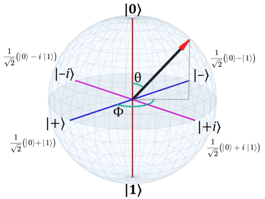
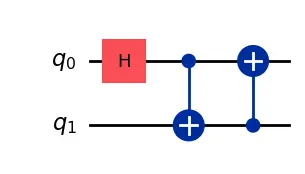
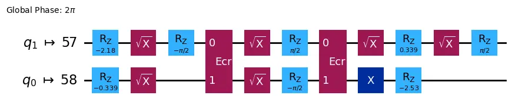

# Puertas cuánticas {.unnumbered}

Ahora que sabemos qué aspecto pueden tener nuestros estados

$$
|\phi\rangle = \left[
\begin{array}{c}
\alpha \\
\beta
\end{array}
\right]
$$

vendría bien entender cómo podemos operar sobre ellos. Los ordenadores cuánticos, como los clásicos, usan puertas lógicas para hacer su trabajo. En este caso, las puertas son operaciones que toman nuestro estado inicial y lo convierten en otro estado cuántico distinto. El régimen clásico es pobre en este sentido, porque los únicos cambios permitidos son entre 0 y 1, pero los estados cuánticos y los cúbits permiten representar mucha más información. Eso hace que las puertas lógicas cuánticas sean también más complejas y ricas.

$$
U|\psi\rangle \rightarrow |\phi\rangle
$$

Pero en este caso, estas puertas son propias del régimen cuántico. Encontraremos algunas similitudes, como en el caso de la puerta not, y algunos casos particulares como la puerta de Hadamard.

Una puerta cuántica es un marco para describir el proceso cuántico que lleva un estado cuántico en el tiempo $t$ al estado en el tiempo $t+1$. Para un sistema cuántico cerrado, el operador que describe la evolución del sistema puede describirse con $e^{-i\int H dt/\hbar}$, que es un operador unitario basado en el hamiltoniano que describe la dinámica del sistema. ¿Qué es un hamiltoniano, preguntas? Pues puede que este vídeo te interese:



Ten en cuenta solo que, si ignoramos la fase global del estado cuántico, podemos suponer que todas las puertas cuánticas son operaciones unitarias especiales, es decir, que su determinante es 1. Esto es para que el estado obtenido caiga en la superficie de la esfera de Bloch (si no, entraríamos en un terreno mucho más complejo).

::: {.callout-tip}
Postulado de la evolución temporal
----------------------------------

Un estado puro $|\psi(t_0)\rangle$ en un espacio de Hilbert $\mathcal{H}$ puede evolucionar a otro estado $|\psi(t)\rangle$ según el operador de evolución temporal $U(t,t_0)$

$$
|\psi(t)\rangle = U(t,t_0)|\psi(t_0)\rangle
$$

donde $U(t,t_0)$ es la transformación unitaria sobre el estado inicial de un sistema cerrado (con el caso especial $U(t_0,t_0)=I$). La evolución temporal la gobierna la ecuación de Schrödinger, sí, la del gato,

$$
i\frac{d}{dt}|\psi(t)\rangle = \hat{H}|\psi(t)\rangle \rightarrow |\psi(t)\rangle = e^{-i\hat{H}t}|\psi(0)\rangle 
$$

aquí $\hat{H}$ es un operador autoadjunto también conocido como hamiltoniano. $\hat{H}$ es un observable asociado a la energía del sistema y gobierna la dinámica de un estado dado, relacionándose con el $U$ mencionado antes como $U(t) = e^{-(i/\hbar)t\hat{H}}$ siguiendo el teorema de Stone.
:::

## La sala de las puertas

Como en la computación clásica, hay algunas puertas clave que hay que conocer. Siendo $NAND$ una puerta universal de la lógica booleana, porque puede crear todas las demás opciones necesarias para representar la lógica booleana, deberíamos presentar algunas de las puertas fundamentales al hablar de computación cuántica y de la universalidad de esas puertas.

### Puerta NOT (X)

La puerta not ($X$ como puerta operadora y $\sigma_x$ si se expresa como matriz de Pauli) es uno de los conceptos más básicos de la computación. Una operación clásica que lleva el bit de una posición (0 o 1) a su opuesto. Pero el _not cuántico_ extiende ese concepto básico a la complejidad del régimen cuántico. El operador puede representarse con una matriz como la siguiente:

$$
X = \left[
\begin{array}{cc}
0 & 1 \\
1 & 0
\end{array}
\right]
$$

Entonces, la operación $X|0\rangle = |1\rangle$ puede comprobarse con la simple multiplicación de la matriz de la puerta por el estado cuántico:

$$
X|0\rangle = \left[
\begin{array}{cc}
0 & 1 \\
1 & 0
\end{array}
\right]\left[
\begin{array}{c}
1 \\
0
\end{array}
\right] = \left[
\begin{array}{c}
0 \\
1
\end{array}
\right] = |1\rangle
$$

Pero si hacemos este ejemplo tan sencillo con el caso genérico de $|\psi\rangle$

$$
X|\psi\rangle = X(\alpha|0\rangle + \beta |1\rangle) = \left[
\begin{array}{cc}
0 & 1 \\
1 & 0
\end{array}
\right]\left[
\begin{array}{c}
\alpha \\
\beta
\end{array}
\right] = \left[
\begin{array}{c}
\beta \\
\alpha
\end{array}
\right] = \beta|0\rangle + \alpha |1\rangle = |\phi\rangle
$$

básicamente hemos creado un nuevo estado cuyas probabilidades de resultado se han desplazado. Por tanto, la operación $X$ puede usarse para desplazar el estado en lugar de hacer un mero lanzamiento de moneda. Esto se pone más interesante si miramos algunas puertas concretas, como la puerta de Hadamard.

### Hadamard (H)

Su representación matricial es

$$
H = \frac{1}{\sqrt{2}}\left[
\begin{array}{cc}
1 & 1 \\
1 & -1
\end{array}
\right]
$$

Y su efecto...

$$
H|0\rangle = \frac{1}{\sqrt{2}}\left[
\begin{array}{cc}
1 & 1 \\
1 & -1
\end{array}
\right]\left[
\begin{array}{c}
1 \\
0
\end{array}
\right] = \frac{1}{\sqrt{2}}\left[
\begin{array}{c}
1 \\
1
\end{array}
\right] = \frac{1}{\sqrt{2}}|0\rangle + \frac{1}{\sqrt{2}}|1\rangle = |+\rangle
$$

básicamente nos permite cambiar el eje de la esfera de Bloch y trabajar sobre la superposición de los estados en el eje $Z$.

<figure markdown>

</figure>

## Rotar estados cuánticos

En esencia, veremos que lo que nos ofrecen muchas puertas son simplemente rotaciones sobre los tres ejes principales de la esfera de Bloch:

$$
R_x(\theta) = \left( 
    \begin{array}{cc}
        \cos(\frac{\theta}{2}) & -i\sin(\frac{\theta}{2}) \\
        -i\sin(\frac{\theta}{2}) & \cos(\frac{\theta}{2})
    \end{array} 
    \right)
$$

$$
R_y(\theta) = \left( 
    \begin{array}{cc}
        \cos(\frac{\theta}{2}) & -\sin(\frac{\theta}{2}) \\
        \sin(\frac{\theta}{2}) & \cos(\frac{\theta}{2})
    \end{array} 
    \right)
$$

$$
R_z(\theta) = \left( 
    \begin{array}{cc}
        e^{-i\frac{\theta}{2}} & 0 \\
        0 & e^{i\frac{\theta}{2}}
    \end{array} 
    \right)
$$

quedando el caso general $R_M(\theta) = \exp^{(−i\theta M/2)}$, donde $M \in \{X,Y,Z\}$, siendo esas tres las matrices de Pauli $\sigma_x, \sigma_y \text{ y } \sigma_z$. En realidad la literatura cita un caso más genérico, dado por el siguiente operador de puerta

$$
U(\theta, \phi, \lambda) = \left( \begin{array}{cc}
        \cos(\frac{\theta}{2}) & -e^{i\lambda}\sin(\frac{\theta}{2})\\
        e^{i\phi}\sin(\frac{\theta}{2}) & e^{i(\phi+\lambda)}\cos(\frac{\theta}{2})
    \end{array} \right)
$$

que se corresponde con las puertas anteriores según la relación $U(\theta,0,0) = R_y(\theta)$, $U(0,0,\lambda) = R_z(\lambda)$ y $U(\theta,-\frac{\pi}{2},\frac{\pi}{2}) = R_x(\theta)$

## Puertas nativas

La computación cuántica es un marco matemático que permite diseñar todo tipo de puertas, pero en muchos casos el conjunto de puertas que podemos usar puede variar según el _fabricante_ del dispositivo. Tendremos que encontrar la combinación de puertas que produzca la acción que buscamos usando las puertas con las que venga equipado cada dispositivo. También se llaman puertas _nativas_.

El conjunto de puertas nativas es el conjunto de puertas, de uno y dos cúbits, que debe usarse para traducir cualquier operador o acción teórica del marco matemático a una acción física realizable, descomponiendo la acción original en distintas operaciones o, mejor dicho, _transpilando_ el circuito.

::: {.callout-caution collapse="true"}
## No te lo vas a creer, pero...

En realidad, dos de las puertas más básicas, la de Hadamard y la CNOT, no existen. Siempre necesitamos encontrar traducciones de esas operaciones fundamentales cuando trabajamos con hardware.
:::

Nuestro circuito:
<figure markdown>

</figure>
$H$ representa la puerta de Hadamard y las otras dos azules, la puerta _Control-NOT_, como base para generar estados entrelazados.

Ningún dispositivo puede implementarlo de forma nativa, al menos que sepamos. Por tanto, para aplicar esa puerta hay que aplicar puertas _nativas_ que produzcan la misma acción o matriz unitaria.

Esto es lo que puede ejecutarse en dispositivos de IBM una vez lo convertimos
<figure markdown>

</figure>

Veremos esto con más detalle más adelante, cuando repasemos los [proveedores de hardware](https://iraitzm.github.io/qc-handbook/parts/computers/serviceproviders.html) y [su implementación real](https://iraitzm.github.io/qc-handbook/parts/computers/challenges.html#native-gates).

# Sistemas multícubit

Hemos visto qué aspecto puede tener el estado cuántico de un único cúbit y cómo operar sobre él usando puertas cuánticas. Ahora, ampliemos el sistema añadiendo más cúbits. La composición de un sistema cuántico de más de un cúbit producirá un estado cuántico que se obtiene tras realizar el *producto tensorial*, o [producto de Kronecker](https://en.wikipedia.org/wiki/Kronecker_product), de sus unidades.

$$
|0\rangle \otimes |0\rangle = \left[
\begin{array}{c}
1 \\
0
\end{array}
\right] \otimes \left[
\begin{array}{c}
1 \\
0
\end{array}
\right] = \left[
\begin{array}{c}
1 \times \left[
\begin{array}{c}
1 \\
0
\end{array}
\right] \\
0 \times \left[
\begin{array}{c}
1 \\
0
\end{array}
\right]
\end{array}
\right] = \left[
\begin{array}{c}
1 \\
0 \\
0 \\
0 
\end{array}
\right] = |00\rangle
$$

Por tanto, para operar con esos sistemas nuestras puertas también tendrán que crecer. La matriz identidad ($I$) será nuestra aliada para poder componer puertas que operen en el mismo régimen del sistema cuántico.

$$
I \otimes X = \left[
\begin{array}{c}
1 & 0\\
0 & 1
\end{array}
\right] \otimes \left[
\begin{array}{c}
0 & 1\\
1 & 0
\end{array}
\right] = \left[
\begin{array}{cc}
1 \times \left[\begin{array}{c}
0 & 1\\
1 & 0
\end{array}\right] &
0 \times \left[\begin{array}{c}
0 & 1\\
1 & 0
\end{array}\right] \\
0 \times \left[\begin{array}{c}
0 & 1\\
1 & 0
\end{array}\right] &
1 \times \left[\begin{array}{c}
0 & 1\\
1 & 0
\end{array}\right]
\end{array}
\right] = \left[
\begin{array}{cccc}
0 & 1 & 0 & 0 \\
1 & 0 & 0 & 0 \\
0 & 0 & 0 & 1 \\
0 & 0 & 1 & 0 \\
\end{array}
\right]
$$

Ahora solo tendríamos que crear el producto entre el estado cuántico y la operación para entender su efecto.

$$
(I \otimes X)|00\rangle = \left[
\begin{array}{cccc}
0 & 1 & 0 & 0 \\
1 & 0 & 0 & 0 \\
0 & 0 & 0 & 1 \\
0 & 0 & 1 & 0 \\
\end{array}
\right]\left[
\begin{array}{c}
1 \\
0 \\
0 \\
0 
\end{array}
\right] = \left[
\begin{array}{c}
0 \\
1 \\
0 \\
0 
\end{array}
\right] = |01\rangle
$$

## Control-NOT (CNOT)

Una puerta interesante de implementar en este régimen es la puerta _Control-NOT_ o CNOT. Esta actúa sobre el cúbit objetivo solo si el primer cúbit está en el estado $|1\rangle$. No requiere ninguna medición u observación clásica, lo que significa que el cúbit de control sigue conservando su caracter cuántico tras la operación de la puerta. Esto es crítico para el buen funcionamiento del sistema, porque cualquier acción clásica afectaría al estado cuántico volviéndolo puramente clásico.

$$
CNOT|00\rangle = \left[
\begin{array}{cccc}
1 & 0 & 0 & 0 \\
0 & 1 & 0 & 0 \\
0 & 0 & 0 & 1 \\
0 & 0 & 1 & 0 \\
\end{array}
\right]\left[
\begin{array}{c}
1 \\
0 \\
0 \\
0 
\end{array}
\right] = \left[
\begin{array}{c}
1 \\
0 \\
0 \\
0 
\end{array}
\right] = |00\rangle
$$

$$
CNOT|10\rangle = \left[
\begin{array}{cccc}
1 & 0 & 0 & 0 \\
0 & 1 & 0 & 0 \\
0 & 0 & 0 & 1 \\
0 & 0 & 1 & 0 \\
\end{array}
\right]\left[
\begin{array}{c}
0 \\
0 \\
1 \\
0 
\end{array}
\right] = \left[
\begin{array}{c}
0 \\
0 \\
0 \\
1 
\end{array}
\right] = |11\rangle
$$

¿Pero qué pasa cuando se aplica a un estado superpuesto?

$$
CNOT|+0\rangle = \left[
\begin{array}{cccc}
1 & 0 & 0 & 0 \\
0 & 1 & 0 & 0 \\
0 & 0 & 0 & 1 \\
0 & 0 & 1 & 0 \\
\end{array}
\right]\left[
\begin{array}{c}
\frac{1}{\sqrt{2}} \\
0 \\
\frac{1}{\sqrt{2}} \\
0
\end{array}
\right] = \left[
\begin{array}{c}
\frac{1}{\sqrt{2}} \\
0 \\
0 \\
\frac{1}{\sqrt{2}}
\end{array}
\right] = \frac{1}{\sqrt{2}}(|00\rangle + |11\rangle)
$$

Bastante interesante. ¿Has probado a descomponer este estado en el producto tensorial del estado cuántico de los dos cúbits?

No pasa nada, porque no es posible. Esto es lo que se llama un estado **entrelazado**. Una ventaja particular de estos estados es que midiendo solo uno de esos cúbits conocemos el valor del segundo sin necesidad de medirlo. No podemos actuar sobre una parte sin afectar al sistema completo, pero también conocemos el estado de la otra parte observando solo una. Esto es lo que Einstein llamó _acción fantasmal a distancia_, y es crítico para la escalabilidad de los algoritmos cuánticos.

## Entrelazamiento {#entrelazamiento}

Los estados entrelazados son críticos para algunos de los algoritmos cuánticos que nos permiten superar (al menos en teoría) a la computación clásica. Los estados entrelazados más básicos (y probablemente más conocidos) son los estados de Bell o pares EPR.

$$
|\Phi^{+}\rangle = \frac{1}{\sqrt{2}}(|00\rangle + |11\rangle) \quad |\Phi^{-}\rangle = \frac{1}{\sqrt{2}}(|00\rangle - |11\rangle)
$$

$$
|\Psi^{+}\rangle = \frac{1}{\sqrt{2}}(|01\rangle + |10\rangle) \quad |\Psi^{-}\rangle = \frac{1}{\sqrt{2}}(|01\rangle - |10\rangle)
$$

Estos no son separables, no hay ningún producto tensorial que describa cada parte por separado. Necesitamos entender el sistema como un todo. Lo bueno es que si medimos uno de los cúbits podemos saber al instante cuál es el estado del otro cúbit incluso sin medirlo.

Los estados entrelazados están detrás de algunos de los algoritmos clave en protocolos de comunicación como la teleportación cuántica o la codificación superdensa, o detrás de las propuestas de criptografía postcuántica, como la distribución cuántica de claves. Pero también son relevantes para la computación, como veremos en las siguientes secciones.

Lo sé, demasiada teoría. Vamos a ejecutar algunos ejemplos para que quede más claro.