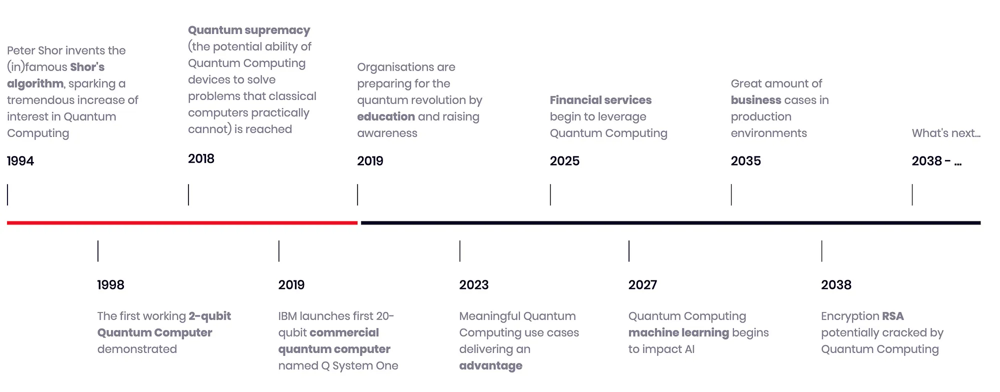

# Primeros pasos

¿Qué es la computación cuántica? Pues nada más que un nuevo paradigma para hacer computación. Se basa en el formalismo de la **física cuántica** y, aunque al principio puede costar hacerse a la idea, con un poco de álgebra lineal básica se pueden entender los fundamentos. Voy a intentar mostrarlo con ejemplos en Python para que sea menos cuesta arriba y más práctico.

La computación clásica también abraza la física, pero a un nivel de abstracción mucho más alto. Al ser capaces de manipular la electricidad, los primeros dispositivos, los dispositivos analógicos, pudieron ejecutar los primeros algoritmos. Programar dispositivos analógicos es desde luego una tarea complicada, así que la digitalización de las operaciones consiguió hacerla más llevadera y, de paso, que las máquinas se entendieran mejor entre sí: aunque intervinieran fabricantes distintos, adoptar los mismos estándares en cuanto a operaciones digitales (acciones acotadas en el tiempo) hizo que les resultara mucho más fácil entenderse unos con otros.

El [álgebra booleana](https://en.wikipedia.org/wiki/Boolean_algebra) lo hizo posible, al proporcionar un conjunto universal de operaciones con el que producir los algoritmos que usamos a diario. Poder fabricar bits como voltajes permitió construir máquinas capaces de seguir esa álgebra y abstraerla aún más hacia lenguajes de programación de alto nivel. El resto es historia.

La idea principal detrás de la computación cuántica es que, en lugar de trabajar a nivel macroscópico como estamos acostumbrados, al usar estados cuánticos sobre algún medio físico podríamos beneficiarnos de los efectos inherentes a la física cuántica para hacer computación de _otra manera_. Aprovechando esos efectos, algunos cálculos realmente complejos podrían hacerse de forma más eficiente. No te preocupes, también usaremos lenguajes de programación de alto nivel, pero necesitamos entender qué pasa por debajo.

La _superposición_, la _interferencia_ y el _entrelazamiento_ son la clave de la mayoría de las aceleraciones que se anuncian en la literatura, y trataremos de entender cómo podemos trabajar con ellos para producir algoritmos de optimización o de aprendizaje automático.

Aquí va una pequeña hoja de ruta de lo que ha pasado en el campo en las dos últimas décadas:
<figure markdown>
  
</figure>

Hay un montón de buenas referencias sobre lo básico, así que trataremos de enlazarlas a la vez que cubrimos en más detalle algunos temas concretos en torno a la _optimización_ y el _aprendizaje automático_. Pero empecemos por lo básico: los estados cuánticos y los cúbits.
