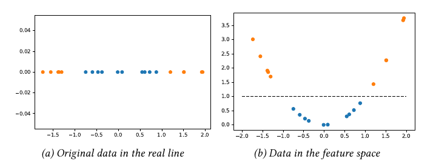
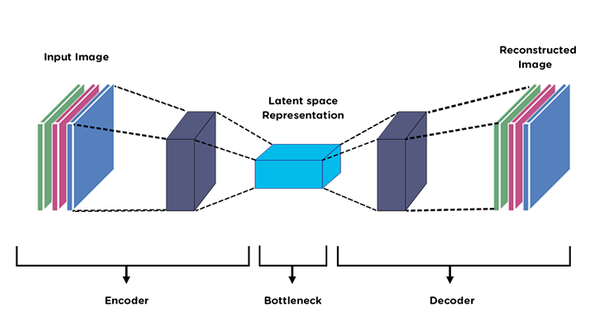

# Embedding de datos {.unnumbered}

Un aspecto clave tanto en machine learning clásico como en cuántico son que son enfoques puramente basados en evidencia. Necesitamos tener datos para reverse engineering la dinámica de un sistema dado o la relación entre evidencias recopiladas y los valores objetivo de la tarea.

La mayoría de las empresas acumulan una gran cantidad de datos, pero estos datos son clásicos por ahora. Nuestros dispositivos cuánticos solo pueden trabajar con estados cuánticos como vimos [previously](../gettingstarted/basics.qmd). También sabemos que al medir cualquier resultado de un dispositivo cuántico, se hace un mapping de cuántico a régimen clásico donde se pierde mucha información

$$
|0\rangle \rightarrow 0 \quad \& \quad |1\rangle \rightarrow 1,
$$

Para que la máquina sea consciente de nuestros datos clásicos deberíamos encontrar la acción inversa, necesitaríamos introducir nuestros datos en el dispositivo cuántico creando un estado que sea significativo para nuestra tarea. Lo más probable es que también requiera una representación más compleja que bits simples, ya que utilizaremos diferentes representaciones de datos en nuestros datasets clásicos (variables booleanas, categóricas y continuas entre otras).

Un tipo especial de circuitos existe para este paso en particular. Esta acción se realiza por **mapas de características**, y el nombre viene de la acción de mapping entre el espacio de datos original $\in \mathbb{R}^n$ a un nuevo espacio de características de diferente dimensión y complejidad ($\in \mathbb{C}^m$).

Muchos métodos en el dominio clásico usan esta técnica, mapeando a una dimensión mayor para que los datos sean fácilmente separables. Esto se realiza principalmente mediante la definición de [kernels](https://en.wikipedia.org/wiki/Kernel_method) en técnicas como [Support Vector Machines](https://scikit-learn.org/stable/modules/svm.html).

<figure markdown>

</figure>

Y en algunos casos, un mapping intencional a espacio de menor dimensión se realiza para eliminar la redundancia de información y sintetizar la información dentro de los datos. Algo similar a las capas bottleneck de redes neuronales intentando definir un espacio latente de menor dimensión.

<figure markdown>

</figure>

A menudo, estas técnicas requieren un buen entendimiento del lado clásico para crear el mejor mapping posible al espacio latente. Debe poder sintetizar la información con precisión eliminando toda la información redundante del espacio de datos original.

Por definición, nuestro mapping al régimen cuántico pertenece a la primera familia ya que la naturaleza de mayor dimensión del formalismo cuántico generalmente se asume. Pero cada tipo de mapping puede beneficiar objetivos diferentes como ya afirmamos anteriormente.