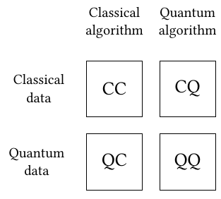

# Aprendizaje automático cuántico {.unnumbered}

Bueno, hay cierto _hype_ alrededor de este tema. Con suerte, la forma en que hemos llegado a proponer el Aprendizaje Automático Cuántico (QML) puede entenderse fácilmente tras haber recorrido las secciones anteriores. Si tenemos la capacidad de _entrenar_ circuitos cuánticos, ¿por qué no usarlos como predictores para tareas de clasificación o como modelos de regresión que nos proporcionen mejores estimadores?

Si no estás del todo familiarizado con el concepto, los métodos clásicos de Aprendizaje Automático se componen de **funciones ajustables** y unos **datos que caracterizan un fenómeno**. Ejemplos canónicos son los datos de clientes y las etiquetas de abandono, las condiciones meteorológicas y la probabilidad de un accidente de tráfico, etc. Son sistemas complejos de caracterizar o modelar; es difícil obtener una formulación que describa la dinámica de los fenómenos.

Pero podríamos aprender algunos patrones básicos que relacionen variables y objetivos usando una función _suficientemente expresiva_. Cuando queremos predecir una condición o una clase para un conjunto de evidencias (datos), hablamos de tareas de _clasificación_. Cuando hay que predecir un porcentaje o un valor numérico, suelen denominarse tareas de _regresión_. Ambas pertenecen a la categoría del **aprendizaje automático supervisado**. Cuando no se define ninguna etiqueta ni variable objetivo, a menudo se realiza una segmentación o agrupamiento de los datos para entender mejor los factores comunes entre los puntos disponibles; esto se denomina **aprendizaje automático no supervisado**. Ahí lo tienes: un párrafo y ya eres un experto en IA 😊

Esta es la base mínima que necesitaremos para entender lo siguiente: el Aprendizaje Automático Cuántico (QML). Mezclar computación cuántica y aprendizaje automático da lugar a este campo, aunque no hay un significado estricto sobre cómo debe hacerse esa mezcla. Encontramos tres recetas habituales:

* Modelos de aprendizaje automático para mejorar la computación cuántica
* Ordenadores cuánticos que ayudan en tareas de aprendizaje automático
* Ordenadores cuánticos que actúan como modelos de aprendizaje automático

<figure markdown>

</figure>

Centrándonos en las dos últimas, hay pasos del aprendizaje automático clásico en los que es necesario filtrar o seleccionar datos y en los que pueden aplicarse técnicas de computación cuántica [@mucke2023feature]. Usar ordenadores cuánticos para encontrar el conjunto adecuado de parámetros en modelos clásicos [@date2021qubo]. O adaptaciones de los Algoritmos Cuánticos Variacionales (VQA), en las que el funcional se aproxima mediante un Circuito Cuántico Parametrizado (PQC) o ansatz, llamado así por el campo clásico análogo de las Redes Neuronales [@schuld2014quest]. Hay muchas hibridaciones de las que podríamos hablar, pero queremos centrarnos en aquellos casos en los que se pueden implementar enfoques significativos y prácticos... por el momento.

Aprenderemos algunas nociones básicas sobre los principales cambios que necesitaremos adoptar para estas técnicas, pero una gran parte proviene de las buenas prácticas ya establecidas por el aprendizaje automático clásico, así que podemos omitir las explicaciones que ya se han cubierto sobre ellas.

::: {.callout-tip collapse=true}
# Vídeo recomendado

Si te interesa, esta charla de Nathan Wiebe sobre el tema me parece realmente interesante; échale un vistazo.


:::
