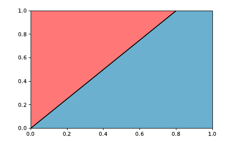
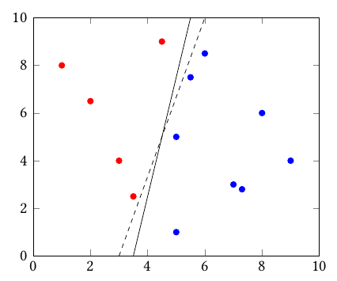
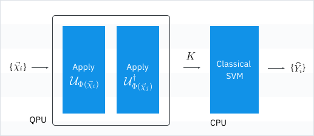

# Kernels {.unnumbered}

Antes de entrar en detalles de qué podrían ser los kernels cuánticos, hablemos del clasificador más simple que podríamos construir. Si se nos proporciona un número podríamos construir un clasificador diciendo si es negativo o positivo. O si vamos a un ejemplo $\mathcal{R}^2$ nos gustaría saber si nuestras muestras pertenecen a la categoría rosa o azul.

<figure markdown>

</figure>

Podríamos intentar dibujar la línea que coloca nuestras muestras en la categoría correspondiente $f(x,y) = w_x x + w_y y + b$. De hecho podría haber más de una opción para que este problema se resuelva.

<figure markdown>

</figure>

Nos gustaría encontrar la hipersuperficie que mejor divida los dos grupos, es decir, que el _margin_ desde la línea a los puntos de datos sea máximo. Algo como

$$
    \min \frac{1}{2}\|w\|^2 + C\sum_j \epsilon_j
$$

$$
    \text{s.t.}\quad y_j(w.x_j + b) \ge 1 - \epsilon_j, \quad \epsilon_j \ge 0
$$

con $C$ siendo un hiperparámetro de nuestra elección. El problema principal de este setup es que solo puede realizar separaciones lineales. Podríamos realizar el **truco de kernel** que consiste en mapear el espacio de datos a un espacio de mayor dimensión para Compute el producto interno de las muestras sin necesidad de Compute realmente las coordenadas de modo que una separación lineal renderizaría un clasificador no lineal de baja dimensión.

Las **funciones de kernel** son mapeadores de miembros de un conjunto no vacío ($x \in \mathbb{X}$) a un valor real

$$
K(x_i, x_j) \ge 0
$$

siendo capaces de mapearlos a un valor de distancia (aunque no equivalente a medición de distancia) entre las dos muestras que se están evaluando.

## Kernel cuántico

En esencia, dado que existe una manera de mapear puntos de datos a un espacio de características cuántico y la operación de producto interno puede realizarse de manera similar deshaciendo las acciones del primer mapa de características, podríamos construir un kernel cuántico de la forma

$$
k(x_i, x_j) = \langle\psi(x_i)|\psi(x_j)\rangle
$$

considerando $\psi(x) = \Psi(x)|0\rangle$ donde $\Psi(x)$ es un mapa de características cuántico como los presentados antes. Tomando su conjugado

$$
k(x_i, x_j) = \langle 0 |\Psi^{\dagger}(x_i)\Psi(x_j)|0\rangle
$$

lo que se puede realizar fácilmente invirtiendo el circuito original y añadiéndolo al mapa de características inicial.

```{python}
from qiskit.circuit.library import ZZFeatureMap

feature_map = ZZFeatureMap(2)

kernel = feature_map.compose(feature_map.inverse())
kernel.decompose().draw('mpl', fold = 150)
```

Al Compute el número de veces que obtenemos $|0\rangle^n$ después de esta ejecución podemos obtener la cercanía de estos dos estados de mapa de características preparados. Si se evalúan estados ortogonales (ej. $\langle 0 | 1\rangle$) entonces podemos asumir sus estados tan lejanos como sea posible dentro del espacio de Hilbert.

De esta manera podríamos Compute fácilmente el **fidelity** entre estados en un espacio de características de mayor dimensión simplemente realizando este ejercicio para cada par de muestras ($O(N^2)$) en lo que se llama un **Fidelity Kernel** [@Hubregtsen_2022].

:::{.callout-important collapse="true"}

# Fidelity

Fidelity viene de la fórmula
$$
F(\rho, \sigma) = \|\langle\psi_{\rho}|\psi_{\sigma}\rangle\|^2
$$
donde ambos estados se consideran puros. Para el caso de estados mixtos, el fidelity [difiere](https://en.wikipedia.org/wiki/Fidelity_of_quantum_states).

:::


Luego, añadiendo un método de clasificación clásica que, usando esa medida de distancia, pueda separar entre ambas clases, obtendríamos un método híbrido cuántico-clásico. De hecho, al encadenar un clasificador Support Vector Machine habríamos obtenido el **Quantum Support Vector Classifier** [@Rebentrost_2014].

<figure markdown>

</figure>