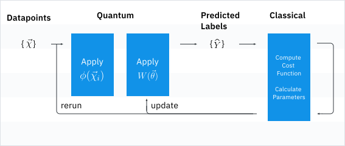
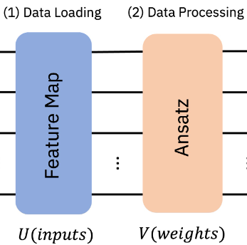
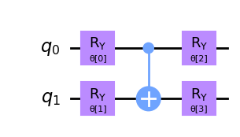
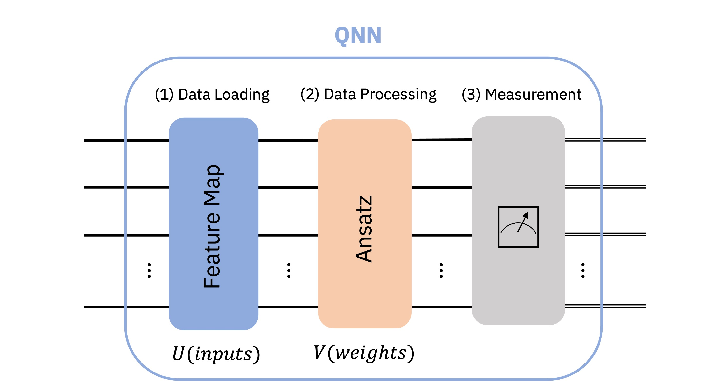

# Redes Neuronales Cuánticas {.unnumbered}

Ha habido algunas críticas sobre esta adaptación del modelo bio-inspirado clásico.

* Redes Neuronales = no lineal
* Computing Cuántico = lineal (hasta el measurement)
* Redes Neuronales Cuánticas = ?

aunque de hecho la literatura sigue creciendo sobre el potencial de estas técnicas para proporcionar resultados similares a los obtenidos dentro del state of the art pero con muchos menos recursos [@Pe_a_Tapia_2023].

Ya sabemos que los datos clásicos pueden convertirse en estados cuánticos. ¿Qué tal si aprovechamos la oportunidad para extender el circuito cuántico existente para que también realice toda la acción hasta que se seleccione una clase como parte del proceso de measurement?

El nombre genérico de este tipo de circuito es el **Variational Quantum Classifier** y muestra una estructura siguiente.

<figure markdown>

</figure>

Se basa en el mismo concepto de circuitos cuánticos paramétricos entrenables y ya tenemos los medios para adaptar los parámetros según una función objetivo. Podríamos necesitar decidir si el valor de expectación o una muestra dada es la medida ideal que nos gustaría obtener del circuito. Esto a menudo se decide dependiendo de qué tipo de modelo nos gustaría obtener, un modelo de clasificación o regresión.

¿Qué ansatz deberíamos seleccionar para la parte entrenable del QNN? Bueno, esta es una pregunta abierta sin respuesta directa. Como sucede en las NN clásicas, la cantidad de circuitos que podríamos seleccionar para nuestro QNN es infinita. Las arquitecturas de NN clásicas por medio de experimentación y mejor comprensión el funcionamiento interno de nuestro cerebro, han llegado a un acuerdo sobre lo que parecen ser conjeturas inteligentes según tareas específicas:

* Para visión artificial: Convolutional Neural Networks
* Para pronóstico en general: Recurrent Neural Networks
* Para tareas conscientes de texto y contexto: Transformers
* Para autos autónomos: Liquid Neural Networks

Así que necesitaremos apuntar a la literatura para mejor entender qué composiciones de ansatz renderizarán el mejor rendimiento en nuestro caso particular. Muchos frameworks ya proporcionan un conjunto de ansätze realmente implementados que reflejan los existentes en la literatura (a menudo también publicados por los mismos equipos que trabajan en IBM o Xanadu), pero proporcionan interesantes benchmarks que pueden ayudar en nuestra decisión.

En esencia necesitamos crear dos bloques, uno codificando nuestros datos en estados cuánticos (feature map) y un Parameterized Quantum Circuit (también ansatz) para que el circuito pueda entrenarse/ajustarse hacia un propósito específico.

<figure markdown>

</figure>

```py
from qiskit import QuantumCircuit
from qiskit.circuit.library import ZZFeatureMap, RealAmplitudes

num_inputs = 2
feature_map = ZZFeatureMap(num_inputs)
ansatz = RealAmplitudes(num_inputs, reps=1)

# construct QNN
qc = QuantumCircuit(num_inputs)
qc.compose(feature_map, inplace=True)
qc.compose(ansatz, inplace=True)
qc.draw(output="mpl")
```

Real amplitudes es solo un ansatz disponible para nosotros siguiendo esta forma abajo. Es lo suficientemente versátil como para ayudarnos a alcanzar el resultado que nos gustaría obtener. Pero, su elección si te gustaría cualquier otro diseño para tu ansatz.

<figure markdown>

</figure>

Luego podemos conectar cada pieza formando nuestro QNN.

<figure markdown>

</figure>

```py
from qiskit.algorithms.optimizers import COBYLA
from qiskit_machine_learning.algorithms.classifiers import NeuralNetworkClassifier
from qiskit_machine_learning.neural_networks import EstimatorQNN

# We append the estructure to the Estimator primitive
estimator_qnn = EstimatorQNN(
    circuit=qc, input_params=feature_map.parameters, weight_params=ansatz.parameters
)

# construct neural network classifier
estimator_classifier = NeuralNetworkClassifier(
    estimator_qnn, optimizer=COBYLA(maxiter=60), callback=callback_graph
)
```

Y componer un procedimiento de entrenamiento como a menudo se hace, llamando _.fit_ función y evaluando la predicción.

```py
estimator_classifier.fit(features, labels)
estimator_classifier.score(features, labels)
```

La clasificación de múltiples etiquetas también puede cubrirse pero en muchos casos se prefiere un stacked set of QNNs (one-vs-all) de modo que obtengamos un conjunto de $N$ redes especializadas parabalancear el voto para $N$ clases potenciales. En lugar de crear manualmente todos esos circuitos y datasets podemos simplemente invocar clases preparadas en frameworks como Qiskit que serán capaces de lidiar con esas complejidades internas. Hay que prestar atención aunque que entrenar varios modelos aumentará el número de iteraciones/ejecuciones del circuito necesario para el ajuste de parámetros (tantas veces como haya clases).

Las tareas de regresión también pueden realizarse si consideramos el valor de expectación como el que mapea nuestro valor objetivo. En ese caso un simple cambio de función de evaluación haría el truco. Sabemos que en realidad es tan fácil como invocar pero, como ya sabemos, obtener el valor de expectación sobre muestreo de circuito simple puede requerir varias evaluaciones del circuito para obtener todas las changes de base para una evaluación adecuada del valor de expectación.

## Elegir tus mapas de características y ansätze

Ahora necesitamos decidir cuál es el mejor ansatz en nuestro caso. Hay varias características que nos gustaría considerar pero una de las más relevantes podría ser **expressivity**. **Expressivity** es un aspecto clave con cualquier approximador de funciones, como con las redes neuronales que son conocidas como aproximadoras universales [@kidger2020universal]. Se espera que las Quantum Neural Networks provean una capacidad similar como ya han sido evaluadas en términos similares [@Pe_a_Tapia_2023] pero esto estará limitado por la selección de ansatz. El ansatz es esencialmente donde una dada Quantum Neural Network producirá estados para un espacio de Hilbert particular y expressivity, en esos términos, se refiere a la capacidad de cubrir dicho espacio de Hilbert.

Un sistema de 4 qubits representa un espacio de Hilbert de dimensión $2^4 = 16$ ($\mathcal{H}$). ¿Cómo podemos medir qué tan expresivo es nuestro ansatz? Evaluar analíticamente la cobertura del espacio de Hilbert quizás no sea práctico, pero podríamos simplemente muestrear desde el circuito un número de veces y comparar los estados que obtenemos en términos de distancia para dicho espacio. **Fidelity** puede usarse para medir la _distance_ entre dos estados como vimos [antes](kernels.qmd), así que lo obtenemos y lo comparamos con qué sería el escenario ideal, una distribución uniforme del space de fidelidad para maximal expressivity [@sim2019expressibility]. Si los estados generados por nuestro circuito pueden renderizar todas las distancias, desde el mismo estado (fidelity de uno) al caso ortogonal (fidelity de cero) entonces nuestro circuito puede cubrir el espectro completo de nuestro espacio de Hilbert. Puede leer más sobre el appendix sobre [quantum features](../appendix/quantumfeatures.qmd).

El camino más fácil hacia adelante es mirar al trabajo anterior, de esa manera podemos ahorrar algunas esquinas y ir directo a las configuraciones que funcionaron para otros. Tenemos algunas referencias en la literatura pero las personas trabajando en sQUlearn ya han implementado muchas opciones para nosotro.

Imagine que le gustaría probar el encoding en _Reduction of finite sampling noise in quantum neural networks_ [@Kreplin_2024].

```{python}
from squlearn.encoding_circuit import ChebyshevPQC

pqc = ChebyshevPQC(num_qubits = 4, num_features = 1, num_layers = 2)
pqc.draw("mpl")
```

¡Fácil! Igual que con otros como _Training Quantum Embedding Kernels on Near-Term Quantum Computers_ [@Hubregtsen_2022]

```{python}
from squlearn.encoding_circuit import HubregtsenEncodingCircuit

pqc = HubregtsenEncodingCircuit(num_qubits=4, num_features=2, num_layers=2)
pqc.draw(output="mpl")
```

Pero también puedes dejar fluir tu creatividad...

```{python}
from squlearn.encoding_circuit import LayeredEncodingCircuit
from squlearn.encoding_circuit.layered_encoding_circuit import Layer

encoding_circuit = LayeredEncodingCircuit(num_qubits=4,num_features=2)
encoding_circuit.H()

layer = Layer(encoding_circuit)
layer.Rz("x")
layer.Ry("p")
layer.cx_entangling("NN")

encoding_circuit.add_layer(layer,num_layers=3)
encoding_circuit.draw(output="mpl")
```

Más sobre esto en la documentación de [sQUlearn](https://squlearn.github.io/user_guide/encoding_circuits.html). ¡No deje de revisarla!